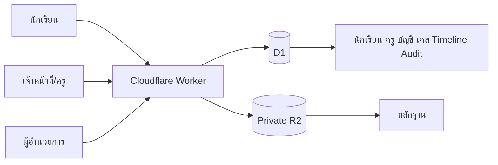
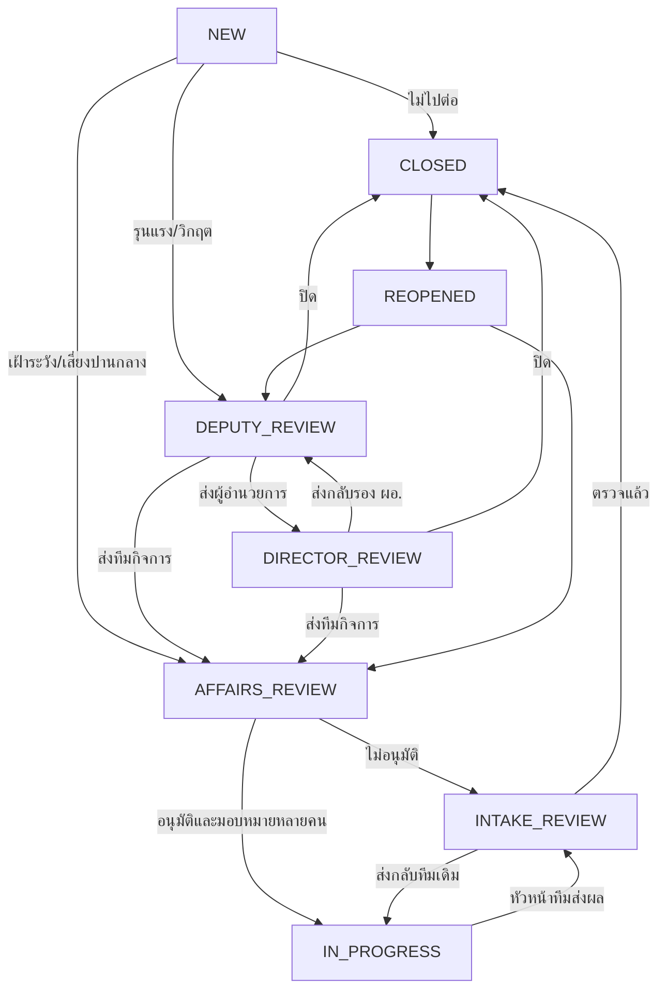
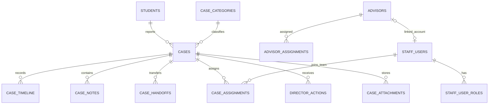
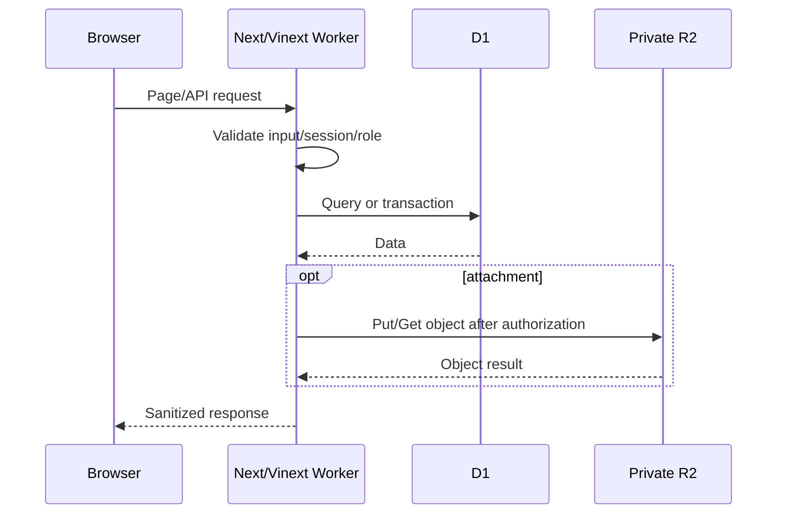

# 📕 กล่องแดง | RED BOX

ระบบรับแจ้งปัญหา ขอความช่วยเหลือ คัดกรอง มอบหมาย ติดตาม และปิดเคสของนักเรียน โรงเรียนจอมทอง

> README ฉบับนี้เป็นทั้งคู่มือผู้ใช้ คู่มือผู้ดูแลระบบ เอกสารสถาปัตยกรรม และคู่มือพัฒนา/Deploy โดยอ้างอิงความสามารถจากโค้ดปัจจุบัน

## สารบัญ

1. [ภาพรวม](#-1-ภาพรวมของระบบ)
2. [เป้าหมายและขอบเขต](#-2-เป้าหมายและขอบเขต)
3. [บทบาทและสิทธิ์](#-3-บทบาทและสิทธิ์)
4. [หน้าใช้งาน](#️-4-หน้าใช้งานและเส้นทางหลัก)
5. [การเข้าสู่ระบบ](#-5-การเข้าสู่ระบบและรหัสผ่าน)
6. [สถาปัตยกรรมและฐานข้อมูล](#️-6-สถาปัตยกรรมและฐานข้อมูล)
7. [กระบวนการทำงาน](#-7-กระบวนการทำงาน)
8. [คู่มือผู้ดูแลระบบ](#-8-คู่มือผู้ดูแลระบบสูงสุด)
9. [คู่มือเจ้าหน้าที่](#-9-คู่มือเจ้าหน้าที่รับเรื่องและผู้รับผิดชอบ)
10. [คู่มือครูที่ปรึกษา](#-10-คู่มือครูที่ปรึกษา)
11. [คู่มือผู้อำนวยการ](#-11-คู่มือผู้อำนวยการ)
12. [คู่มือนักเรียน](#-12-คู่มือนักเรียน)
13. [การพัฒนา](#️-13-การพัฒนาและทดสอบบนเครื่อง)
14. [การนำเข้าข้อมูล](#-14-การนำเข้าข้อมูล)
15. [Cloudflare](#️-15-cloudflare-deployment)
16. [ความปลอดภัย](#-16-ความปลอดภัยและความเป็นส่วนตัว)
17. [สำรองและบำรุงรักษา](#-17-การสำรองและบำรุงรักษา)
18. [ปัญหาที่พบบ่อย](#-18-ปัญหาที่พบบ่อย)
19. [Checklist ก่อนใช้จริง](#-19-checklist-ก่อนใช้งานจริง)
20. [อภิธานศัพท์และค่ามาตรฐาน](#-20-อภิธานศัพท์และค่ามาตรฐาน)
21. [Data Dictionary ฉบับเต็ม](#-21-data-dictionary-ฉบับเต็ม)
22. [ตารางสิทธิ์และการเปลี่ยนสถานะ](#-22-ตารางสิทธิ์และการเปลี่ยนสถานะ)
23. [คู่มือ API และ Validation](#-23-คู่มือ-api-และ-validation)
24. [คู่มือปฏิบัติงานรายหน้าจอ](#-24-คู่มือปฏิบัติงานรายหน้าจอ)
25. [SOP การดูแลเคส](#-25-sop-การดูแลเคส)
26. [คู่มือ Deployment และกู้คืน](#-26-คู่มือ-deployment-และกู้คืน)
27. [แผนทดสอบและเกณฑ์รับมอบ](#-27-แผนทดสอบและเกณฑ์รับมอบ)
28. [แนวทางกำกับดูแลข้อมูล](#-28-แนวทางกำกับดูแลข้อมูล)
29. [ภาคผนวกสำหรับผู้พัฒนา](#-29-ภาคผนวกสำหรับผู้พัฒนา)
30. [Runbook ติดตั้ง ตรวจสอบ และแก้ปัญหา](#-30-runbook-ติดตั้ง-ตรวจสอบ-และแก้ปัญหา)
31. [สรุป](#-31-สรุป)

---

## 🌐 1. ภาพรวมของระบบ

RED BOX เป็นเว็บแอปภายในโรงเรียนสำหรับให้นักเรียนแจ้งเรื่องที่ต้องการความช่วยเหลือ นักเรียนเริ่มด้วยเลขประจำตัวนักเรียน ยืนยันด้วยเลขประจำตัวบุคคลหรือ G Code เลือกประเภท อธิบายเหตุการณ์ ระบุความปลอดภัยและความช่วยเหลือที่ต้องการ และแนบหลักฐานได้โดยไม่ต้องมีบัญชีเจ้าหน้าที่

ระบบออกหมายเลขเคสแบบ `RB-ปี-ลำดับ` เช่น `RB-2026-000001` แล้วส่งเข้าสู่คิวเจ้าหน้าที่รับเรื่อง เจ้าหน้าที่ประเมินระดับและส่งทีมกิจการนักเรียน หรือส่งรองผู้อำนวยการก่อนในเคสรุนแรง/วิกฤต ทีมกิจการอนุมัติและเลือกทีมครูได้หลายคน โดยมีผู้รับผิดชอบหลักหนึ่งคน เมื่อทีมดำเนินการเสร็จจึงส่งผลกลับให้เจ้าหน้าที่รับเรื่องตรวจและปิดเคส

ความสามารถหลัก:

- ตรวจนักเรียนด้วยเลขประจำตัวและเชื่อมชั้น/ห้อง/ครูที่ปรึกษาอัตโนมัติ
- แบบแจ้งเรื่อง 6 ขั้น พร้อม Scroll ไปหัวข้อของขั้นตอนใหม่
- เลือกปกปิดตัวตนและระบุความปลอดภัย
- ยืนยันตัวตนและติดตามเรื่องด้วยเลขประจำตัวบุคคลไทย 13 หลัก หรือ G Code
- แนบ JPG, PNG, WEBP, PDF สูงสุด 5 ไฟล์ ไฟล์ละไม่เกิน 8 MB
- เปิดหลักฐานในระบบโดยไม่บังคับดาวน์โหลด
- จัดคิว `ยังไม่ได้ดำเนินการ → กำลังดำเนินการ → เสร็จสิ้น`
- ค้นหาชื่อและมอบหมายทีมหลายคน พร้อมกำหนดผู้รับผิดชอบหลัก
- ฝ่ายบริหารพิจารณาเคสรุนแรงตามลำดับรองผู้อำนวยการและผู้อำนวยการ
- ครูหนึ่งคนดูแลหลายห้อง และหนึ่งห้องมีครูหลายคนได้
- เลขที่นักเรียนเรียงชายก่อนหญิงอัตโนมัติรายห้อง
- หนึ่งบัญชีมีหลายบทบาท
- บันทึกภายในแก้ไขได้ก่อนเลื่อนไปขั้นต่อไป
- Timeline ภาษาคนและ Audit Log
- Responsive บนโทรศัพท์ แท็บเล็ต และคอมพิวเตอร์

ระบบจริง: `https://redbox.doitgict.workers.dev`

> ข้อมูลนักเรียน เคส และหลักฐานเป็นข้อมูลภายใน ห้ามใส่ข้อมูลจริง รหัสผ่าน หรือ Secret ใน Git, Issue, Screenshot สาธารณะ หรือสื่อประชาสัมพันธ์

---

## 🎯 2. เป้าหมายและขอบเขต

### 2.1 เป้าหมาย

1. ให้นักเรียนมีช่องทางแจ้งเรื่องที่เข้าถึงง่ายและเป็นส่วนตัว
2. ให้การรับเรื่อง คัดกรอง มอบหมาย และติดตามมีเจ้าภาพชัดเจน
3. ลดเคสตกหล่นด้วยสถานะ Timeline และกำหนดติดตาม
4. เชื่อมเคสกับห้องและครูที่ปรึกษา
5. จำกัดการมองเห็นตามบทบาท ห้อง และผู้รับผิดชอบ
6. ให้ผู้บริหารเห็นเฉพาะเรื่องที่เสนอขึ้นมา
7. เก็บประวัติเพื่อตรวจสอบย้อนหลัง

### 2.2 ขอบเขต

ระบบรองรับการแจ้งเรื่อง แนบหลักฐาน ติดตามสถานะ จัดการเคส นักเรียน ครูที่ปรึกษา บัญชีหลายบทบาท การพิจารณาของผู้อำนวยการ Timeline และ Audit Log

ระบบไม่ใช่ระบบฉุกเฉิน ตำรวจ โรงพยาบาล หรือบริการวินิจฉัยสุขภาพ หากมีอันตรายเร่งด่วน ผู้ปฏิบัติงานต้องใช้แผนความปลอดภัยของโรงเรียนทันที ไม่รอเพียงการเปลี่ยนสถานะในเว็บ

---

## 👥 3. บทบาทและสิทธิ์

### 👑 3.1 ผู้ดูแลระบบสูงสุด `SUPER_ADMIN`

- เข้าถึงและดำเนินการกับเคสทั้งหมด
- คัดกรอง มอบหมาย ส่งต่อ ปรับความสำคัญ และปิดเคส
- รับเคสดำเนินการเองและลบเคสถาวร
- จัดการนักเรียน ครูที่ปรึกษา ห้อง บัญชี และหลายบทบาท
- เชื่อมบัญชีกับข้อมูลครูที่ปรึกษา
- เข้าพอร์ทัลผู้อำนวยการได้

บัญชีระบบหลักไม่สามารถลดสิทธิ์หรือปิดผ่านหน้าเว็บ การลบเคสจะลบรายละเอียด Timeline บันทึก และไฟล์หลักฐานถาวร

กฎเฉพาะเจ้าของระบบ: หากนักเรียนอยู่ในห้องที่ปรึกษาซึ่งเชื่อมกับ `source_username=cboonta` เคสใหม่และเคสที่เปิดใหม่จะมองเห็นได้เฉพาะบัญชี `cboonta` ในขั้นพิจารณาแรก เมื่อ `cboonta` ส่งทีมกิจการ ส่งฝ่ายบริหาร หรือปิดเคสแล้ว ระบบจึงเปิดการมองเห็นตาม Workflow ปกติ

### 🧭 3.2 เจ้าหน้าที่รับเรื่อง `INTAKE`

- เห็นคิวเคสทั้งหมด
- ปรับระดับความรุนแรงเป็น เฝ้าระวัง เสี่ยงปานกลาง รุนแรง หรือวิกฤต
- ปิดเคสได้ทันทีเมื่อพิจารณาแล้วไม่ต้องดำเนินการต่อ
- ส่งเคสทั่วไปให้ทีมกิจการนักเรียน และส่งเคสรุนแรง/วิกฤตให้รองผู้อำนวยการ
- ตรวจผลจากทีมครู ส่งกลับทีมเดิม หรือปิดเคส
- เดินเคสเก่าที่ค้างในสถานะ Legacy ต่อได้

### 🧰 3.3 ทีมกิจการนักเรียน `STUDENT_AFFAIRS`

- เห็นคิว `AFFAIRS_REVIEW`; การเห็นข้อมูลผู้แจ้งในเคสปกปิดตัวตนต้องได้รับสิทธิ์รายบุคคลเพิ่ม
- พิจารณาว่าจะอนุมัติส่งต่อหรือส่งกลับเจ้าหน้าที่รับเรื่อง
- เลือกทีมครูได้หลายคนและกำหนดผู้รับผิดชอบหลักหนึ่งคน
- เลือกหัวหน้าระดับ ครูที่ปรึกษา ครูกิจการ หรือครูผู้ดำเนินการได้

### 👥 3.4 ทีมครูผู้ดำเนินการ `LEVEL_HEAD`, `TEACHER`, `ADVISOR`

- เห็นเคสเมื่ออยู่ในทีมที่ได้รับมอบหมาย
- ผู้ร่วมทีมเพิ่มบันทึกและเปิดหลักฐานที่เกี่ยวข้องได้
- ผู้รับผิดชอบหลักส่งผลการดำเนินงานกลับเจ้าหน้าที่รับเรื่อง
- ครูทั่วไปไม่เห็นชื่อนักเรียนในเคสปกปิดตัวตน เว้นแต่แอดมินเปิดสิทธิ์ “ดูตัวตนนักเรียน” ให้บัญชีนั้นโดยเฉพาะ

### 👩‍🏫 3.5 ครูที่ปรึกษา `ADVISOR`

- เห็นเคสนักเรียนในห้องที่ตนดูแล
- เห็นเคสที่มอบหมายให้ตน แม้อยู่นอกห้องที่ปรึกษา
- ดำเนินการเคสเมื่อเป็นผู้รับผิดชอบ
- เปิดหลักฐานตามขอบเขตห้องหรือการมอบหมาย

ข้อมูลครูนำเข้าก่อนได้โดยยังไม่สร้างบัญชี บัญชีที่สร้างภายหลังต้องเชื่อม `advisor_id` ให้ตรงคน

### 🏛️ 3.6 รองผู้อำนวยการ `DEPUTY_DIRECTOR`

- เห็นเคสรุนแรงและวิกฤตใน `DEPUTY_REVIEW`
- ปิดเคส ส่งต่อผู้อำนวยการ หรือส่งทีมกิจการดำเนินการพร้อมคำสั่ง

### 🎓 3.7 ผู้อำนวยการ `DIRECTOR`

- เห็นเฉพาะเคสที่เสนอผู้อำนวยการ
- ปิดเคส ส่งกลับรองผู้อำนวยการ หรือส่งทีมกิจการดำเนินการ
- เปิดรายละเอียด Timeline และหลักฐานของเรื่องที่กำลังพิจารณา

### 🧑‍🎓 3.8 นักเรียน

- ตรวจข้อมูลตนด้วยเลขประจำตัว
- แจ้งเรื่อง ปกปิดตัวตน ยืนยันด้วยเลขประจำตัวบุคคลหรือ G Code และแนบหลักฐาน
- ติดตามด้วยเลขประจำตัวและรหัสของเคสนั้น
- ไม่เห็นบันทึกภายในและคำสั่งส่งต่อ

### 3.9 หลายบทบาท

หนึ่งบัญชีมีได้หลายบทบาท เช่น `STUDENT_AFFAIRS + LEVEL_HEAD + ADVISOR` หรือ `INTAKE + STUDENT_AFFAIRS` ลำดับบทบาทหลักคือ:

`SUPER_ADMIN → INTAKE → STUDENT_AFFAIRS → DEPUTY_DIRECTOR → LEVEL_HEAD → TEACHER → ADVISOR → DIRECTOR`

---

## 🗺️ 4. หน้าใช้งานและเส้นทางหลัก

### 4.1 หน้าสาธารณะ

| เส้นทาง | หน้าที่ |
|---|---|
| `/` | หน้าหลัก แจ้งเรื่อง ตรวจสถานะ และทางเข้าเจ้าหน้าที่ |
| `/report` | แบบแจ้งเรื่อง 6 ขั้น |
| `/track` | ตรวจสถานะด้วยเลขประจำตัวนักเรียนและเลขประจำตัวบุคคล/G Code |

### 4.2 พอร์ทัลเจ้าหน้าที่

| เส้นทาง | หน้าที่ | สิทธิ์ |
|---|---|---|
| `/admin/login` | Login เจ้าหน้าที่ | บัญชีที่เข้าพอร์ทัลเจ้าหน้าที่ได้ |
| `/admin` | Dashboard และจัดการเคส | `SUPER_ADMIN`, `INTAKE`, `STUDENT_AFFAIRS`, `LEVEL_HEAD`, `TEACHER`, `ADVISOR` |
| `/admin/students` | จัดการนักเรียน | `SUPER_ADMIN` |
| `/admin/advisors` | จัดการครูและห้อง | `SUPER_ADMIN` |
| `/admin/users` | จัดการบัญชีและบทบาท | `SUPER_ADMIN` |

Sidebar คงอยู่ทุกหน้าจัดการเพื่อให้สลับเมนูได้โดยไม่ย้อนกลับหน้าเดิม

### 4.3 พอร์ทัลผู้อำนวยการ

| เส้นทาง | หน้าที่ |
|---|---|
| `/director/login` | Login ผู้อำนวยการ |
| `/director` | เคสรอพิจารณาและคำสั่งผู้อำนวยการ |

### 4.4 API หลัก

- `/api/students/verify` ตรวจเลขประจำตัวนักเรียน
- `/api/cases` สร้าง ค้นหา ติดตาม และแสดงคิวเคส
- `/api/cases/:caseNumber` รายละเอียด อัปเดต หรือลบเคส
- `/api/cases/assignees` รายชื่อผู้รับผิดชอบที่เปิดใช้
- `/api/uploads` อัปโหลด/เปิดหลักฐานแบบมีสิทธิ์
- `/api/students`, `/api/advisors`, `/api/admin/users` จัดการข้อมูลหลัก
- `/api/director/cases` รายการและคำสั่งผู้อำนวยการ
- `/api/auth/*` Login, Logout, Session และเปลี่ยนรหัสผ่าน

---

## 🔐 5. การเข้าสู่ระบบและรหัสผ่าน

### 5.1 เจ้าหน้าที่และผู้อำนวยการ

1. เข้า `/admin/login` หรือ `/director/login`
2. กรอก Username และรหัสผ่าน
3. ระบบตรวจสถานะบัญชีและบทบาทให้ตรงพอร์ทัล
4. หากใช้รหัสเริ่มต้น ระบบบังคับเปลี่ยนก่อนใช้งาน
5. Session มีอายุ 8 ชั่วโมง

### 5.2 บัญชีครูหลังนำเข้า

`db:create:advisor-accounts` ใช้ `source_username` เป็น Username และรหัสเริ่มต้น แล้วตั้ง `must_change_password=1` ผู้ใช้ต้องเปลี่ยนรหัสอย่างน้อย 8 ตัวอักษรและไม่ซ้ำรหัสเดิม

ผู้ดูแลสูงสุดรีเซ็ตรหัสของผู้อื่นได้ ระบบไม่เปิดเผย Password Hash และไม่ควรบันทึกรหัสจริงในเอกสารนี้

### 5.3 การยืนยันตัวตนนักเรียน

- รับเลขประจำตัวบุคคลไทย 13 หลักที่ผ่านการตรวจเลขหลักสุดท้าย รวมเลขที่ขึ้นต้น 0 หรือ 8
- รับ G Code ในรูปแบบ G ตามด้วยตัวเลข 12 หลัก สำหรับผู้เรียนที่ไม่มีเลข 13 หลัก
- ต้องใช้คู่กับเลขประจำตัวนักเรียน และต้องตรงกับข้อมูลทะเบียนของนักเรียนคนนั้น
- ระบบเก็บเฉพาะ HMAC แบบมี Secret ไม่เก็บหรือส่งเลขจริงกลับทาง API

### 5.4 Session Cookie

Cookie `redbox_admin_session` ใช้ `HttpOnly`, `SameSite=Strict`, `Secure` บน HTTPS และลงลายเซ็น HMAC-SHA256 ด้วย `SESSION_SECRET`

---

## 🏗️ 6. สถาปัตยกรรมและฐานข้อมูล

### 6.1 เทคโนโลยี

| ส่วน | เทคโนโลยี |
|---|---|
| Framework | Next.js 16, React 19, Vinext |
| ภาษา | TypeScript 5 |
| Runtime | Cloudflare Workers |
| Database | Cloudflare D1 / SQLite |
| Files | Private Cloudflare R2 |
| Schema | Drizzle ORM / Drizzle Kit |
| Validation | Zod |
| Icons | Font Awesome / React Icons |
| Test | Node Test Runner + Production Build |

### 6.2 ภาพรวม



### 6.3 โฟลสถานะ



`SCREENING`, `ASSIGNED`, `ADMIN_REVIEW`, `DIRECTOR_ORDERED`, `PENDING_CLOSE`, `RESOLVED` ยังรองรับเคสเก่า แต่ระบบไม่สร้างสถานะเหล่านี้ในโฟลใหม่

### 6.4 โครงสร้างโค้ด

- `app/` หน้าและ API Route Handlers
- `components/` UI หลัก
- `db/` Schema และ Bootstrap
- `drizzle/` Migration
- `lib/` Auth, password, token, advisor และ Timeline helpers
- `scripts/` Import, account creation และ demo seed
- `tests/` ชุดตรวจข้อกำหนด
- `public/` โลโก้และ Static assets
- `.openai/hosting.json` ประกาศ D1/R2
- `wrangler.direct.jsonc` Direct deployment

### 6.5 Data Dictionary

| ตาราง | หน้าที่และฟิลด์สำคัญ |
|---|---|
| `students` | รหัส ชื่อ ชั้น ห้อง เลขที่ บัตร สถานะ และเวลาปรับปรุง |
| `case_categories` | ประเภทเรื่อง Icon สี ลำดับ และสถานะ |
| `advisors` | ชื่อ ติดต่อ Username ต้นทาง บทบาทพิเศษ และสถานะ |
| `advisor_assignments` | เชื่อมครูกับชั้น/ห้อง/Slot แบบหลายต่อหลาย |
| `cases` | ผู้แจ้ง ประเภท เนื้อหา ความปลอดภัย ความสำคัญ สถานะ ผู้รับผิดชอบ และ Token hash |
| `case_sequences` | ลำดับหมายเลขเคสแยกปีแบบ Atomic |
| `case_timeline` | เหตุการณ์ที่ผู้ใช้ควรอ่านย้อนหลัง |
| `case_notes` | บันทึกภายในและสถานะแก้ไขได้ |
| `staff_users` | Username, hash, ชื่อแสดง บทบาทหลัก Advisor link และสถานะ |
| `staff_user_roles` | หลายบทบาทต่อบัญชีด้วย Primary key ร่วม |
| `case_handoffs` | ต้นทาง ปลายทาง ผู้ส่ง ผู้รับ เหตุผล กำหนดติดตาม |
| `case_assignments` | ทีมครูหลายคน ผู้รับผิดชอบหลัก/สมาชิก สถานะรายคน และผู้มอบหมาย |
| `director_actions` | การรับทราบ สั่งการ ส่งกลับ หรือปิด |
| `case_attachments` | Metadata ไฟล์ใน R2 |
| `audit_logs` | การกระทำ Resource ผู้ดำเนินการ Metadata และเวลา |

ประเภทเริ่มต้น: กลั่นแกล้ง, สุขภาพใจ, ความรุนแรง, ความปลอดภัย, การเรียน, อาคาร/สถานที่, ข้อเสนอแนะ และอื่น ๆ

ดัชนีสำคัญครอบคลุมสถานะ/ความสำคัญ/นักเรียนของเคส, Timeline, Handoff, Director action, Advisor assignment และบัญชีตามบทบาท

---

## 🔄 7. กระบวนการทำงาน

### 7.1 นักเรียนส่งเรื่อง

1. เข้า `/report` และกรอกเลขประจำตัว
2. ตรวจชื่อ ชั้น ห้อง เลขที่ และครูที่ปรึกษา
3. เลือกประเภท
4. กรอกหัวข้ออย่างน้อย 5 และรายละเอียดอย่างน้อย 10 ตัวอักษร
5. สถานที่และบุคคลเกี่ยวข้องเว้นว่างได้
6. เลือกความช่วยเหลือและระดับความปลอดภัย
7. เลือกปกปิดตัวตนได้
8. กรอกเลขประจำตัวบุคคล 13 หลัก หรือ G Code เพื่อยืนยันข้อมูล
9. แนบหลักฐานถ้ามี ตรวจข้อมูล แล้วส่ง

ระบบใช้ `idempotencyKey` ป้องกันส่งซ้ำ ออกหมายเลข Atomic และออก Upload Token อายุ 30 นาที หาก `UNSAFE` จะทำเครื่องหมายตรวจทันทีและเริ่มระดับ `MODERATE`

### 7.2 คัดกรองและมอบหมาย

เจ้าหน้าที่เปิด `NEW` ตรวจข้อมูลและปรับระดับความรุนแรง หากไม่ต้องดำเนินการต่อสามารถปิดเคสได้ทันที ถ้าเป็น `WATCH` หรือ `MODERATE` ให้ส่ง `AFFAIRS_REVIEW`; ถ้าเป็น `SEVERE` หรือ `CRITICAL` ให้ส่ง `DEPUTY_REVIEW`

### 7.3 เริ่มและดำเนินการ

ทีมกิจการพิจารณาเคสใน `AFFAIRS_REVIEW` หากไม่อนุมัติให้ส่ง `INTAKE_REVIEW` กลับเจ้าหน้าที่ หากอนุมัติให้เลือกทีมครูได้หลายคน กำหนดผู้รับผิดชอบหลักหนึ่งคน แล้วเปลี่ยนเป็น `IN_PROGRESS`

### 7.4 บันทึกภายใน

บันทึกไม่แสดงแก่นักเรียน หลังบันทึกแบบฟอร์มยุบ แก้ไขได้ก่อนเลื่อนขั้น เมื่อสถานะเปลี่ยน บันทึกเดิมถูกล็อก

### 7.5 ส่งต่อ

สมาชิกทีมทุกคนเปิดเคส หลักฐาน และเพิ่มบันทึกได้ ผู้รับผิดชอบหลักเป็นผู้กดส่งผล `IN_PROGRESS → INTAKE_REVIEW` เพื่อป้องกันหลายคนส่งผลซ้ำ

### 7.6 ปิดหรือตรวจผล

- เจ้าหน้าที่รับเรื่อง: `INTAKE_REVIEW → CLOSED` หรือส่งกลับ `IN_PROGRESS`
- รองผู้อำนวยการ: `DEPUTY_REVIEW → CLOSED`, `DIRECTOR_REVIEW` หรือ `AFFAIRS_REVIEW`
- ผู้อำนวยการ: `DIRECTOR_REVIEW → CLOSED`, `DEPUTY_REVIEW` หรือ `AFFAIRS_REVIEW`
- เคสปิดสามารถเปิดเป็น `REOPENED` แล้วส่งทีมกิจการหรือรองผู้อำนวยการใหม่

### 7.7 Timeline และ Audit

Timeline แสดงภาษาคน ตัดข้อความสถานะซ้ำ และแปลง JSON เก่าเมื่ออ่าน Audit Log ใช้ตรวจการแก้ข้อมูล รีเซ็ตรหัส จัดการบัญชี และลบเคส โดยไม่เก็บรหัสผ่านจริง

### 7.8 ลบเคส

เฉพาะ `SUPER_ADMIN` การลบจะนำ Director actions, Handoffs, Attachments metadata, Notes, Timeline, Case และไฟล์ R2 ออกถาวร พร้อม Audit log ควรสำรองก่อนลบ

---

## 👑 8. คู่มือผู้ดูแลระบบสูงสุด

### 8.1 Dashboard

- ตรวจเคสใหม่ เคสเร่งด่วน เคสค้าง และเคสรอตรวจ
- ค้นหาหมายเลข/หัวข้อ กรองสถานะและความสำคัญ
- คิวเรียง `ยังไม่ได้ดำเนินการ → กำลังดำเนินการ → เสร็จสิ้น`
- เปิดรายละเอียด ผู้แจ้ง ห้อง ครูที่ปรึกษา หลักฐาน บันทึก และ Timeline

### 8.2 นักเรียน

- เพิ่ม/แก้ไขผ่าน Modal
- ปิดใช้งานแทนลบเมื่อมีประวัติ
- ระบบเรียงเลขที่ชายก่อนหญิงรายห้อง
- ครูเชื่อมตามห้อง ไม่ต้องกรอกซ้ำรายคน

### 8.3 ครูที่ปรึกษา

- เพิ่ม ค้นหา กรอง แก้ไข และปิดใช้งาน
- รองรับ นาย นาง นางสาว ว่าที่ร้อยตรี และค่าอื่นตามข้อมูล
- ครูหนึ่งคนหลายห้อง ห้องหนึ่งหลายครู
- แสดงจำนวนนักเรียนของห้อง

### 8.4 ผู้ใช้งาน

- สร้างชื่อแสดง Username รหัส และอย่างน้อย 1 บทบาท
- Username รองรับตัวอักษรอังกฤษ ตัวเลข `. _ -`
- เชื่อมบทบาท Advisor กับข้อมูลครูที่ยังไม่มีบัญชี
- แก้ไขผ่าน Modal เปิด/ปิดด้วย Toggle และรีเซ็ตรหัสได้
- ปิดบัญชีตนเองไม่ได้ และต้องเหลือ Super admin อย่างน้อยหนึ่งบัญชี

### 8.5 เครื่องมือพิเศษ

คำสั่งปิดเคสทันทีและลบเคสอยู่ในส่วนเครื่องมือผู้ดูแล แยกจากโฟลปกติ

---

## 🧭 9. คู่มือเจ้าหน้าที่รับเรื่องและผู้รับผิดชอบ

### 9.1 รับเรื่อง

ตรวจผู้แจ้ง ห้อง ครูที่ปรึกษา หลักฐานและความปลอดภัย ปรับระดับความรุนแรง แล้วเลือกส่งทีมกิจการ ส่งรองผู้อำนวยการ หรือปิดเรื่องเมื่อไม่ควรดำเนินการต่อ

### 9.2 ดำเนินการ

ทีมกิจการพิจารณาและเลือกทีมผู้ดำเนินการหลายคน สมาชิกทีมเพิ่มบันทึกได้ และผู้รับผิดชอบหลักส่งผลกลับเจ้าหน้าที่รับเรื่อง ข้อความประกอบทุกขั้นเว้นว่างได้

### 9.3 หลักการบันทึก

เขียนเฉพาะข้อเท็จจริง การดำเนินงาน สิ่งติดตาม และกำหนดเวลา ไม่ใส่คำกล่าวหาเกินหลักฐาน ข้อมูลอ่อนไหวเกินจำเป็น รหัสผ่าน หรือข้อความไม่เหมาะสม

---

## 👩‍🏫 10. คู่มือครูที่ปรึกษา

ครูเห็นเคสของห้องที่ดูแลและเคสที่มอบหมายให้ตน หากไม่เห็นให้ตรวจ `advisor_id`, `advisor_assignments`, `assigned_to` และสถานะบัญชี

เมื่อได้รับมอบหมาย ครูสามารถบันทึกและเปิดหลักฐานได้ ผู้รับผิดชอบหลักเป็นผู้ส่งผลกลับเจ้าหน้าที่รับเรื่องเพื่อปิดเคส ไม่ควรสร้างข้อมูลครูซ้ำเพื่อหลายห้อง ให้เพิ่ม Assignment ห้องหรือ Assignment ทีมแทน

---

## 🎓 11. คู่มือผู้อำนวยการ

เข้า `/director/login` พอร์ทัลฝ่ายบริหารจะแสดงคิวตามบทบาทและเรียง `วิกฤต → รุนแรง → เสี่ยงปานกลาง → เฝ้าระวัง`

- รองผู้อำนวยการ: ส่งทีมกิจการ ส่งผู้อำนวยการ หรือปิดเคส
- ผู้อำนวยการ: ส่งทีมกิจการ ส่งกลับรองผู้อำนวยการ หรือปิดเคส

ข้อความคำสั่งไม่บังคับ แต่ควรกรอกเมื่อมีข้อกำหนดเฉพาะ

---

## 🧑‍🎓 12. คู่มือนักเรียน

### 12.1 แจ้งเรื่อง

เตรียมเลขประจำตัวนักเรียน เลขประจำตัวบุคคลหรือ G Code และหลักฐานถ้าสะดวก จากนั้นกรอกข้อมูลตาม 6 ขั้นและตรวจทานก่อนส่ง

### 12.2 หลักฐาน

JPG/PNG/WEBP/PDF สูงสุด 5 ไฟล์ ไฟล์ละ 8 MB มีภาพตัวอย่างและเก็บใน Private R2

### 12.3 ติดตาม

เข้า `/track` กรอกเลขประจำตัวและรหัส 6 หลัก ระบบแสดงเฉพาะประเภท สถานะ และวันที่ ไม่เปิดรายละเอียดภายใน หากลืมรหัสต้องให้ผู้ดูแลสูงสุดรีเซ็ต

---

## 🛠️ 13. การพัฒนาและทดสอบบนเครื่อง

ต้องมี Node.js `>=22.13.0`, npm และ Git

```bash
npm install
npm run dev
```

เปิด `http://localhost:3000` ฐานข้อมูล Local สร้างใน `.wrangler/state/`

```bash
npm run lint
npm run build
npm test
```

| คำสั่ง | หน้าที่ |
|---|---|
| `npm run dev` | Development server |
| `npm run build` | Production build |
| `npm run start` | รัน Build |
| `npm run lint` | ESLint |
| `npm test` | Build + Node tests |
| `npm run db:generate` | สร้าง Drizzle migration |
| `npm run db:seed:demo` | เพิ่มข้อมูลจำลอง Local |
| `npm run db:import:students -- file.csv` | นำเข้านักเรียน Local |
| `npm run db:import:advisors -- file.csv` | นำเข้าครู Local |
| `npm run db:create:advisor-accounts` | สร้างบัญชีครู Local |
| `npm run cf:migrate` | Remote D1 migration |
| `npm run cf:deploy` | Build + Direct deploy |

---

## 📥 14. การนำเข้าข้อมูล

### 14.1 ลำดับแนะนำ

รันระบบหนึ่งครั้ง → นำเข้าครู → นำเข้านักเรียน → ตรวจห้อง → สร้างบัญชีครู → ทดสอบ Login → ตรวจจำนวนก่อนย้าย Production

### 14.2 CSV ครู

คอลัมน์: `ระดับชั้น`, `ห้อง`, `ชื่อ-นามสกุล`, `Username`, `เบอร์โทรศัพท์`, `บทบาทพิเศษ`

```bash
npm run db:import:advisors -- /absolute/path/advisors.csv
```

สคริปต์สำรอง Local DB รวม Username ซ้ำเป็นคนเดียว สร้างหลายห้อง เรียง Slot และยังไม่สร้าง Login

### 14.3 CSV นักเรียน

คอลัมน์หลัก: `เลขที่`, `เลขประจำตัว`, `เลขบัตรนักเรียน`, `คำนำหน้า`, `ชื่อ`, `นามสกุล`, `ระดับชั้น`, `ห้อง` และเพิ่มคอลัมน์ `เลขประจำตัวประชาชน` (หรือ `เลขประชาชน`, `เลขประจำตัวบุคคล`, `รหัส G`) เมื่อต้องการนำเข้าข้อมูลยืนยันตัวตน

```bash
STUDENT_IDENTITY_PEPPER='secret-อย่างน้อย-32-ตัวอักษร' npm run db:import:students -- /absolute/path/students.csv
```

สคริปต์ตรวจข้อมูล สำรอง DB Upsert นักเรียน ปิดรายการเดิมที่หายไป ไม่ลบนักเรียนที่มีเคส และเรียงเลขที่ใหม่ หาก CSV มีเลขยืนยันตัวตน สคริปต์จะตรวจ checksum/G Code และเก็บเฉพาะ HMAC โดย `STUDENT_IDENTITY_PEPPER` (หรือ `SESSION_SECRET` ในโหมดเปลี่ยนผ่าน) ต้องเป็นค่าเดียวกับ Secret ของ Worker

### 14.4 สร้างบัญชีครู

```bash
npm run db:create:advisor-accounts
```

ใช้ Username เป็นรหัสเริ่มต้นและบังคับเปลี่ยนเมื่อ Login

### 14.5 ข้อมูลจำลอง

`npm run db:seed:demo` ใช้เฉพาะ Development/Testing ห้ามรัน Production โดยไม่ตรวจผลกระทบ

สคริปต์นำเข้าปัจจุบันแก้ Local D1 ไม่ได้ส่ง CSV เข้า Production โดยตรง

---

## ☁️ 15. Cloudflare Deployment

| Binding | Resource |
|---|---|
| `DB` | D1 `redbox-db` |
| `EVIDENCE` | Private R2 `redbox-evidence` |

`SESSION_SECRET` และ `STUDENT_IDENTITY_PEPPER` ต้องสุ่ม ยาวอย่างน้อย 32 ตัวอักษร เก็บเป็น Secret และห้าม Commit ค่า `STUDENT_IDENTITY_PEPPER` ต้องคงเดิม เพราะใช้ตรวจเลขยืนยันตัวตนที่นำเข้าไว้แล้ว

```bash
npm run cf:migrate
npm run cf:deploy
```

ก่อน Migrate ให้สำรอง D1 และอ่าน SQL ใน `drizzle/` หลัง Deploy ตรวจ `/`, `/admin/login`, `/director/login`, D1/R2 และยืนยันว่า `/api/cases` โดยไม่ Login ตอบ `401`

ห้ามกระทบโปรเจกต์อื่น: ตรวจ Working directory, Worker `redbox`, D1 `redbox-db`, R2 `redbox-evidence` และ `wrangler.direct.jsonc` ก่อนทุกครั้ง

---

## 🛡️ 16. ความปลอดภัยและความเป็นส่วนตัว

- รหัสใหม่ใช้ HMAC-SHA256 + Salt + Server Secret และรองรับ PBKDF2 เก่า
- API ไม่ส่ง Password/Token hash
- Upload token สุ่ม 32 bytes เก็บ SHA-256 hash และหมดอายุ 30 นาที
- R2 เป็น Private; การเปิดไฟล์ตรวจบทบาท ห้อง และผู้รับผิดชอบ
- Response ไฟล์ใช้ `private, no-store` และ `nosniff`
- นักเรียนเห็นเพียงสถานะย่อของเคสที่รหัสตรง
- ปกปิดตัวตนลดการแสดงชื่อ แต่เคสยังผูก Student ID เพื่อความปลอดภัย จึงต้องใช้หลัก Need-to-know

Production ควรเปิด WAF/Rate limit สำหรับ Login, Verify, Track, Upload ตั้ง Retention policy ทบทวนบัญชีทุกภาคเรียน และติดตาม Observability

---

## 💾 17. การสำรองและบำรุงรักษา

สำรอง D1, R2, Source/Migrations และ CSV ต้นทาง โดยเก็บ Secret แยก ก่อน Import/Migration ให้ทดลอง Local ตรวจจำนวนและความสัมพันธ์

กู้คืน: หยุดแก้ข้อมูล → ระบุช่วงเวลา → สำรองสถานะปัจจุบัน → Restore D1/R2 → ตรวจจำนวน/Foreign key → ทดสอบทุกบทบาท → บันทึกเหตุการณ์

รอบดูแล:

- รายวัน: เคสเร่งด่วนและ Error
- รายสัปดาห์: เคสค้างและบัญชีผิดปกติ
- รายเดือน: ทดสอบ Restore และพื้นที่ R2
- รายภาคเรียน: รายชื่อ ห้อง ครู และบัญชีพ้นหน้าที่
- รายปี: Retention และสิทธิ์ Super admin

---

## 🧪 18. ปัญหาที่พบบ่อย

### Dev เปิดไม่ได้

ตรวจ Node, `npm install`, Port 3000 และ `.wrangler/wrangler.log`

### โลโก้ไม่ขึ้น

ตรวจ `public/images/chomthong-logo.png`, Path `/images/chomthong-logo.png`, ตัวพิมพ์ และ Cache

### Login ไม่ได้

ตรวจ Username, รหัส, `is_active`, บทบาทพอร์ทัล, `SESSION_SECRET` และหน้าบังคับเปลี่ยนรหัส

### ครูไม่เห็นเคส

ตรวจ Role, `advisor_id`, `advisor_assignments`, `assigned_to` และสถานะบัญชี

### ค้นผู้รับผิดชอบไม่พบ

บัญชีต้องเปิดใช้และมี `STUDENT_AFFAIRS`, `LEVEL_HEAD`, `TEACHER` หรือ `ADVISOR` อย่างน้อยหนึ่งบทบาท (`CASE_OFFICER` รองรับเฉพาะบัญชีเดิม)

### นักเรียนไม่พบข้อมูล

ตรวจเลขประจำตัว 4–10 หลัก, `is_active=1`, ฐานข้อมูล Environment และข้อมูลห้อง

### ติดตามไม่ได้

ใช้เลขประจำตัวและรหัส 6 หลักของเคสนั้น หากลืมให้ Super admin รีเซ็ต

### อัปโหลดไม่ได้

ตรวจชนิด ขนาด 8 MB จำนวน 5 ไฟล์ Token 30 นาที และ R2 binding

### เปิดหลักฐานไม่ได้

ตรวจ Login สิทธิ์ ขอบเขตห้อง/ผู้รับผิดชอบ สถานะที่เสนอผู้อำนวยการ และ Object ใน R2

### สถานะซ้ำ

โฟลใหม่ใช้ `NEW→AFFAIRS_REVIEW→IN_PROGRESS→INTAKE_REVIEW→CLOSED` ส่วนเคสรุนแรงใช้ `NEW→DEPUTY_REVIEW` ก่อน หากพบ `SCREENING`, `ASSIGNED`, `ADMIN_REVIEW`, `DIRECTOR_ORDERED`, `PENDING_CLOSE` หรือ `RESOLVED` คือสถานะเก่าที่ระบบยังรองรับ

### Timeline เป็น JSON/ซ้ำ

ตรวจว่า Deploy ล่าสุด API ใช้ `humanizeTimelineEntry` แล้ว Refresh ข้อมูลเก่าไม่ต้องแก้ DB

### Migration ล้มเหลว

หยุด อ่าน SQL ตรวจ Migration history ห้ามลบ Production table เพื่อให้ผ่าน และ Restore หากเปลี่ยนไปบางส่วน

### Deploy ผิดโปรเจกต์

ตรวจ `wrangler whoami` และ Resource ใน Config หยุดก่อน Deploy ซ้ำ ห้ามแก้ Worker ของโปรเจกต์อื่น

---

## 💡 19. Checklist ก่อนใช้งานจริง

### ข้อมูล

- [ ] นักเรียนจริงครบและไม่ซ้ำ
- [ ] เลขที่/ลำดับเพศถูกต้อง
- [ ] ครูและห้องครบ
- [ ] บัญชีครูเชื่อมถูกคน

### สิทธิ์

- [ ] แบ่งบทบาทตามงานจริง
- [ ] ปิดบัญชีทดสอบ
- [ ] เปลี่ยนรหัสเริ่มต้น
- [ ] ทดสอบหลายบทบาท

### โฟล

- [ ] เคสทั่วไปและไม่ปลอดภัย
- [ ] Intake ส่งทีมกิจการ/ส่งรอง ผอ./ปิดทันที
- [ ] ทีมกิจการมอบหมายหลายคนและกำหนด Lead
- [ ] Lead ส่งผลกลับและ Intake ตรวจปิด/ส่งกลับทีม
- [ ] รอง ผอ. และ ผอ. ส่งต่อ/ส่งกลับ/ปิดตามลำดับ
- [ ] เปิดเคสใหม่และแก้เลขยืนยันตัวตนผ่านข้อมูลนักเรียน

### หลักฐาน/Cloudflare

- [ ] ทดสอบไฟล์ทุกชนิดและไฟล์เกินขนาด
- [ ] ผู้ไม่มีสิทธิ์เปิดไม่ได้
- [ ] ตั้ง `SESSION_SECRET`
- [ ] ตั้ง `STUDENT_IDENTITY_PEPPER` และนำเข้าค่า HMAC ของนักเรียนด้วย Secret เดียวกัน
- [ ] Apply migration และ Binding ถูกต้อง
- [ ] WAF/Rate limit, Observability, Backup/Restore พร้อม

### การใช้งานโรงเรียน

- [ ] กำหนดผู้รับเคส Critical และเวลาตอบสนอง
- [ ] อบรมความลับและ Need-to-know
- [ ] มีช่องทางฉุกเฉินนอกระบบ
- [ ] กำหนด Retention และผู้อนุมัติลบเคส

---

## 📚 20. อภิธานศัพท์และค่ามาตรฐาน

ส่วนนี้กำหนดคำที่ใช้ร่วมกันทั้งในหน้าจอ ฐานข้อมูล เอกสารอบรม และการสื่อสารระหว่างผู้ปฏิบัติงาน เพื่อไม่ให้คำเดียวกันถูกตีความต่างกัน

### 20.1 คำสำคัญ

| คำ | ความหมาย |
|---|---|
| เคส | เรื่องที่นักเรียนส่งเข้าระบบหนึ่งรายการ มีหมายเลขเฉพาะและวงจรชีวิตของตนเอง |
| ผู้แจ้ง | นักเรียนเจ้าของเลขประจำตัวที่ใช้ส่งเรื่อง แม้เลือกปกปิดตัวตน |
| ผู้รับผิดชอบ | บัญชีเจ้าหน้าที่หรือครูที่ได้รับมอบหมายให้ดำเนินการเคสในขณะนั้น |
| เจ้าหน้าที่รับเรื่อง | ผู้ตรวจข้อมูลเบื้องต้น ประเมินความสำคัญ และมอบหมายเคส |
| ผู้ดูแลระบบสูงสุด | ผู้มีสิทธิ์จัดการข้อมูลหลัก ผู้ใช้ เคส และเครื่องมือพิเศษทั้งหมด |
| ครูที่ปรึกษา | ครูที่เชื่อมกับชั้น/ห้องผ่านตาราง Assignment ไม่จำเป็นต้องมีบัญชีทันที |
| ผู้อำนวยการ | ผู้พิจารณาเฉพาะเคสที่ถูกเสนอขึ้นพอร์ทัลผู้อำนวยการ |
| Timeline | ประวัติเหตุการณ์ที่อ่านเป็นภาษาคน เรียงจากเหตุการณ์ล่าสุดไปเก่าสุด |
| Audit Log | ประวัติทางเทคนิคสำหรับตรวจสอบว่าใครทำอะไรกับข้อมูลใด |
| Handoff | การส่งต่อความรับผิดชอบหรือสถานะจากบุคคล/ขั้นตอนหนึ่งไปอีกขั้นตอนหนึ่ง |
| บันทึกภายใน | ข้อความทำงานของเจ้าหน้าที่ ไม่แสดงให้นักเรียนเห็น |
| หลักฐาน | ไฟล์ภาพหรือ PDF ที่แนบกับเคสและเก็บใน Private R2 |
| เลขยืนยันตัวตน | เลขประจำตัวบุคคลไทย 13 หลักที่ผ่านเลขตรวจสอบ หรือ G Code (G ตามด้วยตัวเลข 12 หลัก) |
| ปกปิดตัวตน | ลดการแสดงชื่อผู้แจ้งต่อผู้ปฏิบัติงานทั่วไป แต่ระบบยังผูก Student ID เพื่อความปลอดภัย |
| Legacy status | สถานะจากโฟลเดิมที่ยังอ่านและเดินต่อได้เพื่อไม่ให้เคสย้อนหลังเสียหาย |

### 20.2 รูปแบบหมายเลขเคส

หมายเลขใช้รูปแบบ:

```text
RB-YYYY-NNNNNN
```

ตัวอย่าง `RB-2026-000025` หมายถึงเคสลำดับที่ 25 ของปี 2026 ลำดับถูกออกแบบให้เพิ่มแบบ Atomic ผ่าน `case_sequences` เพื่อป้องกันหมายเลขซ้ำเมื่อมีผู้ส่งพร้อมกัน

ข้อกำหนด:

- Prefix เป็น `RB`
- ปีใช้ปีคริสต์ศักราช 4 หลัก
- ลำดับมี 6 หลักและเติมศูนย์ด้านหน้า
- หมายเลขเคสห้ามนำกลับมาใช้ใหม่ แม้เคสเดิมถูกลบ
- หมายเลขเคสไม่ใช่รหัสลับ จึงต้องไม่ใช้แทนการยืนยันตัวตน

### 20.3 ระดับความสำคัญของเคส

| ค่าในระบบ | ข้อความหน้าจอ | ความหมายเชิงปฏิบัติงาน | แนวทาง |
|---|---|---|---|
| `WATCH` | เฝ้าระวัง | ยังไม่มีสัญญาณอันตรายชัด แต่ควรติดตาม | ส่งทีมกิจการตามคิวและกำหนดผู้รับผิดชอบ |
| `MODERATE` | เสี่ยงปานกลาง | มีปัจจัยเสี่ยงหรือผลกระทบที่ต้องติดตามจริงจัง | ส่งทีมกิจการและกำหนดกรอบติดตาม |
| `SEVERE` | รุนแรง | มีผลกระทบสูง ต้องให้ฝ่ายบริหารพิจารณา | ส่งรองผู้อำนวยการก่อนมอบหมายดำเนินการ |
| `CRITICAL` | วิกฤต | มีความเสี่ยงเร่งด่วนสูงสุด | ส่งรองผู้อำนวยการและใช้แผนฉุกเฉินนอกระบบร่วมด้วย |

> ระดับความสำคัญเป็นเครื่องมือจัดคิว ไม่ใช่คำวินิจฉัยหรือข้อสรุปความผิด

### 20.4 ระดับความปลอดภัยที่นักเรียนเลือก

| ค่า | ข้อความ | ผลต่อระบบ |
|---|---|---|
| `SAFE` | ปลอดภัย | สร้างเคสด้วยความสำคัญทั่วไปโดยค่าเริ่มต้น |
| `UNSURE` | ไม่แน่ใจ | แสดงให้เจ้าหน้าที่ตรวจบริบทเพิ่มเติม |
| `UNSAFE` | ไม่ปลอดภัย | ตั้ง `requires_immediate_review=1` และระดับเริ่มต้นเป็น `MODERATE` เพื่อให้เจ้าหน้าที่ประเมินซ้ำ |

หากเนื้อหาบ่งชี้อันตรายจริง เจ้าหน้าที่ต้องปฏิบัติตามแผนฉุกเฉินของโรงเรียนทันที ไม่รอการอัปเดตหน้าเว็บ

### 20.5 กลุ่มสถานะที่ใช้จัดคิว

| กลุ่มหน้าจอ | สถานะที่อยู่ในกลุ่ม | ความหมาย |
|---|---|---|
| รอพิจารณาและมอบหมาย | `NEW`, `REOPENED`, `AFFAIRS_REVIEW`, `DEPUTY_REVIEW` | รอเจ้าหน้าที่ ทีมกิจการ หรือรองผู้อำนวยการตัดสินใจ |
| กำลังดำเนินการและตรวจผล | `IN_PROGRESS`, `INTAKE_REVIEW`, `DIRECTOR_REVIEW` | ทีมครูกำลังทำ เจ้าหน้าที่กำลังตรวจ หรือ ผอ. กำลังพิจารณา |
| เสร็จสิ้น | `CLOSED`, `RESOLVED` | ปิดกระบวนการแล้ว แต่ยังตรวจย้อนหลังได้ |

การเรียงใน Dashboard ต้องเรียงกลุ่มที่ยังไม่ทำก่อน ตามด้วยกำลังทำ และเสร็จสิ้น ภายในกลุ่มให้พิจารณาความสำคัญและเวลาล่าสุด

---

## 🗃️ 21. Data Dictionary ฉบับเต็ม

หัวข้อนี้อธิบายตารางจริงที่ระบบใช้ โดยระบุหน้าที่ของฟิลด์ ความสัมพันธ์ และข้อควรระวังสำหรับการย้ายข้อมูลหรือเขียน Migration

### 21.1 ความสัมพันธ์หลัก



หลักสำคัญของความสัมพันธ์:

- นักเรียนหนึ่งคนส่งได้หลายเคส
- เคสหนึ่งรายการมีประเภทหลักหนึ่งประเภท
- ครูหนึ่งคนมี Assignment ได้หลายห้อง
- ห้องเดียวมีครูได้หลายคนผ่าน `slot`
- บัญชีครูเชื่อม Advisor ได้หนึ่งคนต่อหนึ่งบัญชี
- หนึ่งบัญชีมีหลายบทบาทผ่าน `staff_user_roles`
- ข้อมูลเหตุการณ์ของเคสแยกเป็น Timeline, Note, Handoff และ Director action เพื่อรักษาประวัติ
- เคสหนึ่งรายการมีทีมผู้ดำเนินการหลายคนผ่าน `case_assignments` และต้องมีผู้รับผิดชอบหลักหนึ่งคน

### 21.2 ตาราง `students`

เก็บทะเบียนนักเรียนที่ใช้ยืนยันก่อนส่งเรื่องและเชื่อมชั้น/ห้องกับครูที่ปรึกษา

| ฟิลด์ | ชนิดเชิงตรรกะ | บังคับ | รายละเอียด |
|---|---|---:|---|
| `id` | Text/UUID | ใช่ | Primary key ภายใน ห้ามใช้เป็นรหัสที่แสดงต่อผู้ใช้ |
| `student_code` | Text | ใช่ | เลขประจำตัวนักเรียน 4–10 หลัก ต้องไม่ซ้ำ |
| `student_card_number` | Text | ไม่ | เลขบัตรนักเรียน ถ้ามีจากระบบทะเบียน |
| `identity_number_hash` | Text | ไม่ | HMAC ของเลขประจำตัวบุคคลหรือ G Code ไม่เก็บเลขจริง |
| `tracking_password_hash` | Text | ไม่ | ฟิลด์เดิมเพื่อความเข้ากันได้กับข้อมูลเก่า ไม่ใช้กับเคสใหม่ |
| `prefix` | Text | ใช่ | เด็กชาย เด็กหญิง นาย หรือนางสาว |
| `first_name` | Text | ใช่ | ชื่อ ไม่รวมคำนำหน้า |
| `last_name` | Text | ใช่ | นามสกุล |
| `level` | Text | ใช่ | ระดับชั้น เช่น `ม.1` หรือค่าที่ระบบ normalize แล้ว |
| `classroom` | Text | ใช่ | ห้อง เช่น `1`, `2`, `4` |
| `number` | Integer | ใช่ | เลขที่หลังเรียงชายก่อนหญิงใหม่ภายในห้อง |
| `advisor1` | Text | ไม่ | ข้อมูลอ่านง่าย/ย้อนหลัง ไม่ใช่แหล่งความสัมพันธ์หลัก |
| `advisor2` | Text | ไม่ | ข้อมูลอ่านง่าย/ย้อนหลัง ไม่ใช่แหล่งความสัมพันธ์หลัก |
| `is_active` | Boolean/Integer | ใช่ | `1` ใช้งาน, `0` พ้นสภาพหรือซ่อนจากการส่งเรื่องใหม่ |
| `created_at` | Datetime | ใช่ | วันที่สร้างข้อมูล |
| `updated_at` | Datetime | ใช่ | วันที่แก้ไขล่าสุด |

กฎข้อมูล:

- ใช้ `student_code` เป็น Natural key ตอน Import
- นักเรียนที่มีเคสย้อนหลังต้องไม่ถูก Hard delete
- เมื่อ CSV ใหม่ไม่มีนักเรียนเดิม ให้ปิด `is_active` แทนลบ
- เลขที่คำนวณใหม่ราย `level + classroom`
- ลำดับเพศชายมาก่อนหญิง แล้วเรียงจากเลขที่ต้นทาง/ชื่อเพื่อให้ผลคงที่

### 21.3 ตาราง `case_categories`

เก็บประเภทเรื่องที่แสดงให้นักเรียนเลือก

| ฟิลด์ | ชนิด | บังคับ | รายละเอียด |
|---|---|---:|---|
| `id` | Text | ใช่ | รหัสประเภท ใช้เชื่อมกับเคส |
| `name` | Text | ใช่ | ชื่อประเภท ต้องไม่ซ้ำ |
| `icon` | Text | ไม่ | ชื่อไอคอนที่ UI ใช้แสดง |
| `color` | Text | ไม่ | สีประจำประเภทในรูปแบบที่ UI รองรับ |
| `sort_order` | Integer | ใช่ | ลำดับแสดงผลจากน้อยไปมาก |
| `is_active` | Boolean | ใช่ | ปิดประเภทใหม่ได้โดยไม่กระทบเคสเก่า |

ประเภทเริ่มต้นประกอบด้วยการกลั่นแกล้ง สุขภาพใจ ความรุนแรง ความปลอดภัย การเรียน อาคาร/สถานที่ ข้อเสนอแนะ และอื่น ๆ

### 21.4 ตาราง `advisors`

เก็บบุคลากรครูที่ปรึกษา แยกออกจากบัญชี Login เพื่อให้นำเข้ารายชื่อก่อนได้

| ฟิลด์ | ชนิด | บังคับ | รายละเอียด |
|---|---|---:|---|
| `id` | Text/UUID | ใช่ | Primary key ของครู |
| `prefix` | Text | ใช่ | นาย นาง นางสาว ว่าที่ร้อยตรี หรือค่าที่กำหนด |
| `first_name` | Text | ใช่ | ชื่อ |
| `last_name` | Text | ใช่ | นามสกุล |
| `email` | Text | ไม่ | อีเมลติดต่อ |
| `phone` | Text | ไม่ | เบอร์โทรศัพท์ |
| `source_username` | Text | ไม่ | Username จากไฟล์ต้นทาง ใช้สร้างบัญชีภายหลัง |
| `special_role` | Text | ไม่ | บทบาทพิเศษจากข้อมูลโรงเรียน |
| `is_active` | Boolean | ใช่ | สถานะบุคลากรในระบบ |
| `created_at` | Datetime | ใช่ | วันที่นำเข้าหรือสร้าง |
| `updated_at` | Datetime | ใช่ | วันที่แก้ล่าสุด |

กฎข้อมูล:

- ครูคนเดิมที่มีหลายห้องต้องมีแถวเดียวใน `advisors`
- ใช้ `source_username` รวมข้อมูลระหว่าง Import เมื่อมีค่า
- การปิด Advisor ไม่ควรลบ Assignment/ประวัติเคสย้อนหลังโดยอัตโนมัติ
- การมี Advisor record ไม่ได้หมายความว่ามีบัญชี Login แล้ว

### 21.5 ตาราง `advisor_assignments`

ตารางเชื่อมแบบหลายต่อหลายระหว่างครูกับห้อง

| ฟิลด์ | ชนิด | บังคับ | รายละเอียด |
|---|---|---:|---|
| `id` | Text/UUID | ใช่ | Primary key |
| `advisor_id` | Text | ใช่ | Foreign key ไป `advisors.id` |
| `level` | Text | ใช่ | ระดับชั้นที่ดูแล |
| `classroom` | Text | ใช่ | ห้องที่ดูแล |
| `slot` | Integer | ใช่ | ลำดับครูในห้อง เช่น 1, 2, 3 |
| `created_at` | Datetime | ใช่ | วันที่สร้างความสัมพันธ์ |

Unique constraints:

- `level + classroom + slot` ต้องไม่ซ้ำ เพื่อไม่ให้สองคนครอง Slot เดียว
- `advisor_id + level + classroom` ต้องไม่ซ้ำ เพื่อไม่ให้ครูคนเดิมถูกเพิ่มห้องเดียวกันซ้ำ

### 21.6 ตาราง `cases`

ตารางธุรกรรมหลักของระบบ

| ฟิลด์ | ชนิด | บังคับ | รายละเอียด |
|---|---|---:|---|
| `id` | Text/UUID | ใช่ | Primary key ภายใน |
| `case_number` | Text | ใช่ | หมายเลข `RB-YYYY-NNNNNN` ต้องไม่ซ้ำ |
| `student_id` | Text | ใช่ | Foreign key ไปนักเรียนผู้ส่ง |
| `category_id` | Text | ใช่ | Foreign key ไปประเภทเรื่อง |
| `title` | Text | ใช่ | หัวข้อ 5–160 ตัวอักษร |
| `description` | Text | ใช่ | รายละเอียด 10–5,000 ตัวอักษร |
| `location` | Text | ไม่ | สถานที่เกิดเหตุ สูงสุด 200 ตัวอักษร |
| `people_involved` | Text | ไม่ | บุคคลที่เกี่ยวข้อง สูงสุด 500 ตัวอักษร |
| `requested_help` | Text | ใช่ | สิ่งที่ต้องการให้ช่วย สูงสุด 200 ตัวอักษร |
| `safety_level` | Enum/Text | ใช่ | `SAFE`, `UNSURE`, `UNSAFE` |
| `is_anonymous` | Boolean | ใช่ | นักเรียนเลือกปกปิดตัวตนหรือไม่ |
| `requires_immediate_review` | Boolean | ใช่ | Flag ให้จัดคิวตรวจทันที |
| `tracking_password_hash` | Text | ใช่ | ฟิลด์เดิมของเคสเก่า ไม่ใช้กับเคสใหม่ |
| `upload_token_hash` | Text | ไม่ | Hash ของ Token อัปโหลดหลักฐาน |
| `upload_token_expires_at` | Datetime | ไม่ | เวลาหมดอายุ Token โดยปกติ 30 นาที |
| `severity` | Enum/Text | ใช่ | ระดับความสำคัญของเคส |
| `status` | Enum/Text | ใช่ | สถานะ Workflow ปัจจุบัน |
| `assigned_to` | Text | ไม่ | Username ผู้รับผิดชอบปัจจุบัน |
| `exclusive_reviewer_username` | Text | ไม่ | Username ผู้พิจารณาเฉพาะในช่วง `NEW`/`REOPENED`; ผู้ใช้อื่นรวมถึง Super admin อื่นจะไม่เห็นจนกว่าจะส่งต่อหรือปิด |
| `created_at` | Datetime | ใช่ | เวลาที่นักเรียนส่งเรื่อง |
| `updated_at` | Datetime | ใช่ | เวลาเปลี่ยนข้อมูลล่าสุด |

ข้อควรระวัง:

- `is_anonymous` ไม่ได้ทำให้ `student_id` เป็น Null
- ห้ามส่ง `identity_number_hash`, `tracking_password_hash` หรือ Upload token hash ออก API
- `assigned_to` อ้าง Username เพื่อรองรับประวัติแม้ชื่อแสดงเปลี่ยน
- การเปลี่ยนสถานะต้องผ่านกฎ Workflow ไม่แก้ SQL ตรงโดยไม่มีเหตุผลและ Audit

### 21.7 ตาราง `case_sequences`

| ฟิลด์ | ชนิด | บังคับ | รายละเอียด |
|---|---|---:|---|
| `year` | Integer | ใช่ | Primary key ของปีคริสต์ศักราช |
| `last_value` | Integer | ใช่ | ลำดับล่าสุดที่ถูกจองในปีนั้น |

ตารางนี้ใช้สร้างเลขเคสแบบ Atomic ห้ามลดค่า `last_value` เพื่อใช้หมายเลขที่ถูกลบซ้ำ

### 21.8 ตาราง `case_timeline`

| ฟิลด์ | ชนิด | บังคับ | รายละเอียด |
|---|---|---:|---|
| `id` | Text/UUID | ใช่ | Primary key |
| `case_id` | Text | ใช่ | เคสเจ้าของเหตุการณ์ |
| `action` | Text | ใช่ | รหัสการกระทำสำหรับระบบ |
| `title` | Text | ใช่ | หัวข้อภาษาคน |
| `description` | Text | ไม่ | รายละเอียดภาษาคน; Reader รองรับ JSON เก่า |
| `created_by` | Text | ใช่ | Username หรือ `student` |
| `created_at` | Datetime | ใช่ | เวลาที่เกิดเหตุการณ์ |

แนวทางการเขียน Timeline:

- หัวข้อควรเป็นกริยาที่อ่านเข้าใจ เช่น “มอบหมายผู้รับผิดชอบ”
- รายละเอียดไม่ควรซ้ำหัวข้อ
- ห้ามแสดง JSON ดิบแก่ผู้ใช้
- ข้อมูลสถานะ ชื่อผู้รับ และกำหนดติดตามควรแปลงเป็นประโยค
- Timeline เป็นประวัติ จึงไม่แก้ย้อนหลังโดยไม่มีเหตุจำเป็น

### 21.9 ตาราง `case_notes`

| ฟิลด์ | ชนิด | บังคับ | รายละเอียด |
|---|---|---:|---|
| `id` | Text/UUID | ใช่ | Primary key |
| `case_id` | Text | ใช่ | เคสที่บันทึกอ้างถึง |
| `note` | Text | ใช่ | ข้อความบันทึกภายใน |
| `created_by` | Text | ใช่ | Username ผู้บันทึก |
| `is_editable` | Boolean | ใช่ | แก้ได้เมื่อเคสยังไม่เลื่อนไปขั้นถัดไป |
| `created_at` | Datetime | ใช่ | เวลาบันทึก |

เมื่อบันทึกแล้ว UI ซ่อนช่องเขียนและแสดงข้อความที่บันทึก ผู้ใช้กด “แก้ไข” ได้เฉพาะเมื่อ `is_editable` ยังเป็นจริงและตนมีสิทธิ์ในเคส

### 21.9.1 ตาราง `case_assignments`

เก็บทีมผู้ดำเนินการแบบหลายคน โดยแยกจาก `cases.assigned_to` ซึ่งเก็บ Username ของผู้รับผิดชอบหลักเพื่อรองรับข้อมูลเดิม

| ฟิลด์ | ชนิด | บังคับ | รายละเอียด |
|---|---|---:|---|
| `id` | Text/UUID | ใช่ | Primary key |
| `case_id` | Text | ใช่ | เคสที่ได้รับมอบหมาย; ลบตามเคสแบบ Cascade |
| `user_id` | Text | ใช่ | บัญชีเจ้าหน้าที่ในทีม |
| `username` | Text | ใช่ | Username สำหรับค้นคิวอย่างรวดเร็ว |
| `assignment_role` | Text | ใช่ | `LEAD` ผู้รับผิดชอบหลัก หรือ `MEMBER` ผู้ร่วมดำเนินการ |
| `status` | Text | ใช่ | สถานะงานรายคน ค่าเริ่มต้น `ASSIGNED` |
| `assigned_by` | Text | ใช่ | Username ผู้มอบหมาย |
| `completed_at` | Datetime | ไม่ | เวลาดำเนินการเสร็จเมื่อมีการใช้สถานะรายคน |
| `created_at` | Datetime | ใช่ | เวลามอบหมาย |
| `updated_at` | Datetime | ใช่ | เวลาแก้ไขล่าสุด |

คู่ `case_id + user_id` ต้องไม่ซ้ำ และการส่งผลกลับเจ้าหน้าที่ทำได้โดยสมาชิก `LEAD` เท่านั้น สมาชิกคนอื่นเพิ่มบันทึกภายในได้

### 21.10 ตาราง `staff_users`

| ฟิลด์ | ชนิด | บังคับ | รายละเอียด |
|---|---|---:|---|
| `id` | Text/UUID | ใช่ | Primary key |
| `username` | Text | ใช่ | ชื่อ Login ต้องไม่ซ้ำและตรง Regex ที่กำหนด |
| `password_hash` | Text | ใช่ | Hash พร้อม Salt ห้ามเปิดเผย |
| `display_name` | Text | ใช่ | ชื่อที่แสดงใน UI และ Timeline |
| `role` | Text | ใช่ | Primary/Legacy role เพื่อความเข้ากันได้ |
| `advisor_id` | Text | ไม่ | เชื่อม Advisor record เมื่อตัวบัญชีเป็นครู |
| `can_view_student_identity` | Boolean | ใช่ | สิทธิ์รายบุคคลสำหรับดูชื่อและเลขประจำตัวในเคสปกปิดตัวตน; Super admin ได้สิทธิ์โดยอัตโนมัติ |
| `must_change_password` | Boolean | ใช่ | บังคับเปลี่ยนรหัสเริ่มต้น |
| `is_active` | Boolean | ใช่ | อนุญาต Login หรือไม่ |
| `created_by` | Text | ไม่ | ผู้สร้างบัญชี |
| `created_at` | Datetime | ใช่ | เวลาสร้าง |
| `updated_at` | Datetime | ใช่ | เวลาแก้ไขล่าสุด |

กฎสำคัญ:

- Username ใช้ตัวอักษรอังกฤษ ตัวเลข จุด ขีดล่าง และขีดกลาง
- รหัสทั่วไปอย่างน้อย 8 ตัวอักษร
- บัญชีครูที่สร้างจาก Username ต้นทางถูกบังคับเปลี่ยนรหัส
- ห้ามปิดบัญชีของตนเองระหว่างใช้งาน
- ต้องเหลือ Super admin ที่ Active อย่างน้อยหนึ่งบัญชี
- บัญชีระบบ `cboonta` มีการป้องกันไม่ให้ลดสิทธิ์หรือปิดผ่าน UI

### 21.11 ตาราง `staff_user_roles`

| ฟิลด์ | ชนิด | บังคับ | รายละเอียด |
|---|---|---:|---|
| `user_id` | Text | ใช่ | Foreign key ไป `staff_users.id` |
| `role` | Text | ใช่ | หนึ่งในห้าบทบาทเจ้าหน้าที่ |
| `created_at` | Datetime | ใช่ | วันที่มอบบทบาท |

Primary key เป็น `user_id + role` ทำให้บทบาทเดียวกันไม่ซ้ำ บัญชีหนึ่งคนจึงมีหลายแถวและหลายหน้าที่ได้

### 21.12 ตาราง `case_handoffs`

| ฟิลด์ | ชนิด | บังคับ | รายละเอียด |
|---|---|---:|---|
| `id` | Text/UUID | ใช่ | Primary key |
| `case_id` | Text | ใช่ | เคสที่ส่งต่อ |
| `from_status` | Text | ไม่ | สถานะก่อนส่ง |
| `to_status` | Text | ใช่ | สถานะหลังส่ง |
| `from_username` | Text | ไม่ | ผู้รับผิดชอบเดิม |
| `to_username` | Text | ไม่ | ผู้รับผิดชอบใหม่ |
| `reason` | Text | ใช่ | เหตุผล/ข้อความประกอบ; ระบบเติมข้อความกลางได้เมื่อเว้นว่าง |
| `due_date` | Date | ไม่ | วันที่ควรติดตาม |
| `created_at` | Datetime | ใช่ | เวลาส่งต่อ |

### 21.13 ตาราง `director_actions`

| ฟิลด์ | ชนิด | บังคับ | รายละเอียด |
|---|---|---:|---|
| `id` | Text/UUID | ใช่ | Primary key |
| `case_id` | Text | ใช่ | เคสที่พิจารณา |
| `director_id` | Text | ใช่ | บัญชีผู้อำนวยการผู้ดำเนินการ |
| `action` | Text | ใช่ | `ACKNOWLEDGED`, `ORDER`, `RETURN_TO_ADMIN`, `RESOLVE` |
| `message` | Text | ไม่ | คำสั่งหรือหมายเหตุ ไม่บังคับ |
| `created_at` | Datetime | ใช่ | เวลาดำเนินการ |

### 21.14 ตาราง `case_attachments`

| ฟิลด์ | ชนิด | บังคับ | รายละเอียด |
|---|---|---:|---|
| `id` | Text/UUID | ใช่ | Primary key |
| `case_id` | Text | ใช่ | เคสเจ้าของไฟล์ |
| `original_name` | Text | ใช่ | ชื่อไฟล์จากผู้ใช้หลัง sanitize เพื่อแสดงผล |
| `storage_key` | Text | ใช่ | Key ใน R2 ต้องไม่ซ้ำ |
| `mime_type` | Text | ใช่ | MIME ที่อนุญาต |
| `file_size` | Integer | ใช่ | ขนาดไฟล์เป็น Bytes |
| `created_at` | Datetime | ใช่ | เวลาอัปโหลด |

รูปแบบ Storage key:

```text
cases/{case-id}/{uuid}-{safe-file-name}
```

ไฟล์ไม่เป็น Public URL การเปิดไฟล์ทุกครั้งต้องผ่าน API ตรวจ Session และสิทธิ์เคส

### 21.15 ตาราง `audit_logs`

| ฟิลด์ | ชนิด | บังคับ | รายละเอียด |
|---|---|---:|---|
| `id` | Text/UUID | ใช่ | Primary key |
| `action` | Text | ใช่ | รหัสการกระทำ เช่น reset, delete, update user |
| `resource` | Text | ใช่ | ประเภททรัพยากร เช่น case, user, student |
| `resource_id` | Text | ไม่ | ID หรือหมายเลขของทรัพยากร |
| `actor` | Text | ใช่ | Username ผู้กระทำ |
| `metadata` | Text/JSON | ไม่ | รายละเอียดที่จำเป็นต่อการตรวจสอบ |
| `created_at` | Datetime | ใช่ | เวลากระทำ |

ห้ามเก็บ Password, Tracking code, Session cookie, Upload token หรือ Secret ลง Metadata

### 21.16 หลักการ Migration

1. เพิ่ม Migration ใหม่ แทนแก้ Migration ที่ใช้ Production แล้ว
2. อ่าน SQL ก่อน Apply ทุกครั้ง
3. สำรอง D1 ก่อนเปลี่ยน Schema หรือ Import จำนวนมาก
4. เพิ่มฟิลด์แบบ Nullable/Default ก่อน Backfill เมื่อข้อมูลเดิมมีจำนวนมาก
5. ทดสอบ Local D1 ด้วยสำเนาโครงสร้างเดียวกับ Production
6. ตรวจ Foreign key และ Unique constraint หลัง Migration
7. ทดสอบ Login, สร้างเคส, อัปโหลด และเดิน Workflow หลัง Deploy
8. หาก Migration ล้มกลางทาง ห้ามลบตารางเพื่อให้คำสั่งผ่าน ให้ตรวจสถานะจริงและกู้คืนตาม Runbook

---

## 🔐 22. ตารางสิทธิ์และการเปลี่ยนสถานะ

### 22.1 Permission matrix

สัญลักษณ์: ✅ ทำได้, ◐ ทำได้เมื่อเกี่ยวข้อง/ได้รับมอบหมาย, — ทำไม่ได้

| ความสามารถ | Super admin | Intake | Student affairs | ทีมครูที่มอบหมาย | Deputy | Director | Student |
|---|:---:|:---:|:---:|:---:|:---:|:---:|:---:|
| ดูคิวตามหน้าที่ | ✅ | ✅ | ✅ | ◐ | ✅ | ✅ | — |
| เห็นตัวตนนักเรียนแม้แจ้งแบบปกปิด | ✅ | ◐ ต้องเปิดสิทธิ์รายคน | ◐ ต้องเปิดสิทธิ์รายคน | ◐ ต้องเปิดสิทธิ์รายคน | ◐ ต้องเปิดสิทธิ์รายคน | ◐ ต้องเปิดสิทธิ์รายคน | — |
| ปรับระดับความรุนแรงและส่งคิวแรก | ✅ | ✅ | — | — | — | — | — |
| อนุมัติและเลือกทีมหลายคน | ✅ | — | ✅ | — | — | — | — |
| เพิ่มบันทึกภายใน | ✅ | ◐ | ◐ | ◐ | ◐ | ◐ | — |
| ส่งผลกลับ Intake | ✅ | — | — | ◐ เฉพาะ Lead | — | — | — |
| ตรวจผลและปิดเคส | ✅ | ✅ | — | — | — | — | — |
| ส่งทีมกิจการ/ส่งต่อฝ่ายบริหาร/ปิด | ✅ | — | — | — | ✅ | ✅ | — |
| เปิดเคสที่ปิดแล้ว | ✅ | ✅ | — | — | — | — | — |
| ดูหลักฐาน | ✅ | ✅ | ◐ | ◐ | ◐ | ◐ | — |
| จัดการนักเรียน ครู บัญชี และบทบาท | ✅ | — | — | — | — | — | — |
| ลบเคสถาวร | ✅ | — | — | — | — | — | — |
| แจ้งเรื่องใหม่ | — | — | — | — | — | ✅ |
| ติดตามสถานะย่อ | — | — | — | — | — | ✅ |

### 22.2 เงื่อนไขคำว่า “เกี่ยวข้องกับเคส”

เจ้าหน้าที่ระดับปฏิบัติงานถือว่าเกี่ยวข้องเมื่อเข้าอย่างน้อยหนึ่งเงื่อนไข:

- `assigned_to` ตรง Username ของตน
- มีบทบาท Advisor และห้องนักเรียนตรง `advisor_assignments`
- เป็นผู้ดำเนินการที่ได้รับสิทธิ์จากบทบาทอื่นในบัญชีเดียวกัน
- Super admin ซึ่งอยู่เหนือข้อจำกัดเคส

การเห็นเคสจากห้องที่ปรึกษาไม่ได้หมายความว่าปิดเคสได้เสมอ ต้องรับมอบหมายเป็นผู้รับผิดชอบก่อนดำเนินการที่เปลี่ยน Workflow

### 22.3 ตาราง Transition หลัก

| จาก | การกระทำ | ไป | ผู้ทำได้ | เงื่อนไข |
|---|---|---|---|---|
| `NEW` | พิจารณาแล้วปิด | `CLOSED` | Super admin, Intake | ใช้เมื่อไม่ต้องส่งดำเนินการต่อ |
| `NEW` | ส่งทีมกิจการ | `AFFAIRS_REVIEW` | Super admin, Intake | ระดับเฝ้าระวังหรือเสี่ยงปานกลาง |
| `NEW` | ส่งรองผู้อำนวยการ | `DEPUTY_REVIEW` | Super admin, Intake | ระดับรุนแรง/วิกฤต หรือเจ้าหน้าที่เห็นควร |
| `AFFAIRS_REVIEW` | ไม่อนุมัติส่งต่อ | `INTAKE_REVIEW` | Student affairs, Super admin | ส่งกลับเจ้าหน้าที่เป็นผู้ตัดสินใจปิด |
| `AFFAIRS_REVIEW` | อนุมัติและมอบหมาย | `IN_PROGRESS` | Student affairs, Super admin | เลือกทีมอย่างน้อยหนึ่งคนและหัวหน้าทีมหนึ่งคน |
| `IN_PROGRESS` | ส่งผลกลับเจ้าหน้าที่ | `INTAKE_REVIEW` | ผู้รับผิดชอบหลัก, Super admin | สมาชิกทีมอื่นเพิ่มบันทึกได้แต่ส่งผลไม่ได้ |
| `INTAKE_REVIEW` | ส่งกลับทีมเดิม | `IN_PROGRESS` | Intake, Super admin | ต้องมีทีมเดิมอยู่ |
| `INTAKE_REVIEW` | ตรวจผลและปิด | `CLOSED` | Intake, Super admin | งานเรียบร้อยหรือไม่อนุมัติไปต่อ |
| `DEPUTY_REVIEW` | ส่งทีมกิจการ | `AFFAIRS_REVIEW` | Deputy director, Super admin | ส่งพร้อมคำสั่งได้แต่ข้อความไม่บังคับ |
| `DEPUTY_REVIEW` | ส่งผู้อำนวยการ | `DIRECTOR_REVIEW` | Deputy director, Super admin | ใช้เมื่อควรให้ ผอ. พิจารณา |
| `DEPUTY_REVIEW` | ปิดเคส | `CLOSED` | Deputy director, Super admin | รอง ผอ. พิจารณาแล้ว |
| `DIRECTOR_REVIEW` | ส่งทีมกิจการ | `AFFAIRS_REVIEW` | Director, Super admin | ให้ทีมกิจการจัดทีมดำเนินการ |
| `DIRECTOR_REVIEW` | ส่งกลับรอง ผอ. | `DEPUTY_REVIEW` | Director, Super admin | คืนให้รอง ผอ. พิจารณาต่อ |
| `DIRECTOR_REVIEW` | ปิดเคส | `CLOSED` | Director, Super admin | ผอ. พิจารณาแล้ว |
| `CLOSED` | เปิดเรื่องใหม่ | `REOPENED` | Super admin, Intake | ต้องมีเหตุผลทางงาน |
| `REOPENED` | ส่งทีมกิจการหรือรอง ผอ. | `AFFAIRS_REVIEW`/`DEPUTY_REVIEW` | Super admin, Intake | ประเมินระดับใหม่ก่อนส่ง |

### 22.4 Transition ของสถานะเก่า

| สถานะเก่า | ทางเดินที่รองรับ | เหตุผล |
|---|---|---|
| `SCREENING`, `ASSIGNED` | เดินต่อ `IN_PROGRESS` หรือโฟลใหม่ตามสิทธิ์ | รองรับเคสก่อนปรับระบบ |
| `ADMIN_REVIEW` | ไป `CLOSED` หรือ `DIRECTOR_REVIEW` | รองรับเคสก่อนมี `INTAKE_REVIEW` |
| `DIRECTOR_ORDERED` | ไป `IN_PROGRESS` | รองรับคำสั่ง ผอ. เดิม |
| `PENDING_CLOSE` | ไป `CLOSED` | ตัดขั้นยืนยันปิดซ้ำที่ไม่จำเป็น |
| `RESOLVED` | ไป `CLOSED` | รวมคำว่าแก้ไขแล้วกับปิดเคสให้ผู้ใช้เข้าใจง่าย |

ระบบไม่ควรสร้างสถานะเก่าให้เคสใหม่ แต่ยังต้องแสดงและดำเนินเคสย้อนหลังได้

### 22.5 กฎป้องกัน Workflow ผิดลำดับ

- ห้ามเปลี่ยนชื่อผู้รับผิดชอบในปุ่ม “เริ่มดำเนินการ”
- ต้องกดเริ่มดำเนินการก่อนจึงส่งต่อคนใหม่ได้
- การส่งต่อขณะ `IN_PROGRESS` ไม่สร้างสถานะซ้ำ แต่ต้องสร้าง Handoff และ Timeline หนึ่งรายการ
- การกดปุ่มหนึ่งครั้งต้องไม่บังคับให้กดการกระทำความหมายเดียวกันซ้ำในขั้นถัดไป
- ข้อความประกอบทุกขั้นเป็น Optional เว้นแต่มีข้อบังคับด้านนโยบายของโรงเรียนในอนาคต
- ปุ่มที่ทำไม่ได้ต้องซ่อนหรือ Disabled พร้อมคำอธิบาย ไม่ปล่อยให้ API ปฏิเสธภายหลังอย่างเดียว
- เมื่อคำสั่งสำเร็จต้องแสดง Toast มุมขวาล่างและ Refresh สถานะจริงจาก Server
- เคสที่มี `exclusive_reviewer_username` ต้องถูกกรองทั้ง List, Detail, Update, Delete และ Evidence API ระหว่าง `NEW`/`REOPENED` ไม่ใช่ซ่อนเฉพาะหน้าเว็บ
- เมื่อผู้พิจารณาเฉพาะส่งเคสออกจาก `NEW`/`REOPENED` ผู้รับช่วงจึงเห็นและดำเนินการตามสิทธิ์ปกติ

---

## 🔌 23. คู่มือ API และ Validation

API เป็น Route Handler ภายใต้ `/api` คำตอบ Error ต้องไม่เปิดเผย Stack trace, Hash, Token หรือรายละเอียดระบบภายใน

### 23.1 รูปแบบการตอบทั่วไป

ผลสำเร็จควรตอบ JSON พร้อมข้อมูลที่จำเป็น:

```json
{
  "ok": true,
  "data": {}
}
```

ผลผิดพลาดควรมีข้อความที่ผู้ใช้หรือ UI นำไปแสดงได้:

```json
{
  "ok": false,
  "error": "ข้อมูลไม่ถูกต้อง"
}
```

HTTP status ที่ใช้:

| Status | ใช้เมื่อ |
|---:|---|
| `200` | อ่านหรืออัปเดตสำเร็จ |
| `201` | สร้างข้อมูลสำเร็จ |
| `400` | รูปแบบข้อมูลหรือ Transition ไม่ถูกต้อง |
| `401` | ยังไม่ได้ Login หรือ Session หมดอายุ |
| `403` | Login แล้วแต่ไม่มีสิทธิ์ |
| `404` | ไม่พบทรัพยากรในขอบเขตที่ผู้ใช้มองเห็น |
| `409` | ข้อมูลซ้ำหรือชนกับสถานะปัจจุบัน |
| `413` | ไฟล์หรือ Request ใหญ่เกินกำหนด |
| `429` | Request ถี่เกิน Rate limit |
| `500` | ข้อผิดพลาดภายในที่ไม่ควรเปิดรายละเอียดแก่ Client |

### 23.2 Auth API

| Method | Endpoint | หน้าที่ | Auth |
|---|---|---|---|
| `POST` | `/api/auth/login` | ตรวจ Username/Password และสร้าง Session | Public |
| `POST` | `/api/auth/logout` | ล้าง Session cookie | Login |
| `GET` | `/api/auth/me` | คืนผู้ใช้ บทบาท และสถานะเปลี่ยนรหัส | Login |
| `POST` | `/api/auth/change-password` | เปลี่ยนรหัสตนเอง | Login |

กฎ Login:

- บัญชีต้อง `is_active=1`
- พอร์ทัลต้องตรงกับบทบาทที่ได้รับ
- Session มีอายุ 8 ชั่วโมง
- Cookie เป็น HttpOnly, SameSite Strict และ Secure บน HTTPS
- หาก `must_change_password=1` UI ต้องนำไปหน้าตั้งรหัสใหม่ก่อนใช้งานอื่น

กฎเปลี่ยนรหัส:

- ต้องส่งรหัสเดิมถูกต้อง
- รหัสใหม่อย่างน้อย 8 ตัวอักษร
- รหัสใหม่ต้องไม่ซ้ำรหัสเดิม
- เมื่อสำเร็จให้ปิด `must_change_password`
- ไม่คืน Password hash ใน Response

### 23.3 Student API

| Method | Endpoint | หน้าที่ | Auth |
|---|---|---|---|
| `POST` | `/api/students/verify` | ตรวจเลขประจำตัวก่อนแจ้งเรื่อง | Public |
| `GET` | `/api/students` | ค้นหา/กรองนักเรียน | Super admin |
| `POST` | `/api/students` | เพิ่มนักเรียน | Super admin |
| `PATCH` | `/api/students/:id` | แก้ไขหรือปิดใช้งาน | Super admin |

Validation นักเรียน:

- เลขประจำตัวต้องเป็นตัวเลข 4–10 หลัก
- คำนำหน้าต้องอยู่ในชุดที่รองรับ
- ชั้นและห้องต้องไม่ว่าง
- Student code ห้ามซ้ำ
- การปิดใช้งานต้องไม่ทำให้ประวัติเคสเสีย

### 23.4 Case API

| Method | Endpoint | หน้าที่ | Auth |
|---|---|---|---|
| `POST` | `/api/cases` | สร้างเคสใหม่ | Public หลัง Verify |
| `GET` | `/api/cases` | รายการเคสตามขอบเขต | Staff |
| `GET` | `/api/cases/:caseNumber` | รายละเอียดเคส | Staff ที่มีสิทธิ์ |
| `PATCH` | `/api/cases/:caseNumber` | ทำ Action/เปลี่ยนสถานะ | Staff ตาม Transition |
| `DELETE` | `/api/cases/:caseNumber` | ลบเคสและข้อมูลเกี่ยวข้อง | Super admin |
| `GET` | `/api/cases/assignees` | ค้นผู้รับผิดชอบที่ Active | Staff |

Validation ตอนส่งเรื่อง:

| ฟิลด์ | กฎ |
|---|---|
| `studentId` | ต้องอ้างนักเรียน Active ที่ตรวจสอบแล้ว |
| `categoryId` | ต้องอ้างประเภท Active |
| `title` | 5–160 ตัวอักษร |
| `description` | 10–5,000 ตัวอักษร |
| `location` | Optional, ไม่เกิน 200 ตัวอักษร |
| `peopleInvolved` | Optional, ไม่เกิน 500 ตัวอักษร |
| `requestedHelp` | บังคับ, ไม่เกิน 200 ตัวอักษร |
| `safetyLevel` | `SAFE`, `UNSURE` หรือ `UNSAFE` |
| `isAnonymous` | Boolean |
| `idempotencyKey` | UUID เพื่อป้องกันการกดส่งซ้ำ |
| `identityNumber` | เลขประจำตัวบุคคลไทย 13 หลักที่ checksum ถูกต้อง หรือ G ตามด้วยตัวเลข 12 หลัก |

Idempotency:

- Client สร้าง UUID หนึ่งค่าให้การส่งหนึ่งครั้ง
- หาก Network timeout แล้วส่ง UUID เดิมซ้ำ Server คืนเคสเดิม
- Server ออก Upload token ใหม่ให้เคสเดิมได้โดยไม่สร้างหมายเลขซ้ำ
- Client ต้องไม่สร้าง UUID ใหม่เพียงเพราะผู้ใช้กดซ้ำระหว่าง Request เดิมกำลังทำงาน

### 23.5 Assignee search

รายชื่อผู้รับผิดชอบต้อง:

- เป็นบัญชี Active
- มีบทบาท `STUDENT_AFFAIRS`, `LEVEL_HEAD`, `TEACHER` หรือ `ADVISOR` อย่างน้อยหนึ่งบทบาท หรือเป็น Super admin (`CASE_OFFICER` รองรับเฉพาะข้อมูลเดิม)
- ค้นได้จากชื่อแสดงและ Username
- ไม่ส่ง Password hash หรือข้อมูลลับ
- แสดงชื่อที่มนุษย์อ่านได้เป็นหลัก และ Username เป็นข้อมูลรอง
- Debounce การพิมพ์เพื่อไม่ยิง API ทุก Keystroke

### 23.6 Upload API

| Method | Endpoint | หน้าที่ | Auth/Token |
|---|---|---|---|
| `POST` | `/api/uploads` | อัปโหลดหลักฐานหลังสร้างเคส | Upload token อายุ 30 นาที |
| `GET` | `/api/uploads?...` | เปิดดูไฟล์แบบ Inline | Staff ที่มีสิทธิ์ในเคส |

ข้อกำหนดไฟล์:

- UI รับสูงสุด 5 ไฟล์ต่อเคส
- แต่ละไฟล์ไม่เกิน 8 MB
- MIME: `image/jpeg`, `image/png`, `image/webp`, `application/pdf`
- ภาพต้องมี Thumbnail/Preview หลังเลือก
- PDF แสดงชนิดไฟล์และเปิดดูใน Browser ได้
- ชื่อไฟล์ต้อง sanitize ก่อนสร้าง Storage key
- R2 Bucket เป็น Private
- Response ใช้ `Content-Disposition: inline`
- Response ใช้ `Cache-Control: private, no-store`
- Response ใช้ `X-Content-Type-Options: nosniff`

### 23.7 Advisor API

| Method | Endpoint | หน้าที่ | Auth |
|---|---|---|---|
| `GET` | `/api/advisors` | รายการ ค้นหา กรองห้อง | Super admin |
| `POST` | `/api/advisors` | เพิ่มครูและ Assignment | Super admin |
| `PATCH` | `/api/advisors/:id` | แก้ข้อมูล ห้อง หรือสถานะ | Super admin |

UI ควรแยก Tab “ครูที่ปรึกษาทั้งหมด” และ “เพิ่มครูที่ปรึกษา” การเพิ่ม/แก้ไขใช้ Modal และแสดงห้องทั้งหมดของครูคนนั้นในรายการเดียว

### 23.8 User management API

| Method | Endpoint | หน้าที่ | Auth |
|---|---|---|---|
| `GET` | `/api/admin/users` | รายการบัญชีและบทบาท | Super admin |
| `POST` | `/api/admin/users` | สร้างบัญชี | Super admin |
| `PATCH` | `/api/admin/users/:id` | แก้ชื่อ บทบาท สถานะ หรือรีเซ็ตรหัส | Super admin |
| `DELETE` | `/api/admin/users/:id` | ลบบัญชีที่ไม่มีประวัติเกี่ยวข้องกับเคส | Super admin |

Validation:

- `username` ตรง `^[a-zA-Z0-9._-]+$`
- `displayName` อย่างน้อย 2 ตัวอักษร
- มีบทบาท 1–5 รายการและห้ามซ้ำ
- รหัสบัญชีทั่วไปอย่างน้อย 8 ตัวอักษร
- Advisor เชื่อม `advisor_id` ได้และควรไม่สร้างข้อมูลบุคลากรซ้ำ
- ป้องกันปิดตนเอง ปิด Super admin คนสุดท้าย และแก้บัญชีระบบหลักผิดกฎ

### 23.9 Director API

| Method | Endpoint | หน้าที่ | Auth |
|---|---|---|---|
| `GET` | `/api/director/cases` | เคส `DIRECTOR_REVIEW` ที่รอพิจารณา | Director/Super admin |
| `GET` | `/api/director/cases/:caseNumber` | รายละเอียดเคสที่พิจารณาได้ | Director/Super admin |
| `PATCH` | `/api/director/cases/:caseNumber` | รับทราบ สั่งการ ส่งกลับ หรือปิด | Director/Super admin |

Director ต้องไม่เห็นคิวทั่วไปทั้งหมดโดยอัตโนมัติ เว้นแต่บัญชีเดียวกันมีบทบาทอื่นเพิ่มเติม

---

## 🖥️ 24. คู่มือปฏิบัติงานรายหน้าจอ

### 24.1 หน้าหลัก `/`

องค์ประกอบที่ต้องมี:

- โลโก้โรงเรียนและชื่อ “กล่องแดง | RED BOX”
- ปุ่ม “แจ้งเรื่อง” ที่เด่นชัด
- ปุ่ม “ตรวจสอบสถานะ”
- ไอคอนทางเข้าเจ้าหน้าที่อยู่ท้ายเมนู ไม่รบกวนนักเรียน
- ข้อความอธิบายความเป็นส่วนตัวและกรณีฉุกเฉิน
- Footer ขนาดกะทัดรัด แสดงผู้พัฒนา โรงเรียน และเทคโนโลยีจริง

วิธีตรวจ:

1. เปิดบนจอคอมพิวเตอร์และโทรศัพท์
2. ตรวจว่าโลโก้จาก `/public` โหลดได้และไม่มีภาพแตก
3. กดแจ้งเรื่องไป `/report`
4. กดตรวจสอบสถานะไป `/track`
5. กดไอคอนเจ้าหน้าที่ไป `/admin/login`

### 24.2 แบบแจ้งเรื่อง `/report`

แบบฟอร์มแบ่ง 6 ขั้น:

#### ขั้น 1 ข้อมูลของฉัน

1. กรอกเลขประจำตัวนักเรียน
2. กดตรวจสอบ
3. ระบบแสดงชื่อ ชั้น ห้อง และครูที่ปรึกษาที่เชื่อมไว้
4. หากไม่พบ ให้ตรวจเลขและสถานะ Active ไม่ควรให้กรอกชื่อเองเพื่อเลี่ยงข้อมูลผิดคน

#### ขั้น 2 ประเภทเรื่อง

1. เลือก Category card หนึ่งรายการ
2. การ์ดควรมีไอคอน Font Awesome ชื่อ และสีที่อ่านชัด
3. ถ้าเลือก “อื่น ๆ” รายละเอียดในขั้นถัดไปต้องอธิบายให้ชัด

#### ขั้น 3 รายละเอียด

1. กรอกหัวข้อเรื่อง
2. กรอกว่าเกิดอะไรขึ้น
3. ระบุสถานที่และบุคคลที่เกี่ยวข้องได้โดยไม่บังคับ
4. เมื่อกดถัดไป หน้าต้อง Scroll ไปหัวข้อของขั้นใหม่ด้านบน
5. ข้อมูลที่ผู้ใช้กรอกใช้สีน้ำเงินที่อ่านได้และมี Contrast เพียงพอ

#### ขั้น 4 ความช่วยเหลือและความปลอดภัย

1. ระบุสิ่งที่ต้องการให้โรงเรียนช่วย
2. เลือกว่าปลอดภัย ไม่แน่ใจ หรือไม่ปลอดภัย
3. เลือกปกปิดตัวตนได้
4. อธิบายให้เข้าใจว่าการปกปิดชื่อไม่ใช่การลบความเชื่อมโยงในฐานข้อมูล

#### ขั้น 5 หลักฐาน

1. เลือกหรือลากไฟล์ลงพื้นที่อัปโหลด
2. ภาพแสดงตัวอย่างทันที
3. ผู้ใช้กดภาพเพื่อดูขนาดใหญ่ได้
4. ผู้ใช้ลบไฟล์ก่อนส่งได้
5. แสดงชื่อ ขนาด ชนิด และจำนวนไฟล์
6. หากไฟล์ผิดชนิด/เกินขนาด ให้แจ้งเฉพาะไฟล์นั้นโดยไม่ล้างแบบฟอร์มทั้งหมด

#### ขั้น 6 ตรวจสอบ

1. แสดงข้อมูลทุกส่วนเป็นการ์ดสมดุล
2. Label เป็นสีรองและค่าที่กรอกเป็นสีน้ำเงิน
3. แสดงจำนวนหลักฐานและกด Preview ได้
4. ให้กรอกเลขประจำตัวบุคคลหรือ G Code เพื่อยืนยันกับข้อมูลทะเบียน
5. กดส่งเรื่องครั้งเดียว ปุ่มต้อง Disabled ระหว่างรอ
6. เมื่อสำเร็จ แสดงหมายเลขเคสสำหรับใช้อ้างอิง

### 24.3 หน้าติดตาม `/track`

1. กรอกเลขประจำตัวนักเรียน
2. กรอกเลขประจำตัวบุคคลหรือ G Code เดียวกับข้อมูลทะเบียน
3. กด “ดูความคืบหน้า”
4. ระบบค้นหาเคสล่าสุดที่รหัสตรง
5. แสดงหมายเลข ประเภท วันที่ และสถานะย่อ
6. ไม่แสดงคำสั่งภายใน ชื่อผู้รับผิดชอบ บันทึก หรือหลักฐาน

การจัดหน้า:

- ช่องกรอกและปุ่มต้องมีความสูงสมส่วน
- การ์ดผลลัพธ์จัดข้อความซ้ายและ Badge สถานะขวาโดยไม่เหลือพื้นที่ผิดสัดส่วน
- Badge ใช้ไอคอนกับข้อความในขนาดใกล้เคียงกัน
- กล่องคำอธิบายความเป็นส่วนตัวอยู่หลังผลลัพธ์ ไม่แทรกกลางการกรอก

### 24.4 หน้า Login เจ้าหน้าที่

1. กรอก Username และ Password
2. กด Login
3. ถ้าบัญชีมีหลายบทบาท ระบบเลือกพอร์ทัลที่เข้าได้โดยไม่ตัดบทบาทอื่น
4. ถ้าต้องเปลี่ยนรหัส ให้แสดง Modal/หน้าบังคับเปลี่ยนก่อนเข้า Dashboard
5. Error ไม่ควรบอกว่าผิด Username หรือ Password อย่างใดอย่างหนึ่งโดยละเอียด

### 24.5 Admin Dashboard

ส่วนประกอบ:

- Sidebar คงอยู่ ไม่หายเมื่อเปลี่ยนหน้า
- Header แสดงชื่อบัญชีและบทบาทหลัก
- Summary cards แสดงจำนวนที่มีความหมายและขนาดสมดุล
- Search หมายเลขเคส/หัวข้อ
- Filter สถานะ ความสำคัญ ประเภท และผู้รับผิดชอบตามสิทธิ์
- รายการเรียงยังไม่ทำ → กำลังทำ → เสร็จสิ้น
- ปุ่มออกจากระบบชัดเจนในส่วนบัญชีท้าย Sidebar

เมื่อเปิดเคส:

- Header แสดงหมายเลขและปุ่มปิด Modal
- Badge ความสำคัญ/สถานะมี Font Awesome icon
- ข้อมูลผู้แจ้งแสดงชั้น ห้อง และครูที่ปรึกษา
- หลักฐานกดดู Inline ได้
- ส่วนดำเนินการแสดงเฉพาะ Action ที่ถูกต้องกับสถานะ
- เครื่องมือ Super admin แยกไว้ท้ายรายละเอียด ไม่คั่น Workflow
- Timeline อ่านเป็นภาษาคนและไม่แสดง JSON

### 24.6 Modal คัดกรองและมอบหมาย

1. เปิดจากเคส `NEW`
2. เลือกระดับความสำคัญ
3. พิมพ์ชื่อ/Username ผู้รับผิดชอบ
4. เลือกผลลัพธ์จาก Dropdown
5. ข้อความประกอบและกำหนดติดตามเป็น Optional
6. กด “คัดกรองและมอบหมาย” ครั้งเดียว
7. ระบบเปลี่ยนเป็น `ASSIGNED` และปิด Modal

Modal ต้องอยู่เหนือทุก Layer, Scroll ภายในได้ และ Footer ปุ่มไม่ถูกบังบนจอเตี้ย

### 24.7 Modal เริ่มดำเนินการ

ปุ่มนี้มีหน้าที่รับงานจาก `ASSIGNED` ไป `IN_PROGRESS` เท่านั้น ไม่ควรมีช่องเปลี่ยนผู้รับผิดชอบ เพราะผู้รับถูกเลือกแล้วในขั้นคัดกรอง

ข้อความเริ่มงานเป็น Optional หากเว้นว่าง ระบบสร้าง Timeline สั้น ๆ ว่าเริ่มดำเนินการแล้ว

### 24.8 การส่งต่อระหว่างดำเนินการ

1. เคสต้องอยู่ `IN_PROGRESS`
2. กด “ส่งต่อผู้รับผิดชอบ”
3. ค้นชื่อผู้รับคนใหม่
4. เลือกผลลัพธ์
5. ระบุเหตุผลหรือไม่ระบุก็ได้
6. กดส่งต่อ
7. สถานะยังเป็น `IN_PROGRESS` แต่ `assigned_to` เปลี่ยนและมี Handoff

ผู้รับใหม่เห็นเคสย้อนหลังทั้งหมดที่จำเป็นต่อการทำงาน ส่วนผู้ส่งเดิมจะไม่สามารถเปลี่ยนเคสต่อได้หากไม่มีสิทธิ์จากบทบาทอื่น

### 24.9 บันทึกภายใน

1. กรอกข้อความและกดเพิ่มบันทึก
2. เมื่อสำเร็จ ช่องกรอกถูกซ่อน
3. แสดงข้อความ ผู้บันทึก และเวลา
4. ปุ่มแก้ไขปรากฏเฉพาะผู้มีสิทธิ์และก่อนเคสเดินขั้นต่อไป
5. เมื่อแก้ไข ให้เปิดช่องพร้อมค่าเดิม ไม่สร้างบันทึกซ้ำโดยไม่จำเป็น

### 24.10 จัดการนักเรียน

- รายการค้นหาด้วยรหัส ชื่อ ชั้น และห้อง
- Filter ชั้น/ห้อง/สถานะ
- เพิ่มและแก้ไขด้วย Modal
- ลบเชิงธุรกิจใช้ปิด Active
- แสดงเลขที่ที่ระบบจัดใหม่อย่างชัดเจน
- หลังบันทึก Reload รายการและ Toast มุมขวาล่าง

### 24.11 จัดการครูที่ปรึกษา

- Tab รายการทั้งหมดและเพิ่มครู
- Search ชื่อ Username โทรศัพท์
- Filter ชั้น ห้อง และสถานะ
- Card/Row หนึ่งรายการต่อครู ไม่ซ้ำตามจำนวนห้อง
- แสดง Badge ห้องทั้งหมดที่ดูแล
- เพิ่มหลายห้องใน Modal เดียว
- ป้องกัน Slot ซ้ำและห้องซ้ำ
- แสดงสถานะว่ามีบัญชี Login แล้วหรือยัง

### 24.12 จัดการผู้ใช้งาน

- แสดงบัญชีเป็นตาราง/การ์ดที่ได้สัดส่วน
- แสดงแท็บทุกบทบาทพร้อมจำนวนคน และผู้ใช้หนึ่งคนปรากฏได้หลายแท็บตามบทบาทที่มี
- มีแท็บ “ดูตัวตนนักเรียน” เพื่อดูรายชื่อบัญชี Active ที่ได้รับสิทธิ์นี้
- ชื่อแสดงและ Username อยู่กลุ่มเดียวกัน
- บทบาททั้งหมดแสดงเป็น Badge
- Toggle ไม่มีข้อความได้ แต่สีเขียวหมายถึงเปิด สีแดงหมายถึงปิด และต้องมี `aria-label`
- เพิ่ม/แก้ไข/รีเซ็ตรหัสผ่านใช้ Modal
- Notification ใช้ Toast มุมขวาล่าง ไม่แทรก Layout
- การแก้บทบาทต้องไม่สร้างข้อมูลครูซ้ำ
- บัญชีหนึ่งคนเลือกหลายบทบาทได้
- สิทธิ์ดูชื่อในเคสปกปิดตัวตนแยกจากบทบาท และกำหนดได้เป็นรายบุคคลใน Modal

### 24.13 Director Dashboard

1. Login ผ่าน `/director/login`
2. เห็นเฉพาะรายการที่เสนอขึ้นมา
3. เปิดรายละเอียดและหลักฐานตามสิทธิ์
4. เลือก รับทราบ สั่งการ ส่งกลับ หรือปิด
5. ข้อความทุก Action เป็น Optional
6. เมื่อทำสำเร็จ แสดง Toast และ Refresh คิว

---

## 📋 25. SOP การดูแลเคส

SOP นี้เป็นแนวทางการใช้ระบบ ไม่แทนนโยบายคุ้มครองนักเรียนหรือแผนฉุกเฉินของโรงเรียน

### 25.1 SOP-01 รับเคสใหม่

ผู้รับผิดชอบหลัก: `INTAKE` หรือ `SUPER_ADMIN`

1. เปิดคิว “ยังไม่ได้ดำเนินการ”
2. ตรวจ Flag ไม่ปลอดภัยและความเร่งด่วนก่อน
3. อ่านหัวข้อ รายละเอียด ความช่วยเหลือที่ขอ และข้อมูลผู้แจ้ง
4. ตรวจชั้น ห้อง และครูที่ปรึกษา
5. เปิดหลักฐานเฉพาะที่จำเป็น
6. ประเมินระดับความสำคัญโดยไม่วินิจฉัยเกินข้อมูล
7. เลือกส่งทีมกิจการสำหรับเคสทั่วไป หรือส่งรองผู้อำนวยการสำหรับเคสรุนแรง/วิกฤต
8. ระบุคำแนะนำและกำหนดวันติดตามได้ แต่ไม่บังคับ
9. หากพิจารณาแล้วไม่ควรไปต่อ ให้ปิดเคสได้ทันที
10. ตรวจว่าเคสย้ายไป `AFFAIRS_REVIEW`, `DEPUTY_REVIEW` หรือ `CLOSED` ตามการตัดสินใจ

กรณีเร่งด่วน:

- ติดต่อผู้มีหน้าที่ผ่านช่องทางที่โรงเรียนกำหนดทันที
- อย่ารอเพียง Notification ในระบบ
- บันทึกข้อเท็จจริงและเวลาที่ประสาน
- จำกัดการเปิดเผยข้อมูลเฉพาะผู้จำเป็น

### 25.2 SOP-02 ทีมกิจการรับพิจารณา

1. เปิดเคสจากคิว `AFFAIRS_REVIEW`
2. อ่าน Timeline และข้อมูลการส่งต่อ
3. เลือกไม่อนุมัติและส่งกลับ Intake หรืออนุมัติส่งดำเนินการ
4. เมื่ออนุมัติ เลือกทีมได้หลายคนและกำหนด Lead หนึ่งคน
5. กดอนุมัติและมอบหมายให้เคสเข้าสู่ `IN_PROGRESS`

### 25.3 SOP-03 บันทึกข้อมูลอย่างเหมาะสม

ควรบันทึก:

- วัน เวลา และสิ่งที่ได้ตรวจสอบ
- การประสานงานกับผู้เกี่ยวข้อง
- ข้อตกลงหรือสิ่งที่จะติดตาม
- กำหนดเวลาครั้งถัดไป
- ข้อเท็จจริงที่จำเป็นต่อการส่งต่องาน

ไม่ควรบันทึก:

- Password เจ้าหน้าที่หรือเลขยืนยันตัวตนนักเรียน
- ความเห็นดูหมิ่นหรือตัดสินบุคคล
- ข้อมูลสุขภาพ/ครอบครัวที่ไม่จำเป็น
- ข้อสรุปความผิดที่ยังไม่มีหลักฐาน
- ข้อมูลจากเคสอื่นที่ไม่เกี่ยวข้อง

### 25.4 SOP-04 ทีมกิจการอนุมัติและมอบหมาย

1. เปิดเคสในคิว `AFFAIRS_REVIEW`
2. ตรวจความเหมาะสมของการส่งต่อ หากไม่อนุมัติให้ส่งกลับ Intake
3. หากอนุมัติ ค้นและเลือกหัวหน้าระดับ ครูที่ปรึกษา หรือครูผู้ดำเนินการได้หลายคน
4. ระบุผู้รับผิดชอบหลัก `LEAD` หนึ่งคน
5. ใส่คำแนะนำและกำหนดติดตามได้ แต่ไม่บังคับ
6. กด “อนุมัติและมอบหมาย” ให้เคสเข้าสู่ `IN_PROGRESS`

### 25.5 SOP-05 ทีมครูดำเนินการและรายงานผล

1. สมาชิกทุกคนในทีมเปิดเคสและเพิ่มบันทึกภายในได้
2. ดำเนินการตามหน้าที่และประสานงานนอกระบบเมื่อจำเป็น
3. เมื่อเรียบร้อย ผู้รับผิดชอบหลักกด “ส่งผลกลับเจ้าหน้าที่”
4. เคสเข้าสู่ `INTAKE_REVIEW`; ข้อความสรุปผลเป็น Optional
5. Intake ตรวจผลแล้วปิด หรือส่งกลับทีมเดิมดำเนินการต่อ

### 25.6 SOP-06 Intake ปิดเคส

Intake ปิดได้ทันทีจาก `NEW`/`REOPENED` เมื่อพิจารณาแล้วไม่ควรส่งต่อ หรือปิดจาก `INTAKE_REVIEW` หลังตรวจผลทีม หากส่งกลับทีมเดิม เคสกลับ `IN_PROGRESS` โดยไม่ต้องเลือกทีมซ้ำ

### 25.7 SOP-07 การพิจารณาของฝ่ายบริหาร

1. เคสรุนแรงหรือวิกฤตส่งเข้า `DEPUTY_REVIEW` ก่อน
2. รองผู้อำนวยการเลือกส่งทีมกิจการ ส่งผู้อำนวยการ หรือปิดเคส
3. ผู้อำนวยการเลือกส่งทีมกิจการ ส่งกลับรองผู้อำนวยการ หรือปิดเคส
4. คำสั่งและข้อความประกอบเป็น Optional แต่ควรใส่เมื่อบริบทไม่ชัด
5. ตรวจ Timeline ว่ามีเหตุการณ์เดียวต่อการกดหนึ่งครั้ง

### 25.8 SOP-08 เปิดเคสที่ปิดแล้ว

ใช้เมื่อมีข้อมูลใหม่ การดำเนินการเดิมยังไม่เพียงพอ หรือพบว่าปิดผิด

1. ผู้ดูแลเปิดรายละเอียดเคส
2. ใช้ Action เปิดเรื่องใหม่
3. บันทึกเหตุผล
4. สถานะเป็น `REOPENED`
5. มอบหมายใหม่เป็น `ASSIGNED`
6. ผู้รับใหม่กดเริ่มและดำเนินงานตามปกติ

### 25.9 SOP-09 แก้ไขเลขยืนยันตัวตนนักเรียน

เฉพาะ Super admin:

1. ยืนยันตัวตนนักเรียนตามขั้นตอนโรงเรียน
2. เปิดเมนูข้อมูลนักเรียนและกดแก้ไขนักเรียนคนนั้น
3. กรอกเลขประจำตัวบุคคลหรือ G Code ใหม่ ระบบจะตรวจรูปแบบก่อนบันทึก
4. ไม่บันทึกเลขจริงลง Note, Timeline หรือเอกสารทั่วไป
5. ระบบแทนค่าเดิมด้วย HMAC และ Audit จะบันทึกเพียงว่ามีการแก้ไขโดยไม่เก็บเลขจริง

### 25.10 SOP-10 ลบเคส

การลบเป็นทางเลือกสุดท้ายและเฉพาะ Super admin

1. ตรวจนโยบายและเหตุผลที่ต้องลบถาวร
2. ตรวจหมายเลขเคสและขอบเขตข้อมูลที่จะหาย
3. สำรอง D1/R2 หากเป็นข้อมูลสำคัญ
4. ยืนยันใน Modal ที่แยกจาก Workflow
5. ระบบลบข้อมูลลูกและ Object ใน R2
6. ตรวจ Audit log หลังลบ

หากเพียงไม่ต้องการให้เคสอยู่ในคิว ควรปิดเคส ไม่ควรลบ

### 25.11 SLA ที่โรงเรียนควรกำหนด

ระบบไม่ได้บังคับ SLA ตายตัว แต่โรงเรียนควรประกาศอย่างน้อย:

| ระดับ | เวลาเปิดดูครั้งแรก | เวลาแต่งตั้งผู้รับ | รอบติดตาม |
|---|---:|---:|---:|
| เร่งด่วน | ตามแผนฉุกเฉิน/ทันที | ทันที | จนพ้นภาวะเสี่ยง |
| ร้ายแรง | ภายในช่วงเวลางานที่กำหนด | ภายในวันเดียวกัน | รายวันหรือเหมาะสม |
| ควรติดตาม | ภายใน 1 วันทำการ | ภายใน 1–2 วันทำการ | ตาม Due date |
| ทั่วไป | ภายในกรอบบริการของโรงเรียน | ตามคิว | เมื่อมีความคืบหน้า |

ค่าจริงต้องได้รับอนุมัติจากโรงเรียนก่อนประกาศ

---

## 🚀 26. คู่มือ Deployment และกู้คืน

### 26.1 Environment ที่เกี่ยวข้อง

| Environment | ฐานข้อมูล | ไฟล์ | จุดประสงค์ |
|---|---|---|---|
| Local development | Local D1 ใน `.wrangler/state` | Local/Emulated R2 ตามเครื่องมือ | พัฒนาและทดสอบ |
| Preview/Staging | ควรแยก D1/R2 จากจริง | Bucket ทดสอบ | UAT ก่อน Production |
| Production | `redbox-db` | `redbox-evidence` | ใช้งานจริง |

ห้ามใช้ CSV จริงหรือหลักฐานจริงใน Public repository และห้ามให้ Local script ชี้ Production โดยไม่ตั้งใจ

### 26.2 Pre-deployment checklist

- [ ] อยู่ที่ `/Users/macbook/Desktop/demowebapps/redbox`
- [ ] `git status` ไม่มีไฟล์ลับหรือข้อมูลจริงที่จะ Commit
- [ ] Remote เป็น `cboontact/code-redbox`
- [ ] Worker name ใน Config คือ `redbox`
- [ ] D1 binding `DB` ชี้ `redbox-db`
- [ ] R2 binding `EVIDENCE` ชี้ `redbox-evidence`
- [ ] `SESSION_SECRET` ตั้งเป็น Secret และยาวอย่างน้อย 32 ตัวอักษร
- [ ] อ่าน Migration ใหม่ครบ
- [ ] สำรอง Remote D1 ก่อน Migration
- [ ] `npm run lint` ผ่าน
- [ ] `npm test` ผ่าน
- [ ] `npm run build` ผ่าน
- [ ] ตรวจว่าไม่มีโปรเจกต์อื่นถูกแก้หรือเลือกผิด Account

### 26.3 ลำดับ Deploy มาตรฐาน

```bash
git status
npm install
npm run lint
npm test
npm run build
npm run cf:migrate
npm run cf:deploy
```

หลัง Deploy:

1. เปิดหน้าหลัก Production
2. ตรวจ Logo, Font และ Static asset
3. Login ด้วยบัญชีทดสอบของแต่ละพอร์ทัล
4. ตรวจ Dashboard โดยไม่แก้ข้อมูลจริงเกินจำเป็น
5. สร้างเคสทดสอบที่ระบุชัดว่าเป็น Test หากนโยบายอนุญาต
6. ทดสอบอัปโหลดและเปิดหลักฐาน
7. ทดสอบส่งต่อ/ปิด แล้วล้างข้อมูลทดสอบตามนโยบาย
8. ตรวจ Logs และ Error rate

### 26.4 การตั้งค่า Secret

Secret ต้องไม่อยู่ใน:

- Git history
- README
- Screenshot
- Issue/Chat สาธารณะ
- Source code ฝั่ง Client
- Response ของ API

หากสงสัยว่า Secret รั่ว ให้ Rotate ทันทีและทำให้ Session เดิมใช้ไม่ได้

### 26.5 การสำรอง D1

ก่อน Migration/Import:

1. ระบุ Environment และ Database ID ให้ชัด
2. Export ฐานข้อมูลด้วยเครื่องมือ Cloudflare ที่รองรับ
3. ตั้งชื่อไฟล์มีวันที่ เวลา และ Environment
4. เก็บในพื้นที่เข้ารหัสที่กำหนด
5. ตรวจว่าไฟล์ Export เปิดอ่าน Schema ได้
6. บันทึกผู้สำรองและเหตุผล

ไม่ควรเก็บ Backup ที่มีข้อมูลนักเรียนไว้ใน Repository หรือ Desktop ที่แชร์หลายคน

### 26.6 การสำรอง R2

R2 และ D1 ต้องสำรองเป็นชุดสอดคล้องกัน เพราะ Metadata อยู่ใน D1 แต่ Object อยู่ R2

ตรวจอย่างน้อย:

- จำนวน Attachment metadata
- จำนวน Object ภายใต้ Prefix `cases/`
- ตัวอย่าง Object เปิดได้
- Storage key ตรงกัน
- Retention/Versioning ตามความสามารถที่เปิดใช้

### 26.7 Rollback แอปพลิเคชัน

ถ้า Deploy ใหม่ทำให้ UI/API ใช้งานไม่ได้แต่ Schema ยังเข้ากันได้:

1. หยุดการ Deploy ซ้ำแบบสุ่ม
2. ระบุ Commit ล่าสุดที่ทำงานได้
3. ตรวจ Diff และ Migration ที่เกี่ยวข้อง
4. Deploy Build จาก Commit ที่ดี
5. Smoke test ทุกพอร์ทัล
6. บันทึก Incident และสาเหตุ

ห้ามย้อนโค้ดไปเวอร์ชันที่ไม่เข้าใจ Schema ใหม่โดยไม่ตรวจ Compatibility

### 26.8 Rollback ฐานข้อมูล

หากข้อมูลเสียจาก Migration/Import:

1. จำกัดหรือหยุดการเขียนข้อมูลชั่วคราว
2. สำรองสถานะเสียปัจจุบันไว้เพื่อวิเคราะห์
3. ระบุเวลาสุดท้ายที่ข้อมูลถูกต้อง
4. เลือก Restore ทั้งฐานหรือแก้เฉพาะส่วนตามความเสี่ยง
5. Restore D1 และ R2 ให้สัมพันธ์กัน
6. ตรวจ Row count, FK, Unique key และตัวอย่างเคส
7. ทดสอบ Login, Track, Attachment และ Workflow
8. เปิดระบบและติดตาม Error

### 26.9 Smoke test หลัง Production deploy

| ID | การทดสอบ | ผลที่คาดหวัง |
|---|---|---|
| SM-01 | เปิด `/` | HTTP 200, Logo/Font แสดงครบ |
| SM-02 | เปิด `/report` | ขั้นตอน 1 แสดงและ Verify ได้ |
| SM-03 | เปิด `/track` | ฟอร์มเลขประจำตัวและรหัส 6 หลักแสดงครบ |
| SM-04 | เปิด `/admin` โดยไม่ Login | Redirect/Login หรือ 401 ตามเส้นทาง |
| SM-05 | Login เจ้าหน้าที่ | เข้า Dashboard ตามบทบาท |
| SM-06 | Login ผู้อำนวยการ | เห็น Director portal |
| SM-07 | เรียก API เคสโดยไม่มี Session | ได้ 401 ไม่ใช่ข้อมูลเคส |
| SM-08 | เปิดหลักฐานโดยไม่มีสิทธิ์ | ได้ 401/403/404 ตามนโยบาย |
| SM-09 | Toast หลัง Action | แสดงมุมขวาล่างและไม่ทำ Layout กระโดด |
| SM-10 | Mobile viewport | Modal, Sidebar และปุ่มใช้งานได้ |

### 26.10 Incident response ย่อ

1. **ตรวจพบ** — รับรายงาน/Alert และบันทึกเวลา
2. **จำกัดผลกระทบ** — ปิดบัญชี, Rotate secret, ปิด Upload หรือหยุด Deploy ตามกรณี
3. **รักษาหลักฐาน** — เก็บ Log และ Snapshot โดยไม่เผยแพร่ข้อมูลนักเรียน
4. **แก้สาเหตุ** — Patch, Restore หรือปรับสิทธิ์
5. **ยืนยัน** — ทดสอบด้วยบัญชีแต่ละระดับ
6. **สื่อสาร** — แจ้งผู้รับผิดชอบตามนโยบายโรงเรียน
7. **ทบทวน** — เขียนสาเหตุ มาตรการป้องกัน และผู้รับผิดชอบติดตาม

---

## 🧪 27. แผนทดสอบและเกณฑ์รับมอบ

### 27.1 หลักการทดสอบ

- ทดสอบ Positive case และ Negative case
- ใช้บัญชีแยกบทบาทจริง ไม่ทดสอบทุกอย่างด้วย Super admin อย่างเดียว
- ทดสอบทั้ง Desktop และ Mobile
- ตรวจผลใน UI, API, Database และ R2 ตามความเสี่ยง
- ไม่ใช้ข้อมูลนักเรียนจริงใน Screenshot รายงานทดสอบ
- ทุก Bug ต้องมีขั้นตอนทำซ้ำ ผลที่คาดหวัง และผลจริง

### 27.2 ชุดทดสอบนักเรียน

| ID | กรณี | ขั้นตอนย่อ | ผลที่คาดหวัง |
|---|---|---|---|
| ST-01 | เลขประจำตัวถูกต้อง | Verify นักเรียน Active | แสดงชื่อ ชั้น ห้อง ครู |
| ST-02 | เลขไม่พบ | Verify เลขที่ไม่มี | แจ้งไม่พบโดยไม่เผยข้อมูลอื่น |
| ST-03 | นักเรียนปิดใช้ | Verify นักเรียน Inactive | ไม่อนุญาตส่งใหม่ |
| ST-04 | หัวข้อสั้นเกิน | กรอกต่ำกว่า 5 ตัว | ไม่ผ่าน Validation |
| ST-05 | รายละเอียดสั้นเกิน | กรอกต่ำกว่า 10 ตัว | ไม่ผ่าน Validation |
| ST-06 | เลือก UNSAFE | ส่งเคส | Flag ตรวจทันทีและระดับเริ่มต้นถูกต้อง |
| ST-07 | ปกปิดตัวตน | ส่งเคส Anonymous | UI เจ้าหน้าที่ลดการแสดงชื่อ |
| ST-08 | รหัสไม่ครบ 6 หลัก | กรอก 5/7 หลัก | ไม่อนุญาตส่ง |
| ST-09 | กดส่งซ้ำ | ส่ง Idempotency key เดิม | ได้เคสเดิม ไม่สร้างเลขซ้ำ |
| ST-10 | ขั้นถัดไป | กดถัดไปแต่ละขั้น | Scroll ขึ้นหัวข้อของขั้นใหม่ |

### 27.3 ชุดทดสอบหลักฐาน

| ID | กรณี | ผลที่คาดหวัง |
|---|---|---|
| AT-01 | JPG ถูกขนาด | Preview และอัปโหลดสำเร็จ |
| AT-02 | PNG/WEBP | Preview และอัปโหลดสำเร็จ |
| AT-03 | PDF | แสดงรายการและเปิด Inline |
| AT-04 | ไฟล์เกิน 8 MB | ปฏิเสธพร้อมข้อความชัด |
| AT-05 | ชนิดต้องห้าม | ปฏิเสธโดยไม่อัปโหลด R2 |
| AT-06 | มากกว่า 5 ไฟล์ | ไม่รับไฟล์เกินจำนวน |
| AT-07 | Token หมดอายุ | ปฏิเสธ Upload และไม่สร้าง Metadata |
| AT-08 | เปิดโดยไม่ Login | ไม่คืนไฟล์ |
| AT-09 | เปิดโดย Staff ไม่เกี่ยวข้อง | ไม่คืนไฟล์ |
| AT-10 | ลบเคส | Metadata และ R2 Object ถูกนำออกตามนโยบาย |

### 27.4 ชุดทดสอบ Workflow

| ID | กรณี | ผลที่คาดหวัง |
|---|---|---|
| WF-01 | Intake ส่งเคสทั่วไป | `NEW → AFFAIRS_REVIEW` |
| WF-02 | Intake ปิดโดยไม่ส่งต่อ | `NEW → CLOSED` |
| WF-03 | ทีมกิจการไม่อนุมัติ | `AFFAIRS_REVIEW → INTAKE_REVIEW` |
| WF-04 | มอบหมายหลายคน | สร้างทีมหลายคน มี `LEAD` หนึ่งคน และไป `IN_PROGRESS` |
| WF-05 | สมาชิกทีมบันทึกผล | บันทึกได้ แต่เปลี่ยนสถานะส่งผลไม่ได้ |
| WF-06 | Lead ส่งผล | `IN_PROGRESS → INTAKE_REVIEW` |
| WF-07 | Intake ส่งกลับทีมเดิม | `INTAKE_REVIEW → IN_PROGRESS` โดยทีมเดิมคงอยู่ |
| WF-08 | Intake ตรวจผลแล้วปิด | `INTAKE_REVIEW → CLOSED` |
| WF-09 | เคสรุนแรง/วิกฤต | `NEW → DEPUTY_REVIEW`; ห้าม Intake ข้ามไปทีมกิจการ |
| WF-10 | รองส่งทีมกิจการ | `DEPUTY_REVIEW → AFFAIRS_REVIEW` |
| WF-11 | รองส่ง ผอ. | `DEPUTY_REVIEW → DIRECTOR_REVIEW` |
| WF-12 | ผอ. ส่งกลับรอง | `DIRECTOR_REVIEW → DEPUTY_REVIEW` |
| WF-13 | ฝ่ายบริหารปิด | `DEPUTY_REVIEW` หรือ `DIRECTOR_REVIEW → CLOSED` |
| WF-14 | เปิดเคสใหม่ | `CLOSED → REOPENED` แล้วประเมินเส้นทางใหม่ |
| WF-15 | เคส Legacy | เดินจากสถานะเก่าไปสถานะใหม่ได้โดยไม่แสดงปุ่มซ้ำ |

### 27.5 ชุดทดสอบสิทธิ์

| ID | บัญชี | การทดสอบ | ผลที่คาดหวัง |
|---|---|---|---|
| RB-01 | Super admin | เปิดเคสทั้งหมด | เห็นและดำเนินการได้ |
| RB-02 | Intake | เปิดคิวทั้งหมด | เห็นคิวและคัดกรองได้ |
| RB-03 | Team member A | เปิดเคสของทีม B | ไม่เห็นหรือไม่มีสิทธิ์แก้ |
| RB-04 | Advisor | เปิดเคสห้องที่ดูแล | เห็นตามขอบเขต |
| RB-05 | Advisor | เปลี่ยนเคสที่ยังไม่มอบหมาย | ทำไม่ได้จนรับมอบหมาย |
| RB-06 | Director | เปิดคิวทั่วไป | ไม่เห็นถ้าไม่มีบทบาทอื่น |
| RB-07 | Director | เปิดเคสเสนอขึ้นมา | เห็นและ Action ได้ |
| RB-08 | Multi-role | ใช้สิทธิ์รวม | เข้าเมนูของทุกบทบาทที่ได้รับ |
| RB-09 | Inactive user | Login | ถูกปฏิเสธ |
| RB-10 | Last super admin | ปิดบัญชี | ระบบปฏิเสธ |
| RB-11 | `cboonta` | ลดสิทธิ์ผ่าน UI | ระบบปฏิเสธตามกฎบัญชีหลัก |

### 27.6 ชุดทดสอบข้อมูลครูและนักเรียน

| ID | กรณี | ผลที่คาดหวัง |
|---|---|---|
| DT-01 | ครูหนึ่งคนหลายห้อง | Advisor record เดียว มีหลาย Assignment |
| DT-02 | ห้องหนึ่งหลายครู | มีหลาย Slot ไม่ชนกัน |
| DT-03 | Import Username เดิม | รวมเป็นครูคนเดิม |
| DT-04 | สร้างบัญชีครู | Username ต้นทาง เชื่อม advisor_id |
| DT-05 | Login ครั้งแรก | บังคับเปลี่ยนรหัส |
| DT-06 | นักเรียนชาย/หญิงห้องเดียว | เลขที่ชายมาก่อนหญิง |
| DT-07 | นักเรียนหายจาก CSV | ปิด Active ไม่ลบเคสเก่า |
| DT-08 | Student code ซ้ำ | Import หยุด/รายงาน ไม่สร้างซ้ำ |
| DT-09 | Prefix ไม่รองรับ | รายงานแถวผิดเพื่อแก้ไฟล์ |
| DT-10 | Backup ก่อน Import | มีไฟล์สำรอง Local DB |

### 27.7 ชุดทดสอบ UI/UX

- [ ] Sidebar คงอยู่ทุกหน้าผู้ดูแล
- [ ] Modal อยู่เหนือ Content และ Scroll ได้
- [ ] ปุ่มท้าย Modal ไม่ถูกบังบนจอ 768px สูง
- [ ] Toggle เปิดเป็นเขียว ปิดเป็นแดง และ Keyboard ใช้งานได้
- [ ] Toast อยู่มุมขวาล่างและหายตามเวลา
- [ ] Badge มี Icon/ข้อความสมส่วน
- [ ] ข้อมูลที่ผู้ใช้กรอกในหน้าตรวจสอบเป็นสีน้ำเงิน
- [ ] Footer ไม่สูงเกินและไอคอนเทคโนโลยีเป็นของจริง
- [ ] Timeline ไม่มี JSON ดิบหรือคำสถานะภาษาโค้ด
- [ ] Search assignee พิมพ์ชื่อแล้วมีผลลัพธ์
- [ ] Empty state, Loading state และ Error state แสดงครบ
- [ ] Focus ถูกย้ายเข้า Modal และคืนกลับปุ่มเดิมเมื่อปิด

### 27.8 เกณฑ์รับมอบก่อนใช้งานจริง

ระบบพร้อมใช้งานเมื่อ:

1. Critical/High bugs เป็นศูนย์
2. Workflow หลักผ่านทุกกรณี
3. Permission test ผ่านทุกบทบาท
4. Backup และ Restore ถูกทดลองจริงอย่างน้อยหนึ่งครั้ง
5. ผู้ไม่มีสิทธิ์เปิดหลักฐานไม่ได้
6. ข้อมูลนักเรียน/ครูได้รับการตรวจจำนวนและตัวอย่างรายห้อง
7. บัญชีเริ่มต้นถูกเปลี่ยนรหัส
8. ผู้ปฏิบัติงานได้รับการอบรม
9. มีเจ้าของระบบและช่องทางแจ้งปัญหา
10. มีแผนรับเหตุฉุกเฉินนอกระบบ

---

## 🏛️ 28. แนวทางกำกับดูแลข้อมูล

### 28.1 หลัก Need-to-know

ผู้ใช้ควรเห็นเฉพาะข้อมูลที่จำเป็นต่อหน้าที่ ไม่ใช่ข้อมูลทั้งหมดที่ระบบเก็บได้ Super admin มีสิทธิ์สูงสุดเพื่อดูแลระบบ แต่ยังต้องใช้ข้อมูลตามวัตถุประสงค์และมี Audit

### 28.2 การแบ่งหน้าที่

| งาน | ผู้รับผิดชอบแนะนำ | ผู้ตรวจ/อนุมัติ |
|---|---|---|
| นำเข้าทะเบียนนักเรียน | ผู้ดูแลข้อมูล | Super admin/ทะเบียน |
| จัดห้องครูที่ปรึกษา | ผู้ดูแลข้อมูล | ฝ่ายวิชาการ/งานที่เกี่ยวข้อง |
| สร้างบัญชี | Super admin | เจ้าของระบบ |
| คัดกรองเคส | Intake | หัวหน้างานตามนโยบาย |
| ดำเนินการเคส | ผู้รับผิดชอบ | Intake/Super admin เมื่อส่งตรวจ |
| สั่งการระดับบริหาร | Director | ตามโครงสร้างโรงเรียน |
| ลบเคส | Super admin | ผู้มีอำนาจอนุมัติตามนโยบาย |
| Restore backup | ผู้ดูแลระบบ | เจ้าของระบบ/ผู้บริหารที่กำหนด |

### 28.3 การตั้งชื่อบัญชี

- ใช้บัญชีรายบุคคล ไม่แชร์บัญชีทีม
- Username ควรสอดคล้องระบบโรงเรียนและไม่เปลี่ยนบ่อย
- Display name ใช้ชื่อที่ผู้ร่วมงานจำได้
- ปิดบัญชีเมื่อพ้นหน้าที่ ไม่เปลี่ยนเจ้าของบัญชีเดิมเป็นคนใหม่
- บทบาทชั่วคราวควรมีวันทบทวน

### 28.4 การทบทวนสิทธิ์

ควรทบทวนอย่างน้อยทุกภาคเรียนและเมื่อ:

- บุคลากรย้ายหน้าที่
- ครูเปลี่ยนห้องที่ปรึกษา
- มีผู้พ้นสภาพ
- พบการเข้าถึงผิดปกติ
- มีการเพิ่มบทบาทหรือฟีเจอร์ใหม่
- หลัง Incident ด้านข้อมูล

### 28.5 Retention policy ที่ควรกำหนด

Repository ไม่กำหนดระยะเก็บข้อมูลแทนโรงเรียน โรงเรียนต้องกำหนด:

- ระยะเก็บเคสปิดแล้ว
- ระยะเก็บหลักฐาน
- ระยะเก็บ Audit log
- วิธีจัดการเมื่อพ้นระยะ
- ผู้อนุมัติการลบ
- ข้อยกเว้นกรณีอยู่ระหว่างตรวจสอบ
- วิธีเก็บ Backup ที่พ้นรอบ

### 28.6 การใช้ข้อมูลในรายงานและประชาสัมพันธ์

- ใช้ข้อมูลรวมโดยไม่ระบุตัวบุคคล
- ปิดบังเลขประจำตัว ชื่อ ห้องที่ชี้ตัวได้ และหมายเลขเคสจริง
- ไม่ใช้ Screenshot เคสจริงใน Presentation
- ใช้ข้อมูลจำลองที่ระบุชัด
- ตรวจ Metadata ของไฟล์ภาพ/PDF ก่อนเผยแพร่
- ขออนุมัติตามระเบียบโรงเรียน

### 28.7 ขอบเขตคำว่า “ปกปิดตัวตน”

นักเรียนควรได้รับคำอธิบายที่ตรงไปตรงมา:

- หน้าจอปฏิบัติงานทั่วไปลดการแสดงชื่อ
- ระบบยังต้องรู้ Student ID เพื่อให้ติดตามและช่วยเหลือได้
- Super admin เข้าถึงได้เสมอ ส่วนเจ้าหน้าที่อื่นต้องได้รับสิทธิ์ “ดูตัวตนนักเรียน” เป็นรายบุคคลจากแอดมิน
- ข้อมูลไม่ถูกเผยให้นักเรียนคนอื่น
- ระบบนี้ไม่ใช่ช่องทางนิรนามแบบไม่เก็บร่องรอยโดยสมบูรณ์

### 28.8 การรับมือบัญชีต้องสงสัย

1. ปิดบัญชีที่สงสัยถ้าไม่กระทบการรับเหตุฉุกเฉิน
2. Rotate รหัสผ่านและ Secret ที่เกี่ยวข้อง
3. ตรวจ Audit และ Worker logs
4. ระบุเคส/ไฟล์ที่อาจถูกเข้าถึง
5. แจ้งเจ้าของระบบและผู้มีหน้าที่
6. แก้ช่องโหว่ก่อนเปิดบัญชีใหม่
7. ทบทวนบทบาททั้งหมดของบัญชีนั้น

---

## 👨‍💻 29. ภาคผนวกสำหรับผู้พัฒนา

### 29.1 โครงสร้าง Directory ที่ควรรู้

```text
redbox/
├── app/                  # Next.js pages, layouts และ API route handlers
├── components/           # UI components และโมดูลหน้าจอ
├── db/                   # Drizzle schema, bootstrap และตัวเชื่อมฐานข้อมูล
├── drizzle/              # SQL migrations
├── lib/                  # Auth, password, token, timeline และ helper
├── public/               # Logo, icon และ static assets
├── scripts/              # Import/seed/account scripts
├── tests/                # Automated tests
├── .openai/hosting.json  # Resource declaration สำหรับ hosting
├── wrangler.direct.jsonc # Cloudflare direct deployment config
├── package.json          # Scripts และ dependencies
└── README.md             # คู่มือฉบับนี้
```

### 29.2 Runtime flow



### 29.3 Password storage

รหัสใหม่ใช้แนวคิด HMAC-SHA256 ร่วม Salt แบบสุ่มและ Server secret ระบบยังตรวจ PBKDF2 เก่าที่ Iteration อย่างน้อย 100,000 เพื่อให้บัญชีเดิม Login และย้ายรูปแบบได้โดยไม่เก็บรหัส Plain text

ข้อห้าม:

- ห้าม Log รหัสก่อน Hash
- ห้ามคืน Hash ใน JSON
- ห้ามใช้ Username เป็นรหัสถาวร
- ห้าม Hard-code Secret
- ห้ามเปรียบเทียบ Hash แบบที่รั่ว Timing เมื่อมี Helper ปลอดภัยให้ใช้

### 29.4 Session model

- Cookie: `redbox_admin_session`
- อายุ: 8 ชั่วโมง
- Signature: HMAC-SHA256 ด้วย `SESSION_SECRET`
- Flags: HttpOnly, SameSite Strict, Secure บน HTTPS
- Server อ่าน Session และโหลดบัญชี/บทบาทจากฐานข้อมูล
- การปิดบัญชีต้องทำให้ Request ถัดไปไม่ผ่าน แม้ Cookie ยังไม่หมดอายุ

### 29.5 Timeline humanization

ระบบต้องรองรับข้อมูลเก่าที่ Description เป็น JSON โดย:

1. ตรวจว่าข้อความ Parse เป็น JSON ได้หรือไม่
2. Map `status`, `handoffReason`, `dueDate`, assignee เป็นภาษาคน
3. ตัดค่าที่ซ้ำกับ Title
4. ไม่แสดง Key ภาษาโค้ดแก่ผู้ใช้
5. หาก Parse ไม่ได้ ให้แสดงข้อความเดิมอย่างปลอดภัย

ตัวอย่างที่ไม่ควรแสดง:

```text
{"status":"SCREENING","handoffReason":"มอบหมายครู","dueDate":"2026-09-18"}
```

ตัวอย่างที่ควรแสดง:

```text
เริ่มคัดกรองและมอบหมายให้ครูที่ปรึกษา
กำหนดติดตาม 18 ก.ย. 2569
```

### 29.6 Ordering ของรายการเคส

Sort key เชิงธุรกิจควรประกอบด้วย:

1. กลุ่มสถานะ: ยังไม่ทำ → กำลังทำ → เสร็จ
2. ระดับความสำคัญ: เร่งด่วน → ร้ายแรง → ควรติดตาม → ทั่วไป
3. Flag ต้องตรวจทันที
4. เวลา Updated/Created ตามความหมายของคิว

อย่าใช้การเรียงตามชื่อ Enum หรือวันที่อย่างเดียว เพราะจะทำให้เคสเสร็จแล้วแทรกเหนือเคสใหม่

### 29.7 การเขียน Component

- Reuse Badge, Modal, Toast, Toggle และ Empty state
- ใช้ Semantic HTML และ Label ที่ผูกกับ Input
- Modal มี Focus trap, Escape และคืน Focus
- ปุ่ม Icon-only ต้องมี `aria-label`
- สีไม่ใช่สัญญาณเดียว ต้องมี Icon/ข้อความหรือ Accessible name
- Loading ป้องกัน Double submit
- Error ระบุวิธีแก้ ไม่ล้างข้อมูลผู้ใช้โดยไม่จำเป็น
- Mobile-first และทดสอบข้อความไทยยาว

### 29.8 การเพิ่มบทบาทใหม่

หากต้องเพิ่ม Role ใหม่ ต้องแก้อย่างน้อย:

1. Role type/schema
2. การตรวจ Session และ API authorization
3. Priority ของ Primary role
4. User management UI
5. Sidebar/menu visibility
6. Case visibility query
7. Attachment authorization
8. Transition permission matrix
9. Tests ทุก Endpoint ที่เกี่ยวข้อง
10. README และคู่มืออบรม

ห้ามเพิ่มเพียง Badge ใน UI เพราะไม่ได้ทำให้ API ปลอดภัย

### 29.9 การเพิ่มสถานะใหม่

ก่อนเพิ่มต้องตอบให้ได้:

- สถานะใหม่แก้ปัญหาที่ขั้นเดิมทำไม่ได้จริงหรือไม่
- ใครเป็นผู้เข้าและออกจากสถานะ
- ปุ่มใดทำให้เปลี่ยน
- รายการจะอยู่กลุ่มคิวใด
- Timeline เขียนว่าอะไร
- เคสเก่าจะทำงานอย่างไร
- Director/Advisor เห็นหรือไม่
- มีการแจ้งเตือนหรือ SLA ใด

จากนั้นแก้ Schema/type, transition validator, query ordering, UI action, labels, timeline humanizer, tests และเอกสารพร้อมกัน

### 29.10 การเพิ่มประเภทไฟล์

ต้องแก้ทั้ง:

- `accept` ฝั่ง Input
- Client validation
- Server MIME validation
- File signature validation หากมี
- Preview component
- Content-Disposition/Content-Type
- CSP และ Security headers
- Tests ไฟล์ดี/ไฟล์ปลอม/ไฟล์ใหญ่

การเพิ่มนามสกุลใน UI อย่างเดียวไม่เพียงพอ

### 29.11 Definition of Done

งานหนึ่งชิ้นถือว่าเสร็จเมื่อ:

- Requirement และสิทธิ์ชัดเจน
- UI ครบ Loading/Empty/Error/Success
- API ตรวจ Auth, Role และ Ownership
- Validation อยู่ทั้งจุดรับข้อมูลและ Server
- Timeline/Audit ถูกสร้างเมื่อจำเป็น
- Automated tests ผ่าน
- Build/Lint ผ่าน
- ทดสอบ Responsive และ Keyboard
- ไม่มีข้อมูลลับใน Diff
- README/Migration/Runbook อัปเดตตามผลกระทบ
- Deploy และ Smoke test ผ่านเมื่อเป็นงาน Production

### 29.12 คำสั่งตรวจโครงการ

```bash
# ตรวจไฟล์ที่เปลี่ยน
git status --short
git diff --check

# ตรวจคุณภาพ
npm run lint
npm test
npm run build

# ตรวจ Git remote
git remote -v

# ตรวจ Cloudflare identity ก่อน deploy
npx wrangler whoami
```

### 29.13 ข้อมูลที่ห้าม Commit

- `.env*` ที่มี Secret
- Local D1 state
- Backup ฐานข้อมูล
- CSV นักเรียน/ครูของจริง
- หลักฐานเคส
- Password/Tracking code
- Worker/API tokens
- Screenshot ที่มีข้อมูลระบุตัวบุคคล

### 29.14 แนวทาง Commit

Commit ควรแยกตามงาน เช่น:

```text
fix: prevent duplicate case transition
feat: allow assigned staff to close own case
docs: expand RED BOX operations manual
```

ก่อน Push ให้ตรวจว่าไม่ได้รวมไฟล์จากโปรเจกต์อื่นหรือนested repository โดยเฉพาะ `presentation/` ซึ่งแยก Repository ของตนเอง

### 29.15 ช่องทางโครงการ

- Source code: `https://github.com/cboontact/code-redbox`
- Production: `https://redbox.doitgict.workers.dev`
- Presentation เป็นโครงการแยก: `https://github.com/cboontact/redbox-presentation`

---

## 🧰 30. Runbook ติดตั้ง ตรวจสอบ และแก้ปัญหา

หัวข้อนี้เขียนในรูปแบบ “อาการ → จุดตรวจ → วิธีแก้ → วิธีป้องกัน” เพื่อให้ผู้ดูแลทำตามได้โดยไม่ต้องเดาจาก Error เพียงบรรทัดเดียว

### 30.1 ติดตั้งเครื่องพัฒนาใหม่ตั้งแต่ต้น

#### สิ่งที่ต้องมี

- macOS, Linux หรือระบบที่รัน Node.js ได้
- Node.js เวอร์ชัน `>=22.13.0`
- npm
- Git
- สิทธิ์เข้าถึง Repository
- Cloudflare account ที่ถูก Account และมีสิทธิ์กับ Worker/D1/R2 สำหรับผู้ Deploy

#### ขั้นตอน

```bash
git clone https://github.com/cboontact/code-redbox.git
cd code-redbox
npm install
npm run dev
```

เปิด:

```text
http://localhost:3000
```

จากนั้นตรวจ:

1. Terminal ไม่มี Error จาก D1 binding
2. หน้าหลักมี Logo และ Font
3. `/report` เปิดได้
4. `/track` เปิดได้
5. `/admin/login` เปิดได้
6. Local database ถูกสร้างภายใต้ `.wrangler/state`

#### สิ่งที่ไม่ควรทำ

- Copy `.wrangler/state` จาก Production มาใช้ตรง ๆ
- Commit Local database
- ใส่ Secret ใน `package.json`
- เปลี่ยน Config Cloudflare ให้ชี้ Resource ของโปรเจกต์อื่น
- รัน Import จริงก่อนสำรองและตรวจหัวคอลัมน์

### 30.2 ตรวจเวอร์ชันเครื่องมือ

```bash
node --version
npm --version
git --version
npx wrangler --version
```

ถ้า Node ต่ำกว่าที่กำหนด:

1. ติดตั้ง/สลับ Node เวอร์ชันใหม่
2. ลบเฉพาะ Dependency ที่สร้างจากเวอร์ชันเก่าหากจำเป็น
3. รัน `npm install` ใหม่
4. รัน Build และ Test

### 30.3 ตรวจ Repository ก่อนเริ่มงาน

```bash
pwd
git status --short
git branch --show-current
git remote -v
```

ผลที่ต้องยืนยัน:

- Path ลงท้ายด้วย `/demowebapps/redbox` หรือ Directory clone ของ `code-redbox`
- Branch ที่ต้องการทำงานถูกต้อง
- Origin เป็น `https://github.com/cboontact/code-redbox.git`
- ไม่มีไฟล์จากโปรเจกต์อื่นปะปน
- `presentation/` เป็น Repository แยกและไม่ถูกเพิ่มเข้า Main repo

### 30.4 Dev server เปิดไม่ได้

#### อาการ

- `npm run dev` จบด้วย Error
- Browser ขึ้น Connection refused
- Port 3000 ถูกใช้งาน
- Server ค้างหลังแก้ไฟล์

#### จุดตรวจ

```bash
node --version
npm install
npm run dev
```

ตรวจ Process ที่ใช้ Port และ Log ของ Wrangler โดยไม่ลบข้อมูล Local ก่อนทราบสาเหตุ

#### วิธีแก้

1. ยืนยัน Node version
2. ติดตั้ง Dependency ให้ครบ
3. หยุด Dev process เก่าของโปรเจกต์นี้
4. รันใหม่และอ่าน Error แรก ไม่ไล่แก้ Error ปลายทางก่อน
5. ถ้า D1 binding หาย ตรวจ Config และ Runtime ที่ใช้
6. ถ้า Cache เสีย ค่อยล้าง `.next` แล้ว Build ใหม่

#### วิธีป้องกัน

- ใช้ Node version เดียวในทีม
- ไม่เปิด Dev server ซ้ำหลาย Terminal โดยไม่จำเป็น
- เก็บ Log เมื่อพบ Error ที่ทำซ้ำได้

### 30.5 หน้าเว็บเปิดได้แต่เป็นหน้าขาว

#### จุดตรวจ

- Browser Console
- Network request ที่เป็น 4xx/5xx
- Terminal ของ Dev server
- Error จาก Server component
- Static asset ที่โหลดผิด Path

#### วิธีแก้

1. เปิด URL โดยตรงใน Incognito เพื่อตัด Extension/Cache
2. ตรวจ Request แรกที่ล้ม
3. แยก Client error จาก API error
4. ตรวจว่า Component ใช้ Browser API เฉพาะฝั่ง Client อย่างถูกต้อง
5. รัน `npm run build` เพราะ Production build จับข้อผิดพลาดบางแบบได้ชัดกว่า Dev

### 30.6 Logo หรือ Icon ไม่ขึ้น

#### จุดตรวจ

- ไฟล์อยู่ใน `public/`
- URL เริ่มจาก `/` เช่น `/images/chomthong-logo.png`
- ตัวพิมพ์เล็ก/ใหญ่ตรงชื่อไฟล์
- Network status ไม่ใช่ 404
- ไม่อ้าง Path จากเครื่องผู้พัฒนา

#### Font Awesome

ตรวจว่า:

- Import package/icon ถูกตัว
- Component icon ถูก render ไม่ใช่ข้อความ class ที่ไม่มี CSS
- Icon-only button มี Accessible label
- Badge จัด `display: inline-flex`, Alignment และ Gap สมส่วน

### 30.7 Font ไทยแสดงแปลก

#### จุดตรวจ

- CDN Font โหลดสำเร็จ
- CSS `font-family` ใช้ชื่อที่ตรงกับ CDN
- Weight ที่เรียกมีไฟล์รองรับ
- Fallback font ไม่ทำให้ตัวหนา/ระยะบรรทัดต่างมาก
- CSP ไม่บล็อก Domain ของ Font

#### วิธีแก้

1. เปิด Network filter `font`
2. ตรวจ Status และ CORS
3. ตรวจ Computed style ของข้อความ
4. กำหนด Fallback ที่รองรับภาษาไทย
5. ทดสอบทั้ง Windows/macOS/Android เพราะการ Render ต่างกัน

### 30.8 Local D1 ใช้งานไม่ได้

#### อาการ

- `D1 binding DB is unavailable`
- เปิดหน้าที่ Query แล้ว 500
- ตารางไม่ครบหลัง Checkout

#### จุดตรวจ

- `.openai/hosting.json` ประกาศ `DB`
- Wrangler config มี D1 binding ชื่อ `DB`
- Local runtime ถูกเรียกผ่าน Script ที่โครงการกำหนด
- Bootstrap/Migration ทำงานหรือไม่

#### วิธีแก้

1. ห้ามแก้ชื่อ Binding แบบสุ่ม
2. รันคำสั่ง Local ตาม `package.json`
3. ตรวจ Migration และ Bootstrap log
4. หาก Local DB เสียและไม่มีข้อมูลต้องเก็บ จึงค่อยสร้าง Local state ใหม่
5. หากมีข้อมูลทดสอบสำคัญ ให้สำรองไฟล์ก่อนแก้

### 30.9 ตารางหรือคอลัมน์หาย

#### อาการ

- Error `no such table`
- Error `no such column`
- หน้าหนึ่งทำงาน แต่อีกหน้าล้มหลัง Update code

#### วิธีตรวจ

1. ดู Migration ล่าสุดใน `drizzle/`
2. ตรวจ Environment ว่า Local หรือ Remote
3. ตรวจ Schema ปัจจุบันด้วยคำสั่ง D1 ที่เหมาะสม
4. เทียบ Migration history กับ Commit
5. ห้ามแก้ Production ด้วย SQL เดาสุ่ม

#### วิธีแก้

- Local: Apply Migration/Bootstrap ที่ขาด
- Production: สำรองก่อน Apply Migration ที่ผ่านการตรวจ
- ถ้า Migration เคยล้มกลางทาง ให้ตรวจว่าคำสั่งใดสำเร็จแล้วก่อนรันซ้ำ

### 30.10 Login ไม่ผ่าน

#### แยกอาการ

| อาการ | จุดตรวจแรก |
|---|---|
| แจ้ง Username/Password ไม่ถูกต้อง | ตัวสะกด, Keyboard language, บัญชี Active |
| Login แล้วเด้งกลับ | Session secret/cookie/domain/เวลาเครื่อง |
| เข้า Admin ไม่ได้แต่เข้า Director ได้ | Roles และพอร์ทัล |
| บังคับเปลี่ยนรหัสวน | `must_change_password` และ API change-password |
| ทุกคน Login ไม่ได้หลัง Deploy | `SESSION_SECRET` และ D1 binding |

#### วิธีตรวจบัญชี

- `is_active=1`
- มี Role ที่พอร์ทัลยอมรับ
- Password hash อยู่ในรูปแบบที่ระบบรองรับ
- Advisor account เชื่อม Advisor ถูกคนถ้าจำเป็น
- บัญชีไม่ถูกสร้างซ้ำต่าง Username

#### Session

- Cookie ต้องถูกตั้งจาก Response Login
- HTTPS ต้องใช้ Secure cookie
- Domain/Path ของ Cookie ต้องตรง
- เวลา Server/Client ผิดมากอาจทำให้ Expiry ดูผิด
- Secret ต้องเหมือนกันตลอด Deployment เดียวกัน

### 30.11 เปลี่ยนรหัสผ่านไม่ได้

ตรวจว่า:

- รหัสเดิมถูกต้อง
- รหัสใหม่อย่างน้อย 8 ตัวอักษร
- รหัสใหม่ไม่ซ้ำรหัสเดิม
- Request มี Session
- บัญชียัง Active
- API ไม่ได้รับช่องว่างจาก Auto-fill ผิด Field

เมื่อสำเร็จ:

- Hash เปลี่ยน
- `must_change_password=0`
- ไม่ Log รหัส
- UI แจ้งสำเร็จและกลับหน้าใช้งานได้

### 30.12 ครูมีรายชื่อแต่ Login ไม่ได้

ข้อมูล Advisor และบัญชี Login เป็นคนละส่วน ตรวจตามลำดับ:

1. มี Advisor record หรือไม่
2. มี `source_username` หรือไม่
3. รันสร้าง Advisor accounts ใน Environment ที่ถูกต้องหรือยัง
4. มี Staff user Username เดียวกันหรือไม่
5. `advisor_id` เชื่อม Advisor record หรือไม่
6. มี Role `ADVISOR` หรือไม่
7. บัญชี Active หรือไม่
8. รหัสเริ่มต้นถูกเปลี่ยนแล้วหรือยัง

### 30.13 ครูไม่เห็นนักเรียนหรือเคสในห้อง

#### ตรวจข้อมูลห้อง

- `students.level` ตรง `advisor_assignments.level`
- `students.classroom` ตรง `advisor_assignments.classroom`
- ไม่มีช่องว่าง/รูปแบบ `ม.1` กับ `1` ที่ไม่ Normalize
- Advisor account เชื่อม `advisor_id`
- Advisor และ Assignment ยัง Active/มีอยู่

#### ตรวจสิทธิ์เคส

- ถ้าเป็นเคสนอกห้อง ต้อง `assigned_to` ตรง Username
- ถ้าเห็นรายละเอียดแต่เปลี่ยนไม่ได้ อาจยังไม่ได้รับมอบหมาย
- หลักฐานใช้ Authorization แยก ต้องตรวจ Rule เดียวกัน

### 30.14 นักเรียน Verify ไม่ผ่าน

ตรวจ:

- เลขประจำตัวมี 4–10 หลักและไม่มีช่องว่าง
- Student record อยู่ Environment ที่ใช้งาน
- `is_active=1`
- Import เสร็จโดยไม่มี Error
- ไม่มีการใช้เลขบัตรนักเรียนแทนเลขประจำตัว
- UI ส่ง Field ที่ API คาดหวัง

ข้อความ Error ต้องไม่เปิดเผยว่ามีชื่อใดอยู่ในระบบหรือข้อมูลของนักเรียนคนอื่น

### 30.15 ส่งเรื่องไม่ได้

#### ตรวจ Validation ทีละส่วน

- นักเรียนผ่าน Verify
- Category ยัง Active
- หัวข้อ 5–160 ตัว
- รายละเอียด 10–5,000 ตัว
- ความช่วยเหลือไม่เกิน 200 ตัวและไม่ว่าง
- Safety level ถูกค่า
- เลขประจำตัวบุคคลต้องมี 13 หลักและผ่านเลขตรวจสอบ หรือเป็น G Code ที่มี G ตามด้วยตัวเลข 12 หลัก
- Idempotency key เป็น UUID

#### ตรวจระบบ

- D1 เขียนได้
- Sequence สร้างหมายเลขได้
- Response ไม่ติด CORS/CSP
- ปุ่มไม่ได้ Disabled ค้างจาก Error
- UI รักษาข้อมูลเดิมเมื่อส่งไม่สำเร็จ

### 30.16 ส่งแล้วเกิดเคสซ้ำ

ตรวจ:

- Client ใช้ Idempotency key เดิมสำหรับ Request เดิม
- ปุ่มส่ง Disabled ระหว่างรอ
- Retry จาก Network layer ไม่สร้าง UUID ใหม่
- Server Query เคสเดิมจาก Key ก่อน Insert
- Unique constraint/Transaction ทำงานเมื่อ Request มาพร้อมกัน

ห้ามแก้ด้วยการซ่อนเคสซ้ำเฉพาะ UI เพราะข้อมูลในฐานยังผิด

### 30.17 หมายเลขเคสซ้ำหรือข้าม

หมายเลข “ข้าม” อาจเกิดได้จาก Transaction ที่จองเลขแล้วล้มและไม่จำเป็นต้องนำเลขกลับมาใช้ สิ่งที่ห้ามคือหมายเลขซ้ำ

ถ้าซ้ำ:

1. หยุดสร้างเคสชั่วคราวถ้าจำเป็น
2. ตรวจ Unique constraint ของ `case_number`
3. ตรวจการทำงาน Atomic ของ `case_sequences`
4. ตรวจว่ามีหลายฐานหรือ Script เขียนข้ามกลไก
5. แก้สาเหตุและทดสอบ Concurrent requests

### 30.18 อัปโหลดหลักฐานไม่ได้

ตรวจตามลำดับ:

1. จำนวนไฟล์ไม่เกิน 5
2. ขนาดไฟล์ละไม่เกิน 8 MB
3. MIME อยู่ในรายการอนุญาต
4. Upload token ยังไม่เกิน 30 นาที
5. Token เป็นของเคสเดียวกัน
6. R2 binding ชื่อ `EVIDENCE`
7. Bucket มีอยู่ใน Account ที่ Deploy
8. Metadata insert สำเร็จหลัง Put object

กรณี Put สำเร็จแต่ Insert ล้ม ต้องมีวิธี Cleanup Object orphan หรือตรวจตามรอบบำรุงรักษา

### 30.19 ภาพตัวอย่างไม่ขึ้น

- ตรวจว่าไฟล์เป็น Image จริง ไม่ใช่อาศัยนามสกุลอย่างเดียว
- ตรวจ Object URL ถูกสร้างและไม่ถูก Revoke เร็วเกินไป
- ตรวจ Component แยก PDF กับ Image
- ตรวจ Memory เมื่อเลือกภาพใหญ่หลายไฟล์
- เมื่อเอาไฟล์ออก ให้ Revoke Object URL เพื่อไม่รั่วหน่วยความจำ

### 30.20 เปิดหลักฐานแล้วถูกดาวน์โหลด

ตรวจ Response headers:

- `Content-Disposition` ต้องเป็น `inline`
- `Content-Type` ต้องตรงไฟล์
- Browser รองรับการ Preview MIME นั้น
- ไม่ใช้ `application/octet-stream` โดยไม่จำเป็น

สำหรับ PDF Browser บางเครื่องอาจตั้งค่าให้ดาวน์โหลดเอง แต่ Server ควรส่ง Inline ตามข้อกำหนด

### 30.21 ผู้ไม่มีสิทธิ์เปิดหลักฐานได้

ถือเป็นเหตุด้านความปลอดภัย:

1. ปิด/จำกัด Endpoint หากจำเป็น
2. เก็บ Log และระบุขอบเขตไฟล์
3. ตรวจว่า Authorization อยู่ก่อน `R2.get`
4. ตรวจ Role, Assignee, Advisor room และ Director status
5. ตรวจว่า URL ไม่ใช่ Public bucket URL
6. เพิ่ม Regression test
7. Rotate credential/แจ้งผู้มีหน้าที่ตามนโยบาย

### 30.22 ค้นผู้รับผิดชอบไม่พบ

ตรวจ:

- บัญชี Active
- มี Role `STUDENT_AFFAIRS`, `LEVEL_HEAD`, `TEACHER` หรือ `ADVISOR` (`CASE_OFFICER` ใช้กับบัญชีเดิมเท่านั้น)
- Search API รับ Query จาก UI
- Debounce ไม่ยกเลิก Request ล่าสุดผิดตัว
- Dropdown ไม่ถูก Modal overlay บัง
- ชื่อแสดงและ Username ถูก Index/ค้นหา
- Response ถูก Filter ตาม Role โดยไม่ตัดบัญชีหลายบทบาทผิด

### 30.23 Modal ถูกบังหรือกดปุ่มไม่ได้

#### จุดตรวจ CSS

- Modal portal อยู่ระดับ Root
- Backdrop และ Content มี `z-index` เหมาะสม
- Parent ไม่มี `transform`/`overflow` ที่สร้าง Stacking context ผิด
- Content มี `max-height` และ `overflow-y:auto`
- Footer ปุ่มเป็น Sticky เมื่อเนื้อหายาว
- Mobile safe area ไม่บังปุ่ม

#### จุดตรวจ Accessibility

- Focus อยู่ภายใน Modal
- Escape ปิดได้เมื่อไม่ใช่ Confirm อันตราย
- Tab ไม่หลุดไป Background
- ปุ่มปิดมี Label

### 30.24 Toggle ไม่รู้ว่าเปิดหรือปิด

มาตรฐานของระบบ:

- เปิด: Track/Thumb สีเขียวและตำแหน่งขวา
- ปิด: สีแดงและตำแหน่งซ้าย
- ไม่จำเป็นต้องมีคำ “เปิด/ปิด” บนหน้าจอ
- ต้องมี `aria-checked`, Role switch และ Accessible name
- Disabled state ต้องต่างจาก Off state
- หลังคลิก Optimistic UI ต้องย้อนกลับถ้า API ล้ม

### 30.25 Toast ไม่ขึ้นหรือขึ้นผิดตำแหน่ง

ตรวจ:

- Toast provider ครอบ Layout ที่ใช้
- Container เป็น Fixed มุมขวาล่าง
- `z-index` สูงกว่า Content แต่ไม่บัง Confirm modal
- Mobile มี Margin จากขอบและ Safe area
- Success/Error ใช้สีและ Icon ต่างกัน
- ไม่ใช้ Toast แทนข้อความ Validation ที่ต้องอยู่ข้าง Field

### 30.26 Timeline แสดง JSON

ตรวจ:

- Reader เรียก `humanizeTimelineEntry`
- JSON เก่า Parse ได้
- Key ที่เพิ่มใหม่มี Mapping ภาษาคน
- Component ไม่ Render `description` ดิบก่อน Helper
- Deploy เป็น Commit ล่าสุด

ห้ามแก้ด้วยการลบ Timeline เก่า เพราะเป็นประวัติที่ต้องเก็บ

### 30.27 Timeline มีขั้นซ้ำ

ตัวอย่างปัญหา:

- คัดกรองแล้วสร้างทั้ง “เริ่มคัดกรอง” และ “ส่งต่อ” ใน Action เดียว
- เริ่มดำเนินการแล้วบังคับกดเริ่มอีกครั้ง
- ปิดเคสแล้วมี `RESOLVED` และ `CLOSED` ต่อกันโดยไม่มีเหตุผล

วิธีแก้เชิงระบบ:

1. หนึ่ง User action สร้าง Transition หลักหนึ่งครั้ง
2. สร้าง Timeline สรุปหนึ่งรายการ เว้นแต่มีเหตุการณ์คนละความหมายจริง
3. Handoff เก็บรายละเอียดเชิงโครงสร้างโดยไม่จำเป็นต้องทำ Timeline ซ้ำคำทั้งหมด
4. ทดสอบจำนวน Event หลัง Action

### 30.28 สถานะรายการเรียงมั่ว

ตรวจ Sort ไม่ให้พึ่งตัวอักษร Enum ใช้ Business group:

```text
1. ยังไม่ได้ดำเนินการ
2. กำลังดำเนินการ
3. เสร็จสิ้น
```

แล้วจึงเรียง Severity และเวลา หาก Filter อยู่ ต้องคงกฎเดียวกันภายในผลลัพธ์

### 30.29 เจ้าหน้าที่ปิดเคสของตนไม่ได้

ตรวจ:

- สถานะรองรับ Action ปิด
- `assigned_to` ตรง Username จาก Session
- บัญชี Active และมี Role ที่อนุญาต
- API ใช้ Role set ทั้งหมด ไม่ใช่ Primary role ตัวเดียว
- UI แสดงปุ่มจาก Rule เดียวกับ API
- เคสไม่ได้ถูกส่งต่อให้ผู้อื่นแล้ว

### 30.30 เจ้าหน้าที่ปิดเคสที่ไม่เกี่ยวข้องได้

ถือเป็น Permission bug:

1. ตรวจ Ownership ที่ Server ไม่พึ่งปุ่มซ่อน
2. ทดสอบ Case officer A กับเคส B
3. ตรวจ Multi-role ว่าไม่ได้ตีความ Advisor visibility เป็น Ownership
4. เพิ่ม Audit และ Regression test
5. ตรวจ Attachment/Note endpoint ที่อาจใช้ Rule เดียวกัน

### 30.31 ผู้อำนวยการไม่เห็นเคส

ตรวจ:

- เคสเป็น `DIRECTOR_REVIEW`
- User มี Role `DIRECTOR`
- บัญชี Active
- ใช้ `/director` ไม่ใช่คิว Admin ที่ถูก Filter ต่างกัน
- Query ไม่กรอง Director ID โดยไม่จำเป็น
- Session ถูกสร้างจากพอร์ทัลที่ถูกต้อง

### 30.32 ผู้อำนวยการเห็นเคสทั่วไปทั้งหมด

ถ้าบัญชีมีเฉพาะ `DIRECTOR` ถือว่าผิดขอบเขต ต้องตรวจ:

- API list ใช้ Director-specific query
- UI ไม่เรียก Admin all-cases endpoint
- Multi-role เป็นเหตุโดยตั้งใจหรือไม่
- Super admin exception แยกชัด

### 30.33 บันทึกภายในแก้ไม่ได้

ตรวจ:

- ผู้แก้เป็นเจ้าของ/มีสิทธิ์
- `is_editable=1`
- เคสยังไม่เดินไปขั้นถัดไป
- UI เปิด Edit mode ด้วยข้อความเดิม
- API แยก Update จาก Insert

หากเคสเดินต่อแล้ว ให้เพิ่มบันทึกชี้แจงใหม่แทนแก้ประวัติเดิม

### 30.34 Import ครูล้มเหลว

ตรวจหัวคอลัมน์:

```text
ระดับชั้น, ห้อง, ชื่อ-นามสกุล, Username, เบอร์โทรศัพท์, บทบาทพิเศษ
```

ตรวจเพิ่มเติม:

- Encoding เป็น UTF-8
- Prefix ชื่อรองรับ
- Username ไม่ว่างเมื่อใช้รวมครูคนเดิม
- ห้องและชั้นมีรูปแบบคงที่
- ไม่มีคนสองคนใช้ Username เดียวกัน
- Local backup ถูกสร้างก่อนแก้

เมื่อ Error ให้แก้ CSV ต้นทางและ Import ใหม่ ไม่แก้ Row ในฐานแบบสุ่มจนต้นทางกับระบบไม่ตรงกัน

### 30.35 Import นักเรียนล้มเหลว

หัวคอลัมน์:

```text
เลขที่, เลขประจำตัว, เลขบัตรนักเรียน, คำนำหน้า, ชื่อ, นามสกุล, ระดับชั้น, ห้อง
```

ตรวจ:

- Student code เป็นตัวเลข 4–10 หลัก
- ไม่มี Student code ซ้ำ
- Prefix อยู่ในชุดรองรับ
- ชั้น 1–6 และห้องเป็นตัวเลขตามรูปแบบสคริปต์
- ชื่อ/นามสกุลไม่ว่าง
- CSV ไม่แทรกบรรทัดหัวซ้ำกลางไฟล์
- Encoding ไม่ทำให้ภาษาไทยเพี้ยน

### 30.36 เลขที่นักเรียนไม่เรียงชายก่อนหญิง

ตรวจ:

- Prefix ถูก Normalize
- การจัดกลุ่มใช้ `level + classroom`
- Sort เพศทำก่อนเลขที่ต้นทาง
- Number ถูกเขียนใหม่ 1..N ภายในแต่ละห้อง
- นักเรียน Inactive ไม่ถูกนับในลำดับ Active โดยไม่ตั้งใจ

หลัง Import ควรสุ่มตรวจอย่างน้อยหนึ่งห้องต่อระดับชั้น

### 30.37 ครูซ้ำหลัง Import

สาเหตุที่พบบ่อย:

- Username ว่างหรือสะกดต่างกัน
- ชื่อมีช่องว่าง/Prefix ต่างรูปแบบ
- Import หลายไฟล์ที่ใช้ Natural key คนละแบบ

แนวทาง:

1. สำรองก่อนรวมข้อมูล
2. ระบุ Advisor record ที่ถูกต้อง
3. ย้าย Assignments และ Staff link ให้คนหลัก
4. ตรวจเคส/ห้อง
5. ปิดหรือลบข้อมูลซ้ำตามข้อจำกัด โดยไม่ทำลายประวัติ
6. แก้ CSV ต้นทางเพื่อไม่เกิดซ้ำรอบหน้า

### 30.38 Deploy ไม่ผ่าน

แยกชั้นปัญหา:

| ชั้น | ตัวอย่าง |
|---|---|
| Install | Dependency/lockfile |
| Lint/Type | Type error, import หาย |
| Build | Server/client boundary, unsupported API |
| Wrangler auth | Login/account/permission |
| Binding | D1/R2/Secret หาย |
| Migration | SQL/constraint/data conflict |
| Runtime | Worker deploy สำเร็จแต่ Request 500 |

แก้ Error แรกของชั้นนั้นก่อน และรันขั้นเดิมซ้ำจนผ่านก่อนข้ามไป Deploy

### 30.39 Deploy ไปผิด Cloudflare project

หยุดทันทีและตรวจ:

```bash
npx wrangler whoami
```

ตรวจ `wrangler.direct.jsonc`:

- Worker name
- Account context
- D1 database name/ID
- R2 bucket name
- Route/custom domain ถ้ามี

ห้ามแก้หรือลบ Worker โปรเจกต์อื่นเพื่อแก้ชื่อชน หากไม่แน่ใจให้หยุดและยืนยัน Resource ก่อน

### 30.40 Deploy สำเร็จแต่ Production 500

1. เปิด Worker logs
2. ตรวจ Error จาก Binding หรือ Secret
3. ตรวจ D1 Schema ตรง Code
4. ตรวจ Bootstrap ไม่ล้ม
5. ทดสอบ Endpoint สาธารณะและ Auth แยกกัน
6. ถ้ากระทบทุกคน ให้ Rollback Build ที่เข้ากันได้
7. อย่าแสดง Stack trace ให้ผู้ใช้

### 30.41 Migration Production ล้ม

1. หยุด Deploy ที่พยายาม Apply ซ้ำ
2. เก็บ Error และ SQL statement
3. ตรวจตาราง/คอลัมน์จริงว่าเปลี่ยนไปถึงไหน
4. สำรองสถานะปัจจุบัน
5. ตัดสินใจ Forward-fix หรือ Restore
6. ทดสอบแผนกับสำเนาก่อน Production
7. บันทึกเหตุการณ์และเพิ่ม Guard ใน Migration

### 30.42 ข้อมูล Local กับ Production ไม่ตรง

เป็นเรื่องปกติที่ Environment แยกกัน ห้าม Copy Local state ทับ Production

ให้ใช้:

- Migration สำหรับ Schema
- Import script ที่ผ่านการตรวจสำหรับ Master data
- Backup/Restore tool สำหรับ Disaster recovery
- Seed เฉพาะข้อมูลจำลองใน Development

### 30.43 Git Push ไม่ได้

ตรวจ:

- Remote URL
- Branch
- Authentication/สิทธิ์ Repository
- Remote มี Commit ใหม่หรือไม่
- Working tree มี Conflict หรือไม่

ห้าม Force push ทับงานผู้อื่นโดยไม่ตรวจ History หาก Remote มี Initial commit ให้ Merge ประวัติอย่างมีเหตุผลและตรวจ Diff ก่อน Push

### 30.44 เผลอเพิ่มไฟล์ข้อมูลจริงใน Git

1. หยุด Push ถ้ายังไม่ส่งขึ้น Remote
2. เอาไฟล์ออกจาก Index โดยไม่ทำลายต้นฉบับ
3. เพิ่ม Pattern ใน `.gitignore`
4. ถ้า Push แล้ว ให้ถือว่าข้อมูล/Secret อาจรั่ว
5. Rotate Secret/Password ที่เกี่ยวข้อง
6. ประเมินการล้าง Git history ตามนโยบายและประสานผู้ดูแล Repository
7. ตรวจ Clone/Fork/CI artifact ที่อาจมีสำเนา

### 30.45 ระบบช้าหรือรายการโหลดนาน

ตรวจ:

- Query ดึงทุกเคส/ทุก Timeline โดยไม่แบ่งหน้า
- Search ไม่มี Index หรือ Query wildcard กว้าง
- Attachment ถูกโหลด Binary พร้อมรายการโดยไม่จำเป็น
- Client re-fetch ซ้ำ
- D1 query time และ Worker CPU
- รูป Preview ใหญ่เกิน

แนวแก้:

- Pagination/Limit
- Index ตาม Query จริง
- โหลดรายละเอียดเมื่อเปิดเคส
- แยก Metadata จาก Binary
- Debounce Search
- Cache เฉพาะข้อมูลไม่อ่อนไหวที่เหมาะสม

### 30.46 แนวทางอ่าน Log อย่างปลอดภัย

Log ควรมี:

- Request/Correlation ID
- Endpoint และ Status
- Action ที่สำคัญ
- Actor ID/Username เท่าที่จำเป็น
- Resource ID
- Error code ที่ค้นต่อได้

Log ไม่ควรมี:

- Password
- Tracking code
- Session cookie
- Upload token
- เนื้อหาเคสเต็ม
- ไฟล์หลักฐาน
- Hash/Secret

### 30.47 ตารางตรวจสุขภาพระบบประจำวัน

| รายการ | วิธีตรวจ | เกณฑ์ |
|---|---|---|
| หน้าหลัก | เปิด Production | ตอบ 200 และ Asset ครบ |
| Login | บัญชีทดสอบที่กำหนด | เข้าได้ตามบทบาท |
| เคสเร่งด่วน | Dashboard filter | ไม่มีรายการตกค้างเกิน SLA |
| Error | Worker logs/monitoring | ไม่มี Spike ผิดปกติ |
| Upload | ตรวจ Error count | ไม่มี Failure ต่อเนื่อง |
| Storage | D1/R2 metrics | ไม่ใกล้ Limit |
| Backup | ตรวจ Job/ไฟล์ล่าสุด | อยู่ในรอบที่กำหนด |

### 30.48 ตารางบำรุงรักษารายสัปดาห์

- [ ] ตรวจเคส `NEW`/`AFFAIRS_REVIEW`/`DEPUTY_REVIEW` ที่ค้าง
- [ ] ตรวจ `IN_PROGRESS` ที่ไม่มี Update
- [ ] ตรวจ `INTAKE_REVIEW`/`DIRECTOR_REVIEW` ค้าง
- [ ] ตรวจบัญชี Login ล้มเหลวผิดปกติ
- [ ] ตรวจ Object orphan/metadata mismatch ตามเครื่องมือที่มี
- [ ] ตรวจ Issue ที่ผู้ใช้แจ้งและจัดลำดับ
- [ ] ตรวจว่า Backup ล่าสุดกู้คืนเชิงตัวอย่างได้

### 30.49 ตารางบำรุงรักษารายภาคเรียน

- [ ] นำเข้ารายชื่อนักเรียนใหม่
- [ ] ตรวจนักเรียนย้าย/พ้นสภาพ
- [ ] อัปเดตครูและห้องที่ปรึกษา
- [ ] สร้าง/ปิดบัญชีตามบุคลากร
- [ ] ทบทวน Role หลายบทบาท
- [ ] เปลี่ยนรหัสบัญชีที่ต้อง Rotate ตามนโยบาย
- [ ] ทดสอบ Restore เต็มรูปแบบ
- [ ] ทบทวน Retention และเคสพ้นระยะ
- [ ] อบรมผู้ใช้งานใหม่
- [ ] ทบทวนช่องทางฉุกเฉินและรายชื่อผู้รับผิดชอบ

### 30.50 แบบฟอร์มบันทึก Release

```text
Release version/commit:
วันที่และเวลา:
ผู้ Deploy:
Environment:
รายการเปลี่ยนแปลง:
Migration ที่ใช้:
Backup reference:
ผล lint/test/build:
ผล smoke test:
ปัญหาที่พบ:
Rollback commit/plan:
ผู้ตรวจรับ:
```

### 30.51 แบบฟอร์มรายงาน Bug

```text
หัวข้อ:
วันที่/เวลา:
Environment และ URL:
บทบาทผู้ใช้:
หมายเลขเคสทดสอบ (ห้ามใส่ข้อมูลจริงเกินจำเป็น):
ขั้นตอนทำซ้ำ:
1.
2.
3.
ผลที่คาดหวัง:
ผลที่เกิดจริง:
Screenshot/Log ที่ปิดข้อมูลแล้ว:
ความถี่:
ระดับผลกระทบ:
```

### 30.52 แบบฟอร์ม Incident

```text
Incident ID:
ผู้ตรวจพบ:
เวลาเริ่ม/เวลาตรวจพบ:
ระบบที่กระทบ:
ข้อมูล/ผู้ใช้ที่อาจกระทบ:
มาตรการจำกัดผลกระทบ:
หลักฐานและ Log reference:
สาเหตุราก:
การแก้ไข:
ผลการยืนยัน:
การสื่อสาร:
งานป้องกันซ้ำและผู้รับผิดชอบ:
วันทบทวน:
```

### 30.53 แบบฟอร์มอนุมัติลบเคส

```text
หมายเลขเคส:
เหตุผลที่ปิดเคสไม่เพียงพอและต้องลบ:
นโยบาย/ผู้มีอำนาจอนุมัติ:
Backup reference:
ข้อมูลที่จะถูกลบจาก D1:
R2 object ที่เกี่ยวข้อง:
ผู้ดำเนินการ:
วันที่/เวลา:
Audit reference:
ผลตรวจหลังลบ:
```

### 30.54 Escalation matrix ที่โรงเรียนควรกรอก

| เหตุการณ์ | ผู้รับคนแรก | ผู้สำรอง | ช่องทางทันที | เวลาตอบสนอง |
|---|---|---|---|---|
| นักเรียนระบุไม่ปลอดภัย | _กำหนดโดยโรงเรียน_ | _กำหนด_ | _กำหนด_ | _กำหนด_ |
| ความรุนแรง/อาวุธ | _กำหนดโดยโรงเรียน_ | _กำหนด_ | _กำหนด_ | _กำหนด_ |
| สุขภาพใจเร่งด่วน | _กำหนดโดยโรงเรียน_ | _กำหนด_ | _กำหนด_ | _กำหนด_ |
| ข้อมูลรั่วไหล | _เจ้าของระบบ_ | _กำหนด_ | _กำหนด_ | _กำหนด_ |
| ระบบล่ม | _ผู้ดูแลระบบ_ | _กำหนด_ | _กำหนด_ | _กำหนด_ |
| Backup/Restore ล้มเหลว | _ผู้ดูแลระบบ_ | _กำหนด_ | _กำหนด_ | _กำหนด_ |

ตารางนี้ต้องกรอกชื่อและช่องทางจริงในเอกสารภายในที่ควบคุมสิทธิ์ ไม่ควร Commit เบอร์ส่วนตัวหรือข้อมูลอ่อนไหวลง Public repository

### 30.55 เกณฑ์ส่งต่อปัญหาให้ผู้พัฒนา

ส่งต่อเมื่อ:

- ทำซ้ำได้และไม่ใช่ข้อมูลกรอกผิด
- กระทบสิทธิ์ ความลับ หรือข้อมูลสูญหาย
- Workflow ไปต่อไม่ได้
- Error เกิดซ้ำหลังตรวจ Binding/Account/Environment
- ต้องแก้ Schema/Code/Infrastructure

ข้อมูลที่ควรส่ง:

- Commit/Release
- Environment
- เวลาเกิดพร้อม Timezone
- บทบาท
- ขั้นตอนทำซ้ำ
- Request ID หรือ Log ที่ลบข้อมูลลับแล้ว
- ผลที่คาดหวัง/ผลจริง

### 30.56 เกณฑ์หยุดใช้งานชั่วคราว

พิจารณาหยุดบางฟังก์ชันหรือทั้งระบบเมื่อ:

- ผู้ไม่มีสิทธิ์เข้าถึงข้อมูลเคส/หลักฐาน
- ข้อมูลถูกเขียนผิดคนหรือผิดเคสอย่างต่อเนื่อง
- หมายเลขเคสซ้ำ
- Migration ทำให้ข้อมูลเสีย
- Secret/บัญชีสิทธิ์สูงรั่ว
- ระบบแสดงข้อมูลนักเรียนข้ามบัญชี

การหยุดต้องมีช่องทางรับเหตุเร่งด่วนสำรองและแจ้งผู้ปฏิบัติงานตามนโยบายโรงเรียน

### 30.57 Checklist ปิดงานแก้ปัญหา

- [ ] ระบุสาเหตุราก ไม่ใช่เพียงอาการ
- [ ] แก้ใน Environment ทดสอบก่อนเมื่อทำได้
- [ ] เพิ่ม Test ป้องกันซ้ำ
- [ ] ตรวจสิทธิ์และข้อมูลย้อนหลัง
- [ ] Build/Lint/Test ผ่าน
- [ ] Deploy ถูก Project
- [ ] Smoke test ผ่าน
- [ ] Monitoring ไม่มี Error ใหม่
- [ ] อัปเดต README/Runbook
- [ ] แจ้งผู้รายงานและปิด Issue พร้อมหลักฐานที่ไม่เปิดข้อมูลลับ

---

## ✅ 31. สรุป

RED BOX ครอบคลุมตั้งแต่นักเรียนส่งเรื่อง เจ้าหน้าที่รับเรื่องประเมินระดับ ทีมกิจการอนุมัติและมอบหมายทีมครูหลายคน ทีมส่งผลกลับให้เจ้าหน้าที่ปิดเคส ตลอดจนการพิจารณาเคสรุนแรงโดยรองผู้อำนวยการและผู้อำนวยการ โดยให้ความสำคัญกับสิทธิ์ตามบทบาท ความสัมพันธ์ห้อง/ครู หลักฐาน Private การยืนยันตัวตนด้วยข้อมูลทะเบียนที่เก็บแบบ HMAC และประวัติย้อนหลัง

หลักดูแลระบบ: ใช้ข้อมูลเท่าที่จำเป็น มอบสิทธิ์ตามหน้าที่ ไม่แชร์บัญชี สำรองก่อนเปลี่ยนจำนวนมาก ทดสอบทุกบทบาท มีช่องทางฉุกเฉิน และไม่ Deploy ทับโปรเจกต์อื่น

---

พัฒนาโดย **Chonnatee Boonta**<br>
สำหรับ **โรงเรียนจอมทอง สงวนลิขสิทธิ์**<br>
Powered by **Next.js · TypeScript · Cloudflare Workers · Cloudflare D1 · Cloudflare R2**
