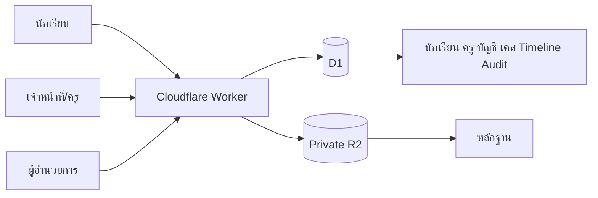
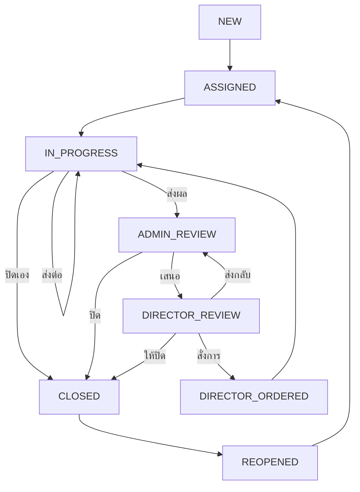

# 📕 กล่องแดง | RED BOX

ระบบรับแจ้งปัญหา ขอความช่วยเหลือ คัดกรอง มอบหมาย ติดตาม และปิดเคสของนักเรียน โรงเรียนจอมทอง

> README ฉบับนี้เป็นทั้งคู่มือผู้ใช้ คู่มือผู้ดูแลระบบ เอกสารสถาปัตยกรรม และคู่มือพัฒนา/Deploy โดยอ้างอิงความสามารถจากโค้ดปัจจุบัน

## สารบัญ

1. [ภาพรวม](#-1-ภาพรวมของระบบ)
2. [เป้าหมายและขอบเขต](#-2-เป้าหมายและขอบเขต)
3. [บทบาทและสิทธิ์](#-3-บทบาทและสิทธิ์)
4. [หน้าใช้งาน](#️-4-หน้าใช้งานและเส้นทางหลัก)
5. [การเข้าสู่ระบบ](#-5-การเข้าสู่ระบบและรหัสผ่าน)
6. [สถาปัตยกรรมและฐานข้อมูล](#️-6-สถาปัตยกรรมและฐานข้อมูล)
7. [กระบวนการทำงาน](#-7-กระบวนการทำงาน)
8. [คู่มือผู้ดูแลระบบ](#-8-คู่มือผู้ดูแลระบบสูงสุด)
9. [คู่มือเจ้าหน้าที่](#-9-คู่มือเจ้าหน้าที่รับเรื่องและผู้รับผิดชอบ)
10. [คู่มือครูที่ปรึกษา](#-10-คู่มือครูที่ปรึกษา)
11. [คู่มือผู้อำนวยการ](#-11-คู่มือผู้อำนวยการ)
12. [คู่มือนักเรียน](#-12-คู่มือนักเรียน)
13. [การพัฒนา](#️-13-การพัฒนาและทดสอบบนเครื่อง)
14. [การนำเข้าข้อมูล](#-14-การนำเข้าข้อมูล)
15. [Cloudflare](#️-15-cloudflare-deployment)
16. [ความปลอดภัย](#-16-ความปลอดภัยและความเป็นส่วนตัว)
17. [สำรองและบำรุงรักษา](#-17-การสำรองและบำรุงรักษา)
18. [ปัญหาที่พบบ่อย](#-18-ปัญหาที่พบบ่อย)
19. [Checklist ก่อนใช้จริง](#-19-checklist-ก่อนใช้งานจริง)
20. [สรุป](#-20-สรุป)

---

## 🌐 1. ภาพรวมของระบบ

RED BOX เป็นเว็บแอปภายในโรงเรียนสำหรับให้นักเรียนแจ้งเรื่องที่ต้องการความช่วยเหลือ นักเรียนเริ่มด้วยเลขประจำตัว เลือกประเภท อธิบายเหตุการณ์ ระบุความปลอดภัยและความช่วยเหลือที่ต้องการ ตั้งรหัสติดตาม 6 หลัก และแนบหลักฐานได้โดยไม่ต้องมีบัญชีเจ้าหน้าที่

ระบบออกหมายเลขเคสแบบ `RB-ปี-ลำดับ` เช่น `RB-2026-000001` แล้วส่งเข้าสู่คิวเจ้าหน้าที่ตามลำดับงาน เจ้าหน้าที่คัดกรองพร้อมมอบหมายในครั้งเดียว ผู้รับผิดชอบเริ่มงาน ส่งต่อ ปิดเคส หรือส่งผลให้ผู้ดูแลตรวจได้ หากจำเป็น ผู้ดูแลเสนอเรื่องให้ผู้อำนวยการรับทราบ สั่งการ ส่งกลับ หรือปิดเรื่องได้

ความสามารถหลัก:

- ตรวจนักเรียนด้วยเลขประจำตัวและเชื่อมชั้น/ห้อง/ครูที่ปรึกษาอัตโนมัติ
- แบบแจ้งเรื่อง 6 ขั้น พร้อม Scroll ไปหัวข้อของขั้นตอนใหม่
- เลือกปกปิดตัวตนและระบุความปลอดภัย
- ตั้งรหัสติดตาม 6 หลักแยกต่อเคส
- แนบ JPG, PNG, WEBP, PDF สูงสุด 5 ไฟล์ ไฟล์ละไม่เกิน 8 MB
- เปิดหลักฐานในระบบโดยไม่บังคับดาวน์โหลด
- จัดคิว `ยังไม่ได้ดำเนินการ → กำลังดำเนินการ → เสร็จสิ้น`
- ค้นหาชื่อและมอบหมาย/ส่งต่อผู้รับผิดชอบ
- ผู้รับผิดชอบปิดเคสของตนเองได้
- ครูหนึ่งคนดูแลหลายห้อง และหนึ่งห้องมีครูหลายคนได้
- เลขที่นักเรียนเรียงชายก่อนหญิงอัตโนมัติรายห้อง
- หนึ่งบัญชีมีหลายบทบาท
- บันทึกภายในแก้ไขได้ก่อนเลื่อนไปขั้นต่อไป
- Timeline ภาษาคนและ Audit Log
- Responsive บนโทรศัพท์ แท็บเล็ต และคอมพิวเตอร์

ระบบจริง: `https://redbox.doitgict.workers.dev`

> ข้อมูลนักเรียน เคส และหลักฐานเป็นข้อมูลภายใน ห้ามใส่ข้อมูลจริง รหัสผ่าน หรือ Secret ใน Git, Issue, Screenshot สาธารณะ หรือสื่อประชาสัมพันธ์

---

## 🎯 2. เป้าหมายและขอบเขต

### 2.1 เป้าหมาย

1. ให้นักเรียนมีช่องทางแจ้งเรื่องที่เข้าถึงง่ายและเป็นส่วนตัว
2. ให้การรับเรื่อง คัดกรอง มอบหมาย และติดตามมีเจ้าภาพชัดเจน
3. ลดเคสตกหล่นด้วยสถานะ Timeline และกำหนดติดตาม
4. เชื่อมเคสกับห้องและครูที่ปรึกษา
5. จำกัดการมองเห็นตามบทบาท ห้อง และผู้รับผิดชอบ
6. ให้ผู้บริหารเห็นเฉพาะเรื่องที่เสนอขึ้นมา
7. เก็บประวัติเพื่อตรวจสอบย้อนหลัง

### 2.2 ขอบเขต

ระบบรองรับการแจ้งเรื่อง แนบหลักฐาน ติดตามสถานะ จัดการเคส นักเรียน ครูที่ปรึกษา บัญชีหลายบทบาท การพิจารณาของผู้อำนวยการ Timeline และ Audit Log

ระบบไม่ใช่ระบบฉุกเฉิน ตำรวจ โรงพยาบาล หรือบริการวินิจฉัยสุขภาพ หากมีอันตรายเร่งด่วน ผู้ปฏิบัติงานต้องใช้แผนความปลอดภัยของโรงเรียนทันที ไม่รอเพียงการเปลี่ยนสถานะในเว็บ

---

## 👥 3. บทบาทและสิทธิ์

### 👑 3.1 ผู้ดูแลระบบสูงสุด `SUPER_ADMIN`

- เข้าถึงและดำเนินการกับเคสทั้งหมด
- คัดกรอง มอบหมาย ส่งต่อ ปรับความสำคัญ และปิดเคส
- รับเคสดำเนินการเอง รีเซ็ตรหัสติดตาม และลบเคสถาวร
- จัดการนักเรียน ครูที่ปรึกษา ห้อง บัญชี และหลายบทบาท
- เชื่อมบัญชีกับข้อมูลครูที่ปรึกษา
- เข้าพอร์ทัลผู้อำนวยการได้

บัญชีระบบหลักไม่สามารถลดสิทธิ์หรือปิดผ่านหน้าเว็บ การลบเคสจะลบรายละเอียด Timeline บันทึก และไฟล์หลักฐานถาวร

### 🧭 3.2 เจ้าหน้าที่รับเรื่อง `INTAKE`

- เห็นคิวเคสทั้งหมด
- ปรับระดับความสำคัญ
- คัดกรองและมอบหมายผู้รับผิดชอบ
- ตรวจผล ปิดเคส หรือเสนอผู้อำนวยการ
- เดินเคสเก่าที่ค้างในสถานะ Legacy ต่อได้

### 🧰 3.3 ผู้รับผิดชอบเคส `CASE_OFFICER`

- เห็นเคสที่มอบหมายให้ตน
- เริ่มดำเนินการ เพิ่มบันทึก ส่งต่อ ส่งให้ตรวจ หรือปิดเคส
- เปิดหลักฐานของเคสที่ตนรับผิดชอบ
- เปลี่ยนความสำคัญไม่ได้ เว้นแต่มี `INTAKE` หรือ `SUPER_ADMIN` เพิ่ม

### 👩‍🏫 3.4 ครูที่ปรึกษา `ADVISOR`

- เห็นเคสนักเรียนในห้องที่ตนดูแล
- เห็นเคสที่มอบหมายให้ตน แม้อยู่นอกห้องที่ปรึกษา
- ดำเนินการเคสเมื่อเป็นผู้รับผิดชอบ
- เปิดหลักฐานตามขอบเขตห้องหรือการมอบหมาย

ข้อมูลครูนำเข้าก่อนได้โดยยังไม่สร้างบัญชี บัญชีที่สร้างภายหลังต้องเชื่อม `advisor_id` ให้ตรงคน

### 🎓 3.5 ผู้อำนวยการ `DIRECTOR`

- เห็นเฉพาะเคสที่เสนอผู้อำนวยการ
- รับทราบ สั่งการ ส่งกลับแอดมิน หรือให้ปิดเรื่อง
- เปิดรายละเอียด Timeline และหลักฐานของเรื่องที่กำลังพิจารณา

### 🧑‍🎓 3.6 นักเรียน

- ตรวจข้อมูลตนด้วยเลขประจำตัว
- แจ้งเรื่อง ปกปิดตัวตน ตั้งรหัสติดตาม และแนบหลักฐาน
- ติดตามด้วยเลขประจำตัวและรหัสของเคสนั้น
- ไม่เห็นบันทึกภายในและคำสั่งส่งต่อ

### 3.7 หลายบทบาท

หนึ่งบัญชีมีได้สูงสุดทุกบทบาท เช่น `ADVISOR + CASE_OFFICER` หรือ `INTAKE + CASE_OFFICER` ลำดับบทบาทหลักคือ:

`SUPER_ADMIN → INTAKE → CASE_OFFICER → ADVISOR → DIRECTOR`

---

## 🗺️ 4. หน้าใช้งานและเส้นทางหลัก

### 4.1 หน้าสาธารณะ

| เส้นทาง | หน้าที่ |
|---|---|
| `/` | หน้าหลัก แจ้งเรื่อง ตรวจสถานะ และทางเข้าเจ้าหน้าที่ |
| `/report` | แบบแจ้งเรื่อง 6 ขั้น |
| `/track` | ตรวจสถานะด้วยเลขประจำตัวและรหัสติดตาม |

### 4.2 พอร์ทัลเจ้าหน้าที่

| เส้นทาง | หน้าที่ | สิทธิ์ |
|---|---|---|
| `/admin/login` | Login เจ้าหน้าที่ | บัญชีที่เข้าพอร์ทัลเจ้าหน้าที่ได้ |
| `/admin` | Dashboard และจัดการเคส | `SUPER_ADMIN`, `INTAKE`, `CASE_OFFICER`, `ADVISOR` |
| `/admin/students` | จัดการนักเรียน | `SUPER_ADMIN` |
| `/admin/advisors` | จัดการครูและห้อง | `SUPER_ADMIN` |
| `/admin/users` | จัดการบัญชีและบทบาท | `SUPER_ADMIN` |

Sidebar คงอยู่ทุกหน้าจัดการเพื่อให้สลับเมนูได้โดยไม่ย้อนกลับหน้าเดิม

### 4.3 พอร์ทัลผู้อำนวยการ

| เส้นทาง | หน้าที่ |
|---|---|
| `/director/login` | Login ผู้อำนวยการ |
| `/director` | เคสรอพิจารณาและคำสั่งผู้อำนวยการ |

### 4.4 API หลัก

- `/api/students/verify` ตรวจเลขประจำตัวนักเรียน
- `/api/cases` สร้าง ค้นหา ติดตาม และแสดงคิวเคส
- `/api/cases/:caseNumber` รายละเอียด อัปเดต หรือลบเคส
- `/api/cases/assignees` รายชื่อผู้รับผิดชอบที่เปิดใช้
- `/api/uploads` อัปโหลด/เปิดหลักฐานแบบมีสิทธิ์
- `/api/students`, `/api/advisors`, `/api/admin/users` จัดการข้อมูลหลัก
- `/api/director/cases` รายการและคำสั่งผู้อำนวยการ
- `/api/auth/*` Login, Logout, Session และเปลี่ยนรหัสผ่าน

---

## 🔐 5. การเข้าสู่ระบบและรหัสผ่าน

### 5.1 เจ้าหน้าที่และผู้อำนวยการ

1. เข้า `/admin/login` หรือ `/director/login`
2. กรอก Username และรหัสผ่าน
3. ระบบตรวจสถานะบัญชีและบทบาทให้ตรงพอร์ทัล
4. หากใช้รหัสเริ่มต้น ระบบบังคับเปลี่ยนก่อนใช้งาน
5. Session มีอายุ 8 ชั่วโมง

### 5.2 บัญชีครูหลังนำเข้า

`db:create:advisor-accounts` ใช้ `source_username` เป็น Username และรหัสเริ่มต้น แล้วตั้ง `must_change_password=1` ผู้ใช้ต้องเปลี่ยนรหัสอย่างน้อย 8 ตัวอักษรและไม่ซ้ำรหัสเดิม

ผู้ดูแลสูงสุดรีเซ็ตรหัสของผู้อื่นได้ ระบบไม่เปิดเผย Password Hash และไม่ควรบันทึกรหัสจริงในเอกสารนี้

### 5.3 รหัสติดตามนักเรียน

- เป็นตัวเลข 6 หลัก ตั้งใหม่ต่อเคส
- ต้องใช้คู่กับเลขประจำตัวนักเรียน
- ผู้ดูแลสูงสุดรีเซ็ตได้ แต่ดูรหัสเดิมไม่ได้
- ระบบเก็บเฉพาะค่าแฮช

### 5.4 Session Cookie

Cookie `redbox_admin_session` ใช้ `HttpOnly`, `SameSite=Strict`, `Secure` บน HTTPS และลงลายเซ็น HMAC-SHA256 ด้วย `SESSION_SECRET`

---

## 🏗️ 6. สถาปัตยกรรมและฐานข้อมูล

### 6.1 เทคโนโลยี

| ส่วน | เทคโนโลยี |
|---|---|
| Framework | Next.js 16, React 19, Vinext |
| ภาษา | TypeScript 5 |
| Runtime | Cloudflare Workers |
| Database | Cloudflare D1 / SQLite |
| Files | Private Cloudflare R2 |
| Schema | Drizzle ORM / Drizzle Kit |
| Validation | Zod |
| Icons | Font Awesome / React Icons |
| Test | Node Test Runner + Production Build |

### 6.2 ภาพรวม



### 6.3 โฟลสถานะ



`SCREENING`, `PENDING_CLOSE`, `RESOLVED` ยังรองรับเคสเก่า แต่โฟลใหม่ข้ามขั้นซ้ำเหล่านี้

### 6.4 โครงสร้างโค้ด

- `app/` หน้าและ API Route Handlers
- `components/` UI หลัก
- `db/` Schema และ Bootstrap
- `drizzle/` Migration
- `lib/` Auth, password, token, advisor และ Timeline helpers
- `scripts/` Import, account creation และ demo seed
- `tests/` ชุดตรวจข้อกำหนด
- `public/` โลโก้และ Static assets
- `.openai/hosting.json` ประกาศ D1/R2
- `wrangler.direct.jsonc` Direct deployment

### 6.5 Data Dictionary

| ตาราง | หน้าที่และฟิลด์สำคัญ |
|---|---|
| `students` | รหัส ชื่อ ชั้น ห้อง เลขที่ บัตร สถานะ และเวลาปรับปรุง |
| `case_categories` | ประเภทเรื่อง Icon สี ลำดับ และสถานะ |
| `advisors` | ชื่อ ติดต่อ Username ต้นทาง บทบาทพิเศษ และสถานะ |
| `advisor_assignments` | เชื่อมครูกับชั้น/ห้อง/Slot แบบหลายต่อหลาย |
| `cases` | ผู้แจ้ง ประเภท เนื้อหา ความปลอดภัย ความสำคัญ สถานะ ผู้รับผิดชอบ และ Token hash |
| `case_sequences` | ลำดับหมายเลขเคสแยกปีแบบ Atomic |
| `case_timeline` | เหตุการณ์ที่ผู้ใช้ควรอ่านย้อนหลัง |
| `case_notes` | บันทึกภายในและสถานะแก้ไขได้ |
| `staff_users` | Username, hash, ชื่อแสดง บทบาทหลัก Advisor link และสถานะ |
| `staff_user_roles` | หลายบทบาทต่อบัญชีด้วย Primary key ร่วม |
| `case_handoffs` | ต้นทาง ปลายทาง ผู้ส่ง ผู้รับ เหตุผล กำหนดติดตาม |
| `director_actions` | การรับทราบ สั่งการ ส่งกลับ หรือปิด |
| `case_attachments` | Metadata ไฟล์ใน R2 |
| `audit_logs` | การกระทำ Resource ผู้ดำเนินการ Metadata และเวลา |

ประเภทเริ่มต้น: กลั่นแกล้ง, สุขภาพใจ, ความรุนแรง, ความปลอดภัย, การเรียน, อาคาร/สถานที่, ข้อเสนอแนะ และอื่น ๆ

ดัชนีสำคัญครอบคลุมสถานะ/ความสำคัญ/นักเรียนของเคส, Timeline, Handoff, Director action, Advisor assignment และบัญชีตามบทบาท

---

## 🔄 7. กระบวนการทำงาน

### 7.1 นักเรียนส่งเรื่อง

1. เข้า `/report` และกรอกเลขประจำตัว
2. ตรวจชื่อ ชั้น ห้อง เลขที่ และครูที่ปรึกษา
3. เลือกประเภท
4. กรอกหัวข้ออย่างน้อย 5 และรายละเอียดอย่างน้อย 10 ตัวอักษร
5. สถานที่และบุคคลเกี่ยวข้องเว้นว่างได้
6. เลือกความช่วยเหลือและระดับความปลอดภัย
7. เลือกปกปิดตัวตนได้
8. ตั้งและยืนยันรหัสติดตาม 6 หลัก
9. แนบหลักฐานถ้ามี ตรวจข้อมูล แล้วส่ง

ระบบใช้ `idempotencyKey` ป้องกันส่งซ้ำ ออกหมายเลข Atomic และออก Upload Token อายุ 30 นาที หาก `UNSAFE` จะทำเครื่องหมายตรวจทันทีและเริ่มความสำคัญ `CONCERN`

### 7.2 คัดกรองและมอบหมาย

เจ้าหน้าที่เปิด `NEW` ตรวจข้อมูล ปรับความสำคัญ ค้นหาผู้รับผิดชอบ แล้วกด `คัดกรองและมอบหมาย` ครั้งเดียวเป็น `ASSIGNED` ข้อความและกำหนดติดตามเว้นว่างได้

### 7.3 เริ่มและดำเนินการ

ผู้รับผิดชอบกดเริ่มเพื่อเปลี่ยน `ASSIGNED → IN_PROGRESS` จากนั้นเพิ่มบันทึก ส่งต่อ ปิดเอง หรือส่งผลให้ผู้ดูแลตรวจได้ การแยกสองสถานะทำให้รู้ว่าเพียงมอบหมายหรือเริ่มทำจริงแล้ว

### 7.4 บันทึกภายใน

บันทึกไม่แสดงแก่นักเรียน หลังบันทึกแบบฟอร์มยุบ แก้ไขได้ก่อนเลื่อนขั้น เมื่อสถานะเปลี่ยน บันทึกเดิมถูกล็อก

### 7.5 ส่งต่อ

เคสต้อง `IN_PROGRESS` ผู้รับผิดชอบปัจจุบันจึงเลือกคนใหม่ได้ สถานะยังเหมือนเดิม แต่ `assigned_to` เปลี่ยนและมี Handoff/Timeline

### 7.6 ปิดหรือตรวจผล

- ผู้รับผิดชอบ: ปิดเคสของตน หรือ `IN_PROGRESS → ADMIN_REVIEW`
- ผู้ดูแล: `ADMIN_REVIEW → CLOSED` หรือ `DIRECTOR_REVIEW`
- ผู้อำนวยการ: รับทราบ, สั่งการเป็น `DIRECTOR_ORDERED`, ส่งกลับ `ADMIN_REVIEW`, หรือปิดทันที
- เคสปิดสามารถเปิดเป็น `REOPENED` แล้วมอบหมายใหม่

### 7.7 Timeline และ Audit

Timeline แสดงภาษาคน ตัดข้อความสถานะซ้ำ และแปลง JSON เก่าเมื่ออ่าน Audit Log ใช้ตรวจการแก้ข้อมูล รีเซ็ตรหัส จัดการบัญชี และลบเคส โดยไม่เก็บรหัสผ่านจริง

### 7.8 ลบเคส

เฉพาะ `SUPER_ADMIN` การลบจะนำ Director actions, Handoffs, Attachments metadata, Notes, Timeline, Case และไฟล์ R2 ออกถาวร พร้อม Audit log ควรสำรองก่อนลบ

---

## 👑 8. คู่มือผู้ดูแลระบบสูงสุด

### 8.1 Dashboard

- ตรวจเคสใหม่ เคสเร่งด่วน เคสค้าง และเคสรอตรวจ
- ค้นหาหมายเลข/หัวข้อ กรองสถานะและความสำคัญ
- คิวเรียง `ยังไม่ได้ดำเนินการ → กำลังดำเนินการ → เสร็จสิ้น`
- เปิดรายละเอียด ผู้แจ้ง ห้อง ครูที่ปรึกษา หลักฐาน บันทึก และ Timeline

### 8.2 นักเรียน

- เพิ่ม/แก้ไขผ่าน Modal
- ปิดใช้งานแทนลบเมื่อมีประวัติ
- ระบบเรียงเลขที่ชายก่อนหญิงรายห้อง
- ครูเชื่อมตามห้อง ไม่ต้องกรอกซ้ำรายคน

### 8.3 ครูที่ปรึกษา

- เพิ่ม ค้นหา กรอง แก้ไข และปิดใช้งาน
- รองรับ นาย นาง นางสาว ว่าที่ร้อยตรี และค่าอื่นตามข้อมูล
- ครูหนึ่งคนหลายห้อง ห้องหนึ่งหลายครู
- แสดงจำนวนนักเรียนของห้อง

### 8.4 ผู้ใช้งาน

- สร้างชื่อแสดง Username รหัส และอย่างน้อย 1 บทบาท
- Username รองรับตัวอักษรอังกฤษ ตัวเลข `. _ -`
- เชื่อมบทบาท Advisor กับข้อมูลครูที่ยังไม่มีบัญชี
- แก้ไขผ่าน Modal เปิด/ปิดด้วย Toggle และรีเซ็ตรหัสได้
- ปิดบัญชีตนเองไม่ได้ และต้องเหลือ Super admin อย่างน้อยหนึ่งบัญชี

### 8.5 เครื่องมือพิเศษ

รีเซ็ตรหัสติดตาม ปิดเคสทันที และลบเคสอยู่ในส่วนเครื่องมือผู้ดูแล แยกจากโฟลปกติ

---

## 🧭 9. คู่มือเจ้าหน้าที่รับเรื่องและผู้รับผิดชอบ

### 9.1 รับเรื่อง

ตรวจผู้แจ้ง ห้อง ครูที่ปรึกษา หลักฐานและความปลอดภัย ปรับความสำคัญ เลือกผู้รับผิดชอบ แล้วคัดกรอง/มอบหมาย

### 9.2 ดำเนินการ

เปิดเคสที่ได้รับ กดเริ่ม เพิ่มบันทึก และเลือกส่งต่อ ปิด หรือส่งให้ตรวจ ข้อความประกอบทุกขั้นเว้นว่างได้

### 9.3 หลักการบันทึก

เขียนเฉพาะข้อเท็จจริง การดำเนินงาน สิ่งติดตาม และกำหนดเวลา ไม่ใส่คำกล่าวหาเกินหลักฐาน ข้อมูลอ่อนไหวเกินจำเป็น รหัสผ่าน หรือข้อความไม่เหมาะสม

---

## 👩‍🏫 10. คู่มือครูที่ปรึกษา

ครูเห็นเคสของห้องที่ดูแลและเคสที่มอบหมายให้ตน หากไม่เห็นให้ตรวจ `advisor_id`, `advisor_assignments`, `assigned_to` และสถานะบัญชี

เมื่อรับเคส ต้องกดเริ่มก่อนส่งต่อ สามารถบันทึก เปิดหลักฐาน ปิดเอง หรือส่งให้ผู้ดูแลตรวจได้ ไม่ควรสร้างข้อมูลครูซ้ำเพื่อหลายห้อง ให้เพิ่ม Assignment แทน

---

## 🎓 11. คู่มือผู้อำนวยการ

เข้า `/director/login` Dashboard แสดงเฉพาะ `DIRECTOR_REVIEW` และเรียง Critical/Serious ก่อน เปิดดูข้อมูลและ Timeline แล้วเลือก:

- `รับทราบ` คงสถานะ
- `สั่งการ` ส่งกลับผู้รับผิดชอบ
- `ส่งกลับแอดมิน` ให้ตรวจใหม่
- `ให้ปิดเรื่อง` ปิดทันที

ข้อความคำสั่งไม่บังคับ แต่ควรกรอกเมื่อมีข้อกำหนดเฉพาะ

---

## 🧑‍🎓 12. คู่มือนักเรียน

### 12.1 แจ้งเรื่อง

เตรียมเลขประจำตัว รหัสติดตามที่จำได้ และหลักฐานถ้าสะดวก กรอกข้อมูลตาม 6 ขั้น ตรวจทาน แล้วเก็บรหัสไว้เป็นความลับ

### 12.2 หลักฐาน

JPG/PNG/WEBP/PDF สูงสุด 5 ไฟล์ ไฟล์ละ 8 MB มีภาพตัวอย่างและเก็บใน Private R2

### 12.3 ติดตาม

เข้า `/track` กรอกเลขประจำตัวและรหัส 6 หลัก ระบบแสดงเฉพาะประเภท สถานะ และวันที่ ไม่เปิดรายละเอียดภายใน หากลืมรหัสต้องให้ผู้ดูแลสูงสุดรีเซ็ต

---

## 🛠️ 13. การพัฒนาและทดสอบบนเครื่อง

ต้องมี Node.js `>=22.13.0`, npm และ Git

```bash
npm install
npm run dev
```

เปิด `http://localhost:3000` ฐานข้อมูล Local สร้างใน `.wrangler/state/`

```bash
npm run lint
npm run build
npm test
```

| คำสั่ง | หน้าที่ |
|---|---|
| `npm run dev` | Development server |
| `npm run build` | Production build |
| `npm run start` | รัน Build |
| `npm run lint` | ESLint |
| `npm test` | Build + Node tests |
| `npm run db:generate` | สร้าง Drizzle migration |
| `npm run db:seed:demo` | เพิ่มข้อมูลจำลอง Local |
| `npm run db:import:students -- file.csv` | นำเข้านักเรียน Local |
| `npm run db:import:advisors -- file.csv` | นำเข้าครู Local |
| `npm run db:create:advisor-accounts` | สร้างบัญชีครู Local |
| `npm run cf:migrate` | Remote D1 migration |
| `npm run cf:deploy` | Build + Direct deploy |

---

## 📥 14. การนำเข้าข้อมูล

### 14.1 ลำดับแนะนำ

รันระบบหนึ่งครั้ง → นำเข้าครู → นำเข้านักเรียน → ตรวจห้อง → สร้างบัญชีครู → ทดสอบ Login → ตรวจจำนวนก่อนย้าย Production

### 14.2 CSV ครู

คอลัมน์: `ระดับชั้น`, `ห้อง`, `ชื่อ-นามสกุล`, `Username`, `เบอร์โทรศัพท์`, `บทบาทพิเศษ`

```bash
npm run db:import:advisors -- /absolute/path/advisors.csv
```

สคริปต์สำรอง Local DB รวม Username ซ้ำเป็นคนเดียว สร้างหลายห้อง เรียง Slot และยังไม่สร้าง Login

### 14.3 CSV นักเรียน

คอลัมน์: `เลขที่`, `เลขประจำตัว`, `เลขบัตรนักเรียน`, `คำนำหน้า`, `ชื่อ`, `นามสกุล`, `ระดับชั้น`, `ห้อง`

```bash
npm run db:import:students -- /absolute/path/students.csv
```

สคริปต์ตรวจข้อมูล สำรอง DB Upsert นักเรียน ปิดรายการเดิมที่หายไป ไม่ลบนักเรียนที่มีเคส และเรียงเลขที่ใหม่

### 14.4 สร้างบัญชีครู

```bash
npm run db:create:advisor-accounts
```

ใช้ Username เป็นรหัสเริ่มต้นและบังคับเปลี่ยนเมื่อ Login

### 14.5 ข้อมูลจำลอง

`npm run db:seed:demo` ใช้เฉพาะ Development/Testing ห้ามรัน Production โดยไม่ตรวจผลกระทบ

สคริปต์นำเข้าปัจจุบันแก้ Local D1 ไม่ได้ส่ง CSV เข้า Production โดยตรง

---

## ☁️ 15. Cloudflare Deployment

| Binding | Resource |
|---|---|
| `DB` | D1 `redbox-db` |
| `EVIDENCE` | Private R2 `redbox-evidence` |

`SESSION_SECRET` ต้องสุ่ม ยาวอย่างน้อย 32 ตัวอักษร เก็บเป็น Secret และห้าม Commit

```bash
npm run cf:migrate
npm run cf:deploy
```

ก่อน Migrate ให้สำรอง D1 และอ่าน SQL ใน `drizzle/` หลัง Deploy ตรวจ `/`, `/admin/login`, `/director/login`, D1/R2 และยืนยันว่า `/api/cases` โดยไม่ Login ตอบ `401`

ห้ามกระทบโปรเจกต์อื่น: ตรวจ Working directory, Worker `redbox`, D1 `redbox-db`, R2 `redbox-evidence` และ `wrangler.direct.jsonc` ก่อนทุกครั้ง

---

## 🛡️ 16. ความปลอดภัยและความเป็นส่วนตัว

- รหัสใหม่ใช้ HMAC-SHA256 + Salt + Server Secret และรองรับ PBKDF2 เก่า
- API ไม่ส่ง Password/Token hash
- Upload token สุ่ม 32 bytes เก็บ SHA-256 hash และหมดอายุ 30 นาที
- R2 เป็น Private; การเปิดไฟล์ตรวจบทบาท ห้อง และผู้รับผิดชอบ
- Response ไฟล์ใช้ `private, no-store` และ `nosniff`
- นักเรียนเห็นเพียงสถานะย่อของเคสที่รหัสตรง
- ปกปิดตัวตนลดการแสดงชื่อ แต่เคสยังผูก Student ID เพื่อความปลอดภัย จึงต้องใช้หลัก Need-to-know

Production ควรเปิด WAF/Rate limit สำหรับ Login, Verify, Track, Upload ตั้ง Retention policy ทบทวนบัญชีทุกภาคเรียน และติดตาม Observability

---

## 💾 17. การสำรองและบำรุงรักษา

สำรอง D1, R2, Source/Migrations และ CSV ต้นทาง โดยเก็บ Secret แยก ก่อน Import/Migration ให้ทดลอง Local ตรวจจำนวนและความสัมพันธ์

กู้คืน: หยุดแก้ข้อมูล → ระบุช่วงเวลา → สำรองสถานะปัจจุบัน → Restore D1/R2 → ตรวจจำนวน/Foreign key → ทดสอบทุกบทบาท → บันทึกเหตุการณ์

รอบดูแล:

- รายวัน: เคสเร่งด่วนและ Error
- รายสัปดาห์: เคสค้างและบัญชีผิดปกติ
- รายเดือน: ทดสอบ Restore และพื้นที่ R2
- รายภาคเรียน: รายชื่อ ห้อง ครู และบัญชีพ้นหน้าที่
- รายปี: Retention และสิทธิ์ Super admin

---

## 🧪 18. ปัญหาที่พบบ่อย

### Dev เปิดไม่ได้

ตรวจ Node, `npm install`, Port 3000 และ `.wrangler/wrangler.log`

### โลโก้ไม่ขึ้น

ตรวจ `public/images/chomthong-logo.png`, Path `/images/chomthong-logo.png`, ตัวพิมพ์ และ Cache

### Login ไม่ได้

ตรวจ Username, รหัส, `is_active`, บทบาทพอร์ทัล, `SESSION_SECRET` และหน้าบังคับเปลี่ยนรหัส

### ครูไม่เห็นเคส

ตรวจ Role, `advisor_id`, `advisor_assignments`, `assigned_to` และสถานะบัญชี

### ค้นผู้รับผิดชอบไม่พบ

บัญชีต้องเปิดใช้และมี `CASE_OFFICER` หรือ `ADVISOR`

### นักเรียนไม่พบข้อมูล

ตรวจเลขประจำตัว 4–10 หลัก, `is_active=1`, ฐานข้อมูล Environment และข้อมูลห้อง

### ติดตามไม่ได้

ใช้เลขประจำตัวและรหัส 6 หลักของเคสนั้น หากลืมให้ Super admin รีเซ็ต

### อัปโหลดไม่ได้

ตรวจชนิด ขนาด 8 MB จำนวน 5 ไฟล์ Token 30 นาที และ R2 binding

### เปิดหลักฐานไม่ได้

ตรวจ Login สิทธิ์ ขอบเขตห้อง/ผู้รับผิดชอบ สถานะที่เสนอผู้อำนวยการ และ Object ใน R2

### สถานะซ้ำ

โฟลใหม่ใช้ `NEW→ASSIGNED`, `ADMIN_REVIEW→CLOSED`, `DIRECTOR_REVIEW→CLOSED` หากพบ `SCREENING`, `PENDING_CLOSE`, `RESOLVED` คือเคสเก่าที่ระบบยังรองรับ

### Timeline เป็น JSON/ซ้ำ

ตรวจว่า Deploy ล่าสุด API ใช้ `humanizeTimelineEntry` แล้ว Refresh ข้อมูลเก่าไม่ต้องแก้ DB

### Migration ล้มเหลว

หยุด อ่าน SQL ตรวจ Migration history ห้ามลบ Production table เพื่อให้ผ่าน และ Restore หากเปลี่ยนไปบางส่วน

### Deploy ผิดโปรเจกต์

ตรวจ `wrangler whoami` และ Resource ใน Config หยุดก่อน Deploy ซ้ำ ห้ามแก้ Worker ของโปรเจกต์อื่น

---

## 💡 19. Checklist ก่อนใช้งานจริง

### ข้อมูล

- [ ] นักเรียนจริงครบและไม่ซ้ำ
- [ ] เลขที่/ลำดับเพศถูกต้อง
- [ ] ครูและห้องครบ
- [ ] บัญชีครูเชื่อมถูกคน

### สิทธิ์

- [ ] แบ่งบทบาทตามงานจริง
- [ ] ปิดบัญชีทดสอบ
- [ ] เปลี่ยนรหัสเริ่มต้น
- [ ] ทดสอบหลายบทบาท

### โฟล

- [ ] เคสทั่วไปและไม่ปลอดภัย
- [ ] ส่งต่อ ปิดเอง ส่งให้ตรวจ
- [ ] แอดมินปิด/เสนอผู้อำนวยการ
- [ ] ผู้อำนวยการสั่งการ/ปิด
- [ ] เปิดเคสใหม่และรีเซ็ตรหัส

### หลักฐาน/Cloudflare

- [ ] ทดสอบไฟล์ทุกชนิดและไฟล์เกินขนาด
- [ ] ผู้ไม่มีสิทธิ์เปิดไม่ได้
- [ ] ตั้ง `SESSION_SECRET`
- [ ] Apply migration และ Binding ถูกต้อง
- [ ] WAF/Rate limit, Observability, Backup/Restore พร้อม

### การใช้งานโรงเรียน

- [ ] กำหนดผู้รับเคส Critical และเวลาตอบสนอง
- [ ] อบรมความลับและ Need-to-know
- [ ] มีช่องทางฉุกเฉินนอกระบบ
- [ ] กำหนด Retention และผู้อนุมัติลบเคส

---

## ✅ 20. สรุป

RED BOX ครอบคลุมตั้งแต่นักเรียนส่งเรื่อง เจ้าหน้าที่คัดกรองและมอบหมาย ผู้รับผิดชอบดำเนินงาน ผู้ดูแลตรวจผล จนถึงการพิจารณาโดยผู้อำนวยการ โดยให้ความสำคัญกับสิทธิ์ตามบทบาท ความสัมพันธ์ห้อง/ครู หลักฐาน Private รหัสติดตามเฉพาะเคส และประวัติย้อนหลัง

หลักดูแลระบบ: ใช้ข้อมูลเท่าที่จำเป็น มอบสิทธิ์ตามหน้าที่ ไม่แชร์บัญชี สำรองก่อนเปลี่ยนจำนวนมาก ทดสอบทุกบทบาท มีช่องทางฉุกเฉิน และไม่ Deploy ทับโปรเจกต์อื่น

---

พัฒนาโดย **Chonnatee Boonta**<br>
สำหรับ **โรงเรียนจอมทอง สงวนลิขสิทธิ์**<br>
Powered by **Next.js · TypeScript · Cloudflare Workers · Cloudflare D1 · Cloudflare R2**
